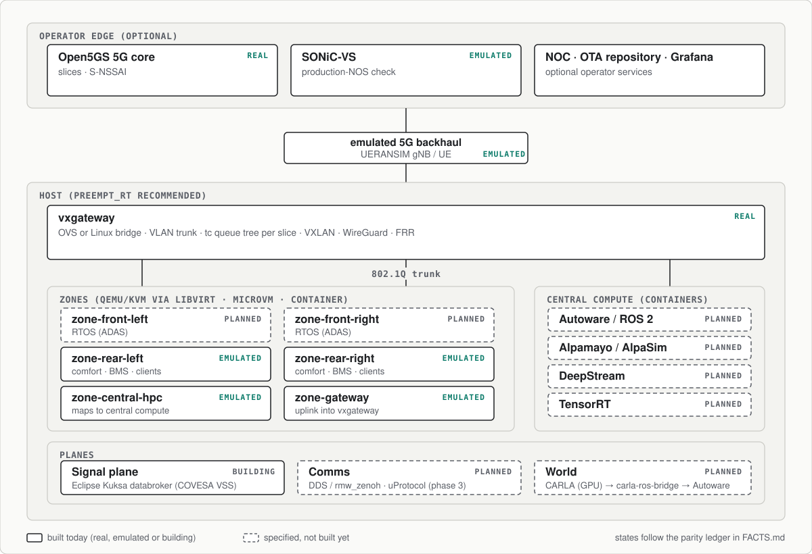
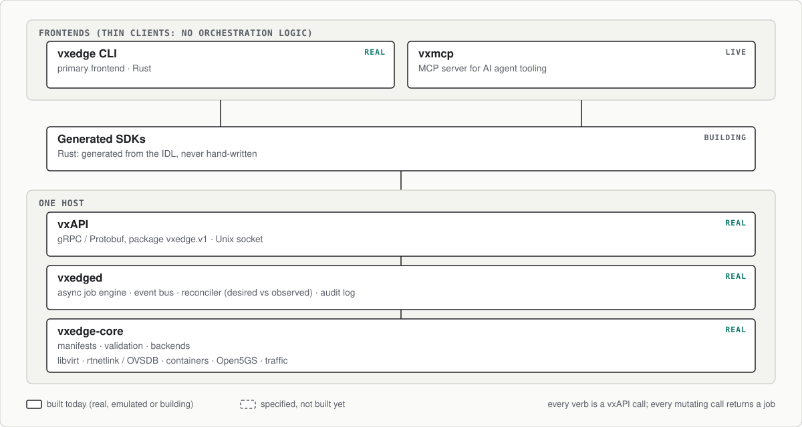

# Architecture

*The architecture specification for vxedge: research goals, topology, vxAPI, manifest schemas, the network, service and virtualization models, methodology, and the phases.*

vxedge is a research-grade orchestration and experiment platform that evaluates 5G network-slice mapping onto zonal and central software-defined-vehicle (SDV) E/E architectures, **entirely in software**. In short:

- **Gateway.** `vxgateway`, built on the Linux networking stack, replaces physical edge gear.
- **Zones.** KVM/QEMU VMs managed through libvirt provide zonal ECUs (Zephyr, FreeRTOS, Android Automotive).
- **Compute.** Containerized central compute runs Autoware/ROS 2 and NVIDIA AD workloads (Alpamayo, DeepStream, TensorRT).
- **Control plane.** A Rust daemon (`vxedged`) orchestrates manifest-driven vehicles, experiments, services and telemetry, and exposes a versioned gRPC/Protobuf API (**vxAPI**).
- **Frontends.** Thin clients of that API: the `vxedge` CLI and an MCP server (`vxmcp`) for AI agent tooling, over a local Unix socket.

*Qt/QML is not an operator-dashboard frontend here; see §5.1 for its role as an in-vehicle embedded IVI loadable.*

---

## Table of contents

1. Executive summary
2. Research goals & hypotheses
3. High-level architecture (topology & components)
4. Repositories & single-source rules
5. vxedge control plane & API (vxedged, vxAPI, frontends, CLI)
6. Manifests (experiment & vehicle schemas)
7. Network model, vxgateway (SDN slicing)
8. Service model (OTA, telemetry, extensibility)
9. Virtualization & zone provisioning (libvirt, QEMU/KVM, RTOS, containers)
10. Compute model (Autoware/ROS2, Alpamayo, inference, OTA hosting)
11. Edge agents & telemetry collection (vxagents / vxtelemetry)
12. Experiment methodology, metrics, and analysis plan
13. Reproducibility, CI/CD, artifact publication
14. Safety, security, licensing, and industrialization notes
15. Implementation policy & phases
16. Appendix: example manifests, gateway snippets, run sequence

---

## 1: Executive summary

vxedge is a reproducible, modular framework to define and run SDV experiments that combine zone
virtual ECUs, central compute, a **software-defined virtual edge gateway** with 5G-style slicing,
and services (OTA, telemetry). Manifests declare the whole system, up to and including a complete
**software-bootstrapped vehicle** (`vxedge vehicle up`). The Rust CLI orchestrates the lifecycle
using a simple `up|down` model across all subsystems.

The platform is designed to:

- generate publishable results (latency/jitter percentiles, OTA reliability, isolation metrics);
- stay production-representative: the same middleware (Eclipse SDV: Kuksa/VSS, Zenoh, uProtocol),
  network stack (OVS/tc/FRR/WireGuard, SONiC as production NOS twin), and AD workloads
  (Autoware, NVIDIA Alpamayo) used or converged on by OEMs;
- run on a single host;
- be **API-first**: all orchestration lives behind vxAPI (gRPC/Protobuf) served by the `vxedged`
  daemon. The CLI and the `vxmcp` MCP server are interchangeable thin clients,
  human-operated or agent-operated, same rule either way.

No physical router is required: the edge-gateway role is fully absorbed by `vxgateway`.

---

## 2: Research goals & hypotheses

**Primary goal:** Quantify whether a **software-defined virtual gateway**, built from the
production Linux SDN stack (OVS/Linux bridge, tc queue trees, VXLAN, WireGuard, FRR) and running
co-located with virtualized zonal ECUs and central compute, can provide slice isolation and
deterministic performance for SDV workloads mapped to logical 5G slices.

**Hypotheses to test:**

- **H1 (isolation):** Per-slice VLAN/VXLAN mapping with hierarchical tc queue-tree reservations in
  vxgateway can keep p95/p99 latency for ADAS (URLLC-like) traffic near baseline under heavy
  infotainment load.
- **H2 (real slicing vs. static mapping):** True 5G slicing (S-NSSAI PDU sessions via
  Open5GS + UERANSIM) provides measurably different, and under contention, stronger, isolation
  than static VLAN-to-slice mapping.
- **H3 (virtualization choice):** Virtual ECU packaging (full VM via libvirt vs. container vs.
  microVM via raw QEMU/QMP or cloud-hypervisor) measurably affects latency/jitter observable at
  zone-to-compute flows.
- **H4 (service co-location):** OTA service co-located in central compute (deployed on demand)
  does not compromise ADAS slice SLAs when slices and queue reservations are correctly configured.

**Deliverables:** Reproducible experiment artifacts, datasets, scripts, and publishable analysis,
plus a reference "vehicle-in-software" composition demonstrating the full stack end to end.

**Framing note:** unlike physical edge gear, the virtual gateway shares the host with the
workloads it isolates. Determinism controls (PREEMPT_RT kernel, `isolcpus`, CPU pinning,
hugepages) are part of the method, and their effect is itself reported.

---

## 3: High-level architecture (topology & components)

[](diagrams/zonal-topology.svg)

*Figure 3.1: the topology (click for full size). Box states follow the parity ledger in [`FACTS.md`](FACTS.md): solid is built
today (real, emulated or building), dashed is specified and not built yet. Source:
[`diagrams/topology.py`](diagrams/topology.py).*

**Key components:**

- **vxedged (Rust)**: control-plane daemon: orchestration + provisioning core behind **vxAPI**
  (gRPC/Protobuf). See §5.
- **vxedge CLI (Rust)**: thin vxAPI client; the primary frontend.
- **vxgateway**: the software-defined edge gateway: Linux-native data plane (OVS or Linux
  bridge, tc, VXLAN, WireGuard, FRR), provisioned declaratively by the CLI. See §7.
- **Zone and compute loadables** (zone manifests, VM images for Zephyr, FreeRTOS and AAOS,
  RTOS builds, central compute manifests, Autoware/ROS2 images, Alpamayo/AlpaSim, inference): see
  `vxparts` below.
- **vxota**: OTA server & signing tooling (artifact store).
- **vxagents**: performant Rust agents for measurements and metrics.
- **vxtelemetry**: telemetry ingestion & Prometheus export (VSS-aligned; see §11).
- **vxperiments**: manifest-driven experiments, vehicle manifests, and results.

---

## 4: Repositories & single-source rules

Canonical repos (under vxedge org):

- `vxedge/vxedge`: Rust workspace: `vxedge-core` (domain lib), `vxedged` (daemon, vxAPI),
  `vxedge-cli` (thin client), `proto/` (vxAPI Protobuf IDL, the source for all generated SDKs:
  Rust/tonic, TypeScript/connect-es), plus **gateway provisioning templates**
  (netlink/OVS/nftables/tc, libvirt domain XML templates).
- `vxedge/vxparts`: the unified loadable registry: zone VM/kernel/RTOS bundles, central-compute
  container images, gateway/TCU images, agent binaries, and platform-service images, every
  loadable the platform boots, published to `ghcr.io/vxedge/parts/...` via OCI/ORAS, classified
  by `class`/`subtype`/`layer` (see §13's own artifact-publication rules). **Supersedes
  the earlier zone-image and compute-container repos** (Track P, decided 2026-07-26): those two repos split loadables by
  deployment mechanism (VM vs. container) rather than by domain, which is exactly the kind of
  implementation detail this workspace's own single-source-of-truth discipline exists to keep
  out of repo topology. Both were **archived 2026-08-04** (GitHub archive, not deleted, their
  history stays reachable to the owner, read-only) once their content was confirmed fully present in
  `vxparts`.
- `vxedge/vxota`: OTA server, signing, manifests.
- `vxedge/vxagents`: Rust agents, metrics exporters.
- `vxedge/vxtelemetry`: telemetry ingestion and exporters.
- `vxedge/vxperiments`: experiment manifests, **vehicle manifests**, notebooks, results.
- `vxedge/vxmodels`: *(track M)* SysML v2 system models:
  requirements/traceability (H1–H4 `verify`-linked to frozen result archives), vehicle
  structure models, the analysis-case/variant library, and the `vxmodel` renderer (Rust)
  that generates manifests from models. See §6.3 and §15 (track M).
- `vxedge/docs`: papers, slides, reproducibility guide.

**Single-source rules:**

- A zone/compute's manifest is authoritative for its images and node IDs.
- Services declared under `services` in an experiment manifest are the authoritative runtime
  descriptors for that experiment (image + config). The code lives in vxota or vxtelemetry as
  appropriate.
- A **vehicle manifest** is the authoritative composition of zones + compute + network + services
  for a software-bootstrapped vehicle; experiments reference a vehicle rather than restating it.
- CLI uses manifests as sole input; state stored in ephemeral runtime directories and vxedge logs.
- Exactly two cross-language interfaces exist: **manifests** (YAML content) and **vxAPI**
  (Protobuf IDL under `vxedge/vxedge/proto/`, authoritative; client SDKs are generated, never
  hand-written). No bespoke ad-hoc RPC.
- **Model governance (track M, when `vxmodels` lands):** the SysML v2 model is the *design
  authority* upstream of manifests; manifests remain the **sole execution contract**, the
  daemon/CLI never read models. A model-rendered manifest records the digest of the model
  version that produced it and must pass `vxedge manifest validate` like any hand-written
  manifest. The model never duplicates what zone/compute manifests are authoritative for
  (images, node IDs). See §6.3.

---

## 5: vxedge control plane & API (vxedged, vxAPI, frontends, CLI)

**Principle (API-first):** the split every production SDV toolchain converges on, Tesla-style
fleet tooling, NVIDIA DriveWorks tools, AUTOSAR Adaptive development tooling, is a headless core
behind a strongly-typed IDL, with every UI a disposable thin client. vxedge adopts it outright:
**no orchestration logic lives in any frontend.**

### 5.1 Layers & frontends

[](diagrams/vxapi-layers.svg)

*Figure 5.1: layers and frontends (click for full size). Box states follow the parity ledger in [`FACTS.md`](FACTS.md).
Source: [`diagrams/layers.py`](diagrams/layers.py).*

- **vxedge-core** (Rust lib): pure domain logic; no user-facing I/O.
- **vxedged** (Rust daemon, tonic + tonic-web): hosts vxAPI. Every mutating verb is an **async
  job** with server-streamed progress; the reconciler compares desired (manifest) vs observed
  state, that is what makes `up|down` idempotent.
- **Frontends** (all thin clients of the same API): platform administration, live status
  monitoring, and experiment operation, for two kinds of operator: OEM engineers and SDV
  researchers directly, and (via `vxmcp`) AI agent tooling acting on their behalf. **None of
  these are the in-vehicle HMI**, that role belongs to **Android Automotive (AAOS)**, already
  the infotainment zone's guest OS, or an **embedded Qt/QML IVI loadable** (running under a
  QEMU ARM zone node; both are real, alternate in-vehicle-HMI baselines, §9). Frontends here are
  external tooling that operates the testbed, not something running inside a simulated vehicle. **Correction
  (2026-08-06): there is no Qt/QML operator dashboard**, any platform monitoring dashboard is
  web-based (TS) or the CLI, never Qt.
  - **`vxedge` CLI** (Rust): unchanged UX; local Unix socket by default, `--endpoint` for
    remote; auto-spawns an ephemeral local daemon for single-host lab use.
  - **Web dashboard** (TypeScript; connect-es-generated SDK over gRPC-Web): not built.
  - **`vxmcp`** (Rust, `rmcp`, the official MCP Rust SDK): an MCP server exposing vxAPI to AI
    agent tooling (any MCP client), for the same reason every frontend above exists: a
    thin, 1:1 client over the same RPCs, this time addressed by an LLM agent's tool-call surface
    instead of a terminal or a GUI. Every MCP tool is a direct wrapper over one vxAPI RPC
    (`GatewayService`/`ZoneService`/`ComputeService`/`VehicleService`/`ExperimentService`/
    `TrafficService`/`SvcService`/`NosCheckService`/`TelemetryService`/`LogService`/`RunService`/
    `WorkspaceService`/`HostService`/`JobService`/`EventService`), never a multi-step workflow baked into the
    server, the hard rule stated explicitly for this frontend too. Sits directly on
    `vxedge-api`'s generated tonic bindings (a Rust-to-Rust dependency, not a second codegen
    pipeline the way the TS SDK is). Targets **MCP spec 2026-07-28**: stateless
    request-response (no `initialize` handshake), with **Multi Round-Trip Requests**
    (`InputRequiredResult`/`InputRequest::Elicitation`) as the mechanism for the one thing a
    thin wrapper still needs, a mutating tool (`up`/`down`/`traffic up`) asking its caller to
    confirm before it runs, the same posture a human operator gets from the CLI's own explicit
    verbs, not something an LLM can chain unsupervised into a destructive sequence. Read tools
    (`status`/`list`/`events subscribe`/results-archive summaries) carry no such question.
    Mutating tools run behind that confirmation (`mcp.mutate` in `FACTS.md`). Repo: `vxedge/vxmcp`.

### 5.2 API surface (vxAPI, `proto/vxedge/v1/`)

| Service | RPCs (declarative, manifest-in) |
|---|---|
| `GatewayService` | `Apply`, `Up`, `Down`, `Status` |
| `ZoneService` / `ComputeService` | `Apply`, `Up`, `Down`, `List`, `Remove`, `PushImage` (client-streaming) |
| `SvcService` (ota, telemetry) | `Up`, `Down`, `Status` |
| `VehicleService` | `Up`, `Down`, `Status` |
| `ExperimentService` | `Up`, `Down`, `Status` |
| `TrafficService` | `Up`, `Down`, `Status` |
| `MeasurementService` | `Start`, `Stop`, `Status` (an experiment's `measurements`, run inside each end's network namespace) |
| `CampaignService` | `Plan` (a campaign's trials, each point's bound document checked; touches nothing), `Start` (runs the trials serially as one job), `Get`, `List`, `Watch` (status as it changes) |
| `ResultService` | `List` (a host's results: campaigns' trial archives and a workspace's `results/`), `Get`, `Fetch` (an archive's bytes, server-streaming), by digest; `Verdict` (an experiment's criteria judged over a campaign's archives, with the reference campaigns they read), `Compare` (a campaign against a reference campaign, run on this host or recorded in a workspace's `results/`) |
| `PackageService` | `Inspect` (a package's descriptor, digest, lock state, requirements, typed intent, measurements and entities; touches nothing), `List` (the host's package cache), `Pull`, `Import` (client-streaming) |
| `NosCheckService` | `Up`, `Down`, `Status`, `Verify` |
| `JobService` | `Get`, `Watch` (server-streamed progress; every mutating RPC returns a `Job`), `List`, `Cancel` |
| `EventService` | `Subscribe` (state transitions, audit events; resumable with `after_id`) |
| `TelemetryService` | `Collect` (archive job), `StreamRecords` (live records, resumable with `after`), `StreamMetrics` (live samples) |
| `LogService` | `Follow` (live log lines per entity and stream, resumable with `after`) |
| `RunService` | `Get`, `List` |
| `WorkspaceService` | `Plan` |
| `HostService` | `Capabilities` |

Rules: mutating RPCs carry manifest documents (or references to them), the API introduces **no
second source of truth** beside manifests; daemon state stays in ephemeral runtime dirs + logs.

**Not built.** `Apply`, `Remove` and `PushImage` on `ZoneService` and `ComputeService` answer
`UNIMPLEMENTED`, and are to be deprecated: manifests define the topology, and parts come from the
registry.

**Versioning.** vxAPI stays in the `vxedge.v1` package, and wire changes are additive: new RPCs,
fields and values, with old ones kept and marked deprecated. Behaviour may change between releases
when the changelog says so. A version roadmap is defined once vxedge can simulate real software use
cases for SDV OEM engineers.

**Agent surface (built in `vxedge` 0.5.0).** An agent must be able to plan, run,
observe and recover a run on its own, branching on typed fields and never on `detail` or `message`,
which stay for people. All of this is additive to `vxedge.v1`:

- **Runs.** A run is one provisioned workspace on the host, identified by a run id and its workspace
  identity (§13). It starts when the gateway comes up, survives a repeated `up` and a daemon restart,
  and ends when the gateway goes down. A read-only `RunService` (`Get`, `List`) reports runs. Resource
  verbs take an optional `RunRef`; empty means the only run, and a mismatch is refused. The host still
  runs one at a time, so `List` returns zero or one.
- **Typed status.** `NodeStatus` carries the zone, role, backend, port, peer, VLAN and payload
  (kind, reference, digest) that `detail` holds as text today. `RESOURCE_STATE_UNPROVISIONED` marks a
  declared device nothing provisions. `observed_unix_ms` says when a status was read, and
  `since_unix_ms` is 0 when the transition time is unknown.
- **Planning.** A read-only `WorkspaceService.Plan` returns typed problems, nodes, services, images
  and host checks without touching the host. It runs the same checks as `up`, so the two cannot
  disagree. `HostService.Capabilities` reports what this host supports.
- **Errors.** Refusals carry `google.rpc.ErrorInfo`. The `ErrorReason` enum in `common.proto` defines
  the reasons, its value names are the wire `reason` strings, and `domain` is `vxedge.v1`.
  `Job.error_reason` does the same for a job that fails after it starts.
- **Jobs.** `Job` gains `parent_job_id`, `run_id` and a typed `artifact`. `JobService` gains `List`
  and a cooperative `Cancel`, which takes effect between steps and leaves partial state for `down` to
  clear. One lifecycle operation runs at a time: a duplicate returns the running job, and any other
  is refused as busy. Verbs that do not converge (`TrafficService.Up`, `NosCheckService.Verify`) accept
  a `request_id`, so a retry returns the original job. Job history is bounded, and job ids carry a
  per-boot prefix, so an id from before a restart is reported as unknown, never as another job.
- **Events.** `Event` gains `run_id`, and `Subscribe` takes `after_id` to resume from a bounded
  history. Event ids carry the same per-boot prefix. A subscriber that falls behind gets a typed error
  instead of a silent gap. `run.up` and `run.down` report vehicles and experiments.
- **Stages.** `ExperimentStage` gains `COMPUTE` and `SIGNAL_PLANE`, vehicle `up` and `down` accept
  `stages`, and `ResourceKind` gains `SIGNAL_PLANE`, so status reports the databroker as itself.
- **Traffic and evidence.** `TrafficService.Status` reports each profile as running, finished or
  failed. `TelemetryService.Collect` runs as a job and returns the archive with its digest.
  `StreamMetrics` stays unbuilt.

**Why gRPC/Protobuf** (not SOME/IP, not bare REST): SOME/IP–`ara::com` is the *in-vehicle service
plane*, the wrong tool for an orchestration/tooling plane; bare REST lacks first-class streaming
and codegen rigor. One Protobuf IDL generates every SDK, gRPC-Web covers browsers,
and Protobuf is what Eclipse uProtocol already speaks, schema reuse for the signal plane.

### 5.3 Transport, security, deployment modes

- **Local (default, live today):** Unix domain socket only, `vxedged --listen` rejects any
  other scheme outright, and `vxedge --endpoint` rejects any non-`unix://` value the same way
  (neither side has ever accepted anything else).
  The access boundary today is filesystem permissions on the socket path, not a per-call
  identity check, no `SO_PEERCRED`/`UCred` peer-credential extraction exists anywhere in the
  code yet. "Peer-credential auth" below is the target for this mode, not its current
  behavior; stated here per this doc's own fidelity rule (§14 / `testbed-quality`)
  rather than implying it already gates local connections.
- **Remote and cloud-hosted modes** do not exist today: there is no TCP listener, no
  authentication beyond socket permissions, and `Audit::record(rpc, detail)`
  (`vxedged/src/audit.rs`) carries no caller identity.

### 5.4 CLI: commands & semantics

**Location:** `vxedge/vxedge` (Rust workspace: `vxedge-core`, `vxedged`, `vxedge-cli`, `proto/`).
**Binaries:** `vxedge` (thin client), `vxedged` (daemon).
**Global behavior:** all lifecycle commands follow `up|down` semantics. Where staging is required,
`up` performs staging + start; `down` stops + cleanup. All operations are idempotent.

**Commands (canonical)**

```bash
# Daemon / control plane
vxedged serve [--listen unix:///run/vxedge.sock]

# Client endpoint (applies to every command below; defaults to the local Unix socket)
vxedge [--endpoint <url>] ...

# Gateway (vxgateway, virtual edge gateway)
vxedge up|down|status

# Zones
vxedge zone up --vxid <vxid>
vxedge zone down --vxid <vxid>
vxedge zone list
vxedge zone add --manifest <zone-manifest>.yaml                      # not built, see §5.2
vxedge zone rm --vxid <vxid>                                         # not built, see §5.2
vxedge zone image push --vxid <vxid> --from <path> --registry <url?> # not built, see §5.2

# Compute
vxedge compute up --vxid <vxid>
vxedge compute down --vxid <vxid>
vxedge compute add --manifest <compute-manifest>.yaml                      # not built, see §5.2
vxedge compute rm --vxid <vxid>                                            # not built, see §5.2
vxedge compute image push --vxid <vxid> --from <path> --registry <url?>    # not built, see §5.2

# Services (OTA, telemetry)
vxedge ota up [--experiment <path>]      # cwd-resolved by default, like `experiment up`;
vxedge ota down [--experiment <path>]    # --experiment overrides with an explicit workspace
vxedge telemetry up|down --experiment <path>   # SvcService, like `ota up|down`
vxedge telemetry collect --manifest <path> [--out <zip>]   # TelemetryService.Collect: the
                                          # results archive, returned with its sha256

# Vehicle (software-bootstrapped SDV: gateway + zones + compute + signal plane + services)
vxedge vehicle up --manifest vxperiments/vehicles/<vehicle>.yaml
vxedge vehicle down --manifest vxperiments/vehicles/<vehicle>.yaml
vxedge vehicle status --manifest vxperiments/vehicles/<vehicle>.yaml

# Experiments (manifest-driven; may reference a vehicle manifest)
vxedge experiment up      # from the workspace directory; --chdir <dir> from elsewhere
vxedge experiment down

# Traffic generation
vxedge traffic up --manifest ...

# Measurements (in the workspace's folder; the experiment must be up)
vxedge measure start [--id <measurement>] [--duration-s <s>]
vxedge measure status
vxedge measure stop

# Production-NOS config-parity check (never part of `experiment up`, §7)
vxedge nos-check up|down|status|verify [--experiment <path>]
```

`vxedge vehicle up` is sugar for the ordered composition: gateway up → zones up → compute up →
signal plane up (Kuksa, phase 3) → services up. `vehicle down` tears down in reverse. A vehicle
with no `signal_plane` block (§6.0.1) has no such stage, and it is not reported as done. A
declared signal plane that does not stay running fails the job.
`vxedge vehicle up|down` and `vxedge experiment up|down` run the same order, and
`--stage gateway|zones|compute|signal-plane|services` restricts them to the stages named, so `--stage services` alone does not start the databroker.
`vehicle status` reads the
workspace it is pointed at and observes each declared component on the host (netlink, nftables,
QEMU, Podman), so its answer survives a daemon restart and never comes from `vxedged`'s memory.

Every CLI verb is a 1:1 wrapper over a vxAPI RPC, anything the CLI can do, every other frontend
(scripts against the generated SDK) can do identically.

---

## 6: Manifests, final schemas (YAML)

### 6.0 The workspace model (Track D)

An experiment is a **folder**. Every file declares its `kind` and `id`; the loader indexes on
that pair, and **every cross-reference is by id, never by path**, so files can be renamed or
reorganised without breaking anything.

```
h1-slice-isolation/
  vxp.yaml                 # package descriptor: schema, id, version, entry, requires
  vxp.lock                 # generated by `vxedge pkg lock`, never hand-edited (§6.0.7)
  .vxpignore               # optional: further identity exclusions (§13)
  main.yaml                # kind: experiment  — the test
  vehicle.yaml             # kind: vehicle     — the system under test
  road1.yaml               # kind: road        — the road network (omit if unused)
  scenario.yaml            # kind: scenario    — what happens on the road (omit if unused)
  parts.yaml               # kind: baseline    — which software
  scripts/run.sh           # the campaign: repetitions, warmup, measurement window
  parts/                   # this experiment's own loadables
  assets/                  # OpenDRIVE roads, OpenSCENARIO storyboards, traces, maps
  tools/                   # analysis specific to this experiment
  results/                 # archives, one per run
```

**A workspace is a sandbox.** It owns everything the experiment needs, so it can be zipped,
sent, unzipped and run, which is what makes an experiment shareable at all. A workspace whose
parts live three directories up is not something a recipient can unpack. Only the top-level
`*.yaml` are workspace *documents*; the subdirectories are content, and the loader ignores them
(a `part.yaml` inside `parts/` describes a loadable, not an experiment).

Kinds: `experiment` | `vehicle` | `road` | `scenario` | `baseline` | `component`. Loading is: read the
descriptor, glob `*.yaml` (non-recursive, so a `results/` archive is never absorbed), index by
`(kind, id)`, resolve references by id. No includes, no import boilerplate, no ordering rules.
Files exist only when the experiment needs them. `vxp.yaml` is the descriptor, not a document, and
the glob skips it.

**Descriptor name.** The descriptor is `vxp.yaml` (§6.0.3), a fixed name as `Cargo.toml` is, and
`.vxp` names the packed, shareable file (§6.0.7). A folder whose descriptor is a legacy
`<name>.vxp` YAML file, the form vxedge 0.5.x read, is refused with the steps to migrate it, and a
folder holding both names is refused. A packed `.vxp` found in a source folder is refused as such: a
file whose bytes are a tar archive is never parsed as YAML.

**A file may hold several documents**, `---`-separated, and a whole workspace may be one file.
That follows from every reference being by id: the file boundary carries no meaning, so it is
free to move. Separate files stay the scaffold default because they teach the model, but an
engineer who wants one file, or a caller with no directory to point at, such as an inline
manifest over vxAPI, has one.

**Structure and software are separate files.** One `vehicle.yaml` with many baselines is what
an OTA campaign is, what an RxSWIN identifies, and what makes an A/B arm two baselines rather
than two vehicle files that drift apart.

**The vehicle names a slice; the experiment defines it.** `links[].slice: adas` in the vehicle,
`network.slices[].mode: vlan|s-nssai` in the experiment. H2's comparison is therefore *one
block changed over a provably unchanged vehicle*, enforced by the schema rather than asserted
in a README. This is the only reference that crosses the structure/test boundary, and
`vxedge experiment validate` checks it.

`network:` (and everything under it, `slices`, `tunnels`, `data_plane`, `nos_check`) lives in
the experiment document only, never inside a vehicle document, for a second reason beyond H2:
there is exactly **one** vxgateway per experiment run (one bridge, one HTB tree, a deliberate
fidelity choice, one vehicle has one gateway ECU, not an oversight). When an experiment
references multiple vehicles (`vehicles: [car1, car2]`), they share that one gateway, so they
share one `network:` block too, a per-vehicle `network:` would imply each vehicle gets its own
separate gateway, which the system doesn't build. Vehicles that need distinct, isolated
segments still get them: the experiment declares every slice either vehicle needs
(`car1-adas`/`car2-adas` on separate VLANs, say), and each vehicle's own `links` references only
the slice IDs that belong to it, `car2.yaml` never has to mention `car1-adas` at all.

**Local-first.** Every ref has a local form (`./images/foo`) and a published form
(`ghcr.io/…` + digest), same key, resolved by shape. `digest` is optional for local refs
(content-hashed into the results archive) and **required** for published ones, a moving tag
is not reproducible for anyone else. So a run is always reproducible *for its author*, and
publishing is what makes it reproducible *for others*. `vxedge experiment up` must work
offline with zero published artifacts.

Tooling: `vxedge experiment new <id> [--template minimal|slicing]` scaffolds a workspace;
`vxedge experiment validate [path]` runs every cross-file check and reports all problems at
once. `vxedge pkg new | validate | lock | pack | unpack | inspect` work on packages (§6.0.7),
locally and offline, as `experiment validate` does, since vxedge 0.6.1. `experiment new` and `pkg new` scaffold the same `vxp/1` package, with id
`local/<id>` until `--namespace` names the publishing organisation, and write its first lock.

#### 6.0.1 `kind: vehicle`

```yaml
kind: vehicle
id: car1
class: road                          # taxonomy spine: kind > class > subtype
subtype: car

zones:                               # REGIONS of the entity, not devices
  front-left: {}
  central: { name: central compute bay, reference: <external zoning std> }

devices:                             # units LOCATED IN zones
  zonefl: { role: zone-controller, zone: front-left, backend: container }
  hpc1:   { role: hpc, zone: central, backend: container, resources: { cpu: 4, memory: 8 } }
  gw1:    { role: gateway, backend: container }

functions:                           # units of BEHAVIOUR, deployed onto devices
  adas:    { deployed_on: zonefl, asil: B }
  percept: { deployed_on: hpc1 }

links:                               # transport: how bytes move (the harness)
  - { id: trunk-fl,  endpoints: [gw1:eth0, zonefl:eth0], slice: adas }
  - id: arm-cont                     # object form, when an attachment needs a fixed address
    endpoints: [{ node: zonefl, port: eth0, ip: 10.101.0.11/24 }]
    slice: adas
  - id: seg-t1                       # a slice-bound link may emulate its PHY
    endpoints: [node-sensor-01:eth0]
    slice: adas
    impairments: { rate_mbps: 100, delay_us: 250, jitter_us: 40, loss_pct: 0.01 }
    harness: { medium: 100BASE-T1, length_m: 2.4, weight_g: 85 }

channels:                            # interaction: what is exchanged, between FUNCTIONS
  - id: adas.object-list
    from: percept
    to:   [adas]
    protocol: dds | zenoh | someip | udp
    qos: { reliability: reliable, deadline_ms: 50 }
    carried_by: [trunk-hpc, trunk-fl]

services:                            # what the vehicle hosts, each placed on one of its devices
  ota:
    id: ota-01
    type: ota
    image: { url: localhost/vxedge/ota:1, kind: container }
    on: hpc1                         # required here: joins that device's container group
    config: { listen: "0.0.0.0:9900", artifacts: ./ota-store }   # or a published store, below

signal_plane:                        # the vehicle's signals, placed the way a service is
  kuksa:
    image:
      url: ghcr.io/eclipse-kuksa/kuksa-databroker@sha256:529d8c6d3cc223362667672978bcb8f92c4d356b25aedd336e7a2e004d7279bd
      kind: container
    on: hpc1
    config: { listen: "0.0.0.0:55555" }
```

**Zone, device, function are three different things.** A zone is a *place*, a named region
(front-left, cabin, nacelle-2, an ATA zone), not an enum, which is what lets a non-road entity
have zones at all. A device is a unit located in one. A function is behaviour deployed *onto* a
device: AUTOSAR calls it a software component, and separating it from the ECU it runs on is the
whole point of the Virtual Function Bus. `parts:` targets **functions**, and `channels` connect
functions, a topic flows between behaviours, and which devices they sit on is a deployment
decision a study should be able to vary without rewriting the interaction topology.

`role` is `zone-controller | hpc | gateway | ecu | sensor | actuator | switch`. `backend` is
`container | qemu-microvm | libvirt | cloud-hypervisor | wasm-capsule | attach | qemu-mcu` and is **required for any device attached to a slice**:
the planner has to know whether to build a veth or a tap, or to adopt an interface another stack made
(`attach`, §9), and guessing produced a workspace that validated and then could not boot.

An endpoint's `ip` is one CIDR, or a list of them on the same port: the first is the device's address, and a
container device also carries the rest, as a multi-homed ECU does (`ip: [10.120.0.60/24, 192.168.98.1/24]`). A
VM guest is given the first only.

Addressing is `<id>[:<port>]`. Ids are **flat and unique workspace-wide** (`zonefl`, not
`zones.front-left`): structural paths break when the model is restructured, and flat ids do
not. Uniqueness is an enforced check, and so is the zone/device collision it makes possible.

A link endpoint takes two forms. The **bare** `zonefl:eth0` is right whenever nothing has to be
reachable at a known address, which is most attachments. The **object** form
`{ node, port, ip }` pins a host address on that attachment, for the case with no other
expression: exp-002's three arms share one VLAN and are told apart *only* by address. An
address belongs to the attachment rather than the device, a device on two slices has two, and
it lives in the vehicle rather than the experiment because it states a structural fact ("this
ECU answers here"), which is what keeps one vehicle usable by many baselines.

**One attachment per device, for now.** The schema can express a device on two slices; the
planner cannot provision one yet, so it refuses the workspace and names the device. A silently
missing second NIC would pass every check and then measure the wrong topology. `role: gateway`
is the same kind of limit in the other direction: vxgateway is implicit in every slice, and a
device with that role runs as an ordinary node, not as a gateway. `resources` is recorded but no
backend enforces it yet.

`carried_by` binds a channel to the links carrying it, and validation requires the channel's
endpoints to be **reachable** over those links. This is what makes latency and loss
attributable **per topic per slice** rather than only per link, the measurement §12 exists to
produce. Without the reachability check, `carried_by` would be an unchecked assertion.

A slice-bound link may add `impairments` (tc netem: `rate_mbps`/`delay_us`/`jitter_us`/
`loss_pct`) to emulate the PHY it stands for, the mechanism behind §7's "Harness modeling."
Every value is per traversal, one direction: a round trip pays the declared delay twice. Exactly
one of the link's access ports renders it, in both directions (the reverse direction rides an
IFB, since a qdisc only shapes egress); which port is not observable in a measurement, only that
the segment's declared characteristics apply once per crossing. Any link, impaired or not, may
separately carry `harness` (`medium`, `length_m`, `weight_g`), the declarative record a
zonal-versus-domain harness-reduction study reports on, distinct from `impairments`' emulated
half: nothing about a length in meters is a `tc` argument.

Behaviour splits in two: *interaction* (`channels`) belongs to the vehicle; *stimulus*
(`traffic_profiles`, scenario) belongs to the experiment and the road. The vehicle is the same
vehicle whether it is driven hard or gently.

**A service a vehicle hosts is placed on a device.** Each entry under `services` has the §8 shape
plus `on: <device>`, which is required here. The device must use the `container` backend and run
a container payload; the service becomes one more member of that device's container group, in
its network namespace. It therefore answers at the device's address, on the device's slice, and
is unreachable from any other slice by the same VLAN rule that isolates the device itself. The
alternative, giving the host an address on the slice, would put a shared host inside every
slice's isolation claim. Declaring one service type in both a vehicle and the experiment that
wraps it is refused: two owners for one service would leave `svc status` answering for neither.

**The signal plane is placed the same way.** `signal_plane.kuksa` runs the Kuksa databroker as a
member of the `on:` device's container group, under the rules a placed service follows: a
`container` device with a payload, and a `localhost/` or digest-pinned image. Its signals are
therefore reachable on that device's slice and nowhere else. It is a block of its own, not a
`services` entry, because it has its own stage: it comes up after compute and before services, so
a service can depend on it. `vehicle status` reports it as a component. A vehicle with no
`signal_plane` block has no such stage.

**The databroker runs with `--insecure`, so signals are unauthenticated.** It has no TLS and no
tokens here, and any client that reaches it can read and write every signal. Slice isolation is
the only protection: a study that needs more than that cannot rely on this signal plane.

#### 6.0.2 `kind: baseline`

```yaml
kind: baseline
id: bl-2026-07
rxswin: RX-VXE-0001-0003             # optional; UN R156, a property of the vehicle TYPE

parts:
  - ref: ghcr.io/vxedge/parts/zone/linux/stack/probe-bundle:0.1.0
    digest: sha256:…                 # required for published refs
    target_ids: [zonefl, zonefr]     # scalar or list — declared once, however many nodes
  - ref: ./images/my-autoware        # local; no digest required
    target_ids: hpc1
  - ref: localhost/vxedge/probe:1    # this host's Podman image store; no digest required
    target_ids: zonefr
```

Each entry carries `ref`, `digest`, `target_ids`, and, only where the reference is silent
about it, `kind: container | bundle | wasm | attach`. Class, subtype, layer, name and the VXPN part number are
all derivable from the ref path; restating them is the drift the computed-part-number design
exists to prevent.

`kind` exists because a part knows what it *is* and a device knows how it is *run*, and the two
have to agree: a container backend boots a container image, libvirt, qemu-microvm,
cloud-hypervisor and qemu-mcu boot a guest bundle, wasm-capsule runs a `.wasm` module, and attach runs the platform adapter
an `attach` part declares (§9). The `local/…` namespace is conclusive on its own (a host process, never a
bundle), and a published vxparts ref is deliberately **not** read for this, its class says
what kind of node the part loads onto, not how it is packaged, and a zone guest is legitimately
a container under the netns backend. A `localhost/…` ref is conclusive the other way: a
container image already in this host's Podman store, run as the device's payload like a
published one. It is built per host, so a run records its image ID, and `up` refuses a missing
image and names it rather than letting Podman reach for a registry. Only a bare path is
ambiguous, and there `kind` is how the author says so. A stated kind is validated against the device's backend, so a
baseline pointing an H3 libvirt arm at a container image is rejected with both halves named
rather than silently accepted and failed at boot. A planned `vxedge manifest bom` (not built) will
derive them for display, SBOM export and the RxSWIN roll-up.

`target_ids` declared once for many components is deliberate: repeating a shared part
per-component is how fleet baselines silently drift when one copy is bumped and the others are
not.

#### 6.0.3 `kind: experiment` and the package descriptor

`kind: experiment` carries `network` (slices, tunnels, nos_check, shaping, time_sync), `traffic_profiles`,
`telemetry`, `services` and `results`, plus `vehicles: [<id>…]`, `baseline: <id>`,
`scenario: <id>` (below; `world: <id>` is its legacy name and still reads as it), and a `method`
block (`duration_s`, `repetitions`, `warmup_s`). It may also carry typed intent,
`hypothesis`, `parameters`, `metrics`, `criteria` and `campaign` (below). It carries no
`zones`/`compute` inline: structure is the vehicle's, and software is the baseline's.

`services` declared here run as host processes (§8). A service placed inside a slice belongs to
the vehicle (§6.0.1).

Every one of those blocks is **typed and validated when the model is built**, a malformed
`services:` entry is one error against the file the author wrote, not a surprise at `svc up`.

`network.tunnels` (`docs/ROADMAP.md` #16) declares a point-to-point link the gateway itself
terminates, reaching a *remote* peer (another site's gateway), distinct from `network.slices`,
which partitions the *local* bridge fabric zone nodes attach to. Two kinds today, each with only
the fields it needs:

```yaml
network:
  tunnels:
    - id: ota-uplink
      kind: wireguard                  # an encrypted, routed L3 endpoint
      listen_port: 51820
      address: 10.200.0.1/24           # this side's address on the tunnel's own overlay subnet
      peer:
        public_key: <base64>           # the peer's key, known out of band — never this side's own
        endpoint: 198.51.100.7:51820   # omit if this side only listens (WireGuard roaming)
        allowed_ips: [10.200.0.0/24]
    - id: site-b-adas
      kind: vxlan                      # extends a local slice's L2 domain across hosts
      vni: 100                         # 24-bit VXLAN network identifier
      remote: 198.51.100.7             # the remote gateway's reachable address (bare IP)
      dstport: 4789                    # optional; defaults to the IANA-assigned VXLAN port
      slices: [adas]                   # which of this experiment's own slices this link carries
```

`wireguard` carries no local key material, deliberately: a manifest is a versioned document, and
a private key does not belong in one. The gateway mints its own identity on first `up`, piped
straight from `wg genkey` into `wg set`'s stdin, never written to disk, and `vxedge status`
reports the resulting public key back, which is what an operator hands to the peer out of band.
Re-applying an already-existing tunnel reconfigures its peer/listen-port declaratively without
touching that identity, so a routine reconcile pass can never silently invalidate what the peer
already trusts.

`vxlan` has no key material at all, an unencrypted L2 extension, the same trust model as a
physical inter-switch link, and is structurally the opposite of `wireguard`: a WireGuard
interface is a routed L3 endpoint, never enslaved to the bridge/OVS switch, while a VXLAN
interface *joins* the bridge as a trunk-like port, so `slices` (not an `address`/`peer` block)
is what a `vxlan` tunnel actually needs, which local slice(s) it extends, validated against
`network.slices` the same way a `links[].slice` reference is. **Model and validation only**
(`docs/ROADMAP.md` #16, delivered 2026-08-04), `GatewayPlan` refuses to plan a `kind: vxlan`
tunnel today (`PlanError::VxlanTunnelNotYetProvisionable`), loudly rather than silently
dropping it, since provisioning it is a separate, not-yet-built follow-on.

`network.nos_check` (`docs/ROADMAP.md` #16/#31, schema settled 2026-08-04) opts an experiment
into checking its `network.slices` VLAN intent against a real production network OS, alongside,
never instead of, the actual measured path (`network.data_plane`). Absent by default; most
experiments don't declare it:

```yaml
network:
  nos_check:
    kind: sonic-vs                     # the only kind today
    trunk_port: Ethernet0              # validated against the pinned image's actual port list
    # part_ref / digest: optional, default to the pinned build vxparts/parts/gw/nos/os/sonic-vs
```

Deliberately not named "twin": the whole testbed already is one (an executable virtual
prototype of a vehicle), so reusing that word for one internal field would describe nothing.
What this does is a **check**, boot a real instance of the named NOS, hand it the same VLAN
declaration `network.slices` already expresses, and confirm it accepts and reports back exactly
that. It never carries measured traffic (§7: SONiC-VS is functional but not
timing-representative), and it is not part of `experiment up`'s provisioning sequence, a
missing or misconfigured `nos_check` block never blocks or changes what an experiment actually
measures.

`kind` names which NOS is being checked against, `sonic-vs` today, the shape a second kind
would extend rather than a reason to design one now (`network.data_plane`'s own
`kernel-bridge | ovs` precedent). `trunk_port` is not a name vxedge invents: it is one of the
pinned image's own, fixed port names (SONiC-VS's default reference platform exposes exactly 32,
`Ethernet0`/`Ethernet4`/.../`Ethernet124`, confirmed by booting it, not assumed), validated at
`vxedge experiment validate` time against that concrete list rather than a free-form string or a
loose pattern.

`network.shaping` and `network.time_sync` add a time-aware gateway, the TSN variant of §7. Both
are optional, and an experiment without them keeps the HTB tree it has today. **Specified
2026-11-13, not implemented in vxedge yet.**

```yaml
network:
  slices:
    - { id: adas, mode: vlan, vlan: 101 }
    - { id: infotainment, mode: vlan, vlan: 103 }
  shaping:
    kind: taprio                       # the only kind; absent means the HTB tree
    windows:                           # one cycle, repeated; the cycle is the sum of the windows
      - { open: [adas], duration_us: 200 }
      - { open: [infotainment, default], duration_us: 800 }
  time_sync:
    kind: gptp                         # IEEE 802.1AS profile, run by linuxptp
    followers: [zonefl, hpc1]          # devices that follow the gateway's clock
```

`shaping` replaces the HTB tree with an IEEE 802.1Qbv gate schedule (`tc` `taprio`) on the same
port and in the same direction: the uplink, for frames leaving the bridge.

- **One class per slice.** Each slice is one traffic class. `default` is one more, for frames
  that match no slice, as HTB's default class is today. `taprio` has 16 classes, so a schedule
  takes at most 15 slices.
- **Windows.** A window opens the gates of the classes it lists for `duration_us`, a positive
  whole number of microseconds. The windows run in order and the cycle is their sum. The
  schedule starts on the TAI epoch, so its phase is the same in every run.
- **What validation refuses:**
  - a class that no window opens, since it could never send;
  - an unknown slice id in `open`;
  - a slice `qos` or `network.defaults.bandwidth` beside `shaping`. They are HTB's parameters,
    so they are refused rather than ignored.
- **Rendering.**
  - The planner creates the uplink with one transmit queue per class.
  - A `clsact` egress filter per slice sets a frame's priority from its VLAN tag
    (`flower vlan_id <vlan> action skbedit priority <p>`), the match the HTB filters use.
  - `taprio` maps each priority to its slice's class, in software mode, timed by the kernel's
    TAI clock.
  - The `clsact` qdisc is created **before** `taprio`. Installed the other way round, the gates
    held no traffic when tested.
- **Fidelity: the uplink has no line rate under `taprio`.** HTB's root rate is what makes slices
  contend for bandwidth. The veth uplink has no rate of its own, so a gate schedule
  decides when a class may send, not how much fits in a window. A study that compares the two
  modes states this beside its result.

`time_sync` makes the gateway the grandmaster of an IEEE 802.1AS (gPTP) domain over the
followers' access ports:

- **The gateway is the grandmaster.** It runs one `ptp4l` as a boundary clock, with one port per
  follower's access port.
- **Frames do not cross the bridge.** gPTP frames go to `01:80:C2:00:00:0E`, a link-local
  address a Linux bridge passes to the receiving port and does not forward. Each follower
  therefore hears the gateway only, as each port of a TSN switch would.
- **Data plane.** `time_sync` needs `network.data_plane: kernel-bridge`. With `ovs` it is
  refused, because the OVS data path takes every frame on its ports and has not been verified
  for gPTP.
- **Followers.** A follower is a `container` device. Its `ptp4l` joins the device's container
  group, as a placed service does (§6.0.1). A VM device is refused: its guest runs its own
  follower, and vxedge has no way into it.
- **Container followers measure, they do not steer.** They share the host's clock, so they run
  free and report their offset from the grandmaster and the peer delay. That measures the
  time-sync path, not clock discipline.
- **Offsets are telemetry.** vxedged's exporter (§12, host-side measurements) serves
  `vxedge_gptp_offset_ns` and `vxedge_gptp_path_delay_ns` for each follower, with the follower
  as entity, read from that follower's `ptp4l`. They land in the run's samples beside the
  latency they help explain. A follower whose `ptp4l` does not answer leaves a `gap`.
- **Profile.** The 802.1AS settings, with `neighborPropDelayThresh` raised above the standard's
  800 ns. Software timestamps on a veth put the peer delay close to that limit, and a follower
  dropped out at the default.

**Verified on a veth pair and on a VLAN-aware Linux bridge between network namespaces**,
outside vxedge, with linuxptp 4.2 and software timestamps:

- a gateway `ptp4l` on two bridge ports held a follower in each namespace;
- `taprio` on an uplink, classified by slice VLAN, held each class to its windows.

**Typed intent.** A `kind: experiment` can say what it tests and how a result is judged, in
fields a machine can check before any trial runs. Every block below is optional: an experiment
without them runs exactly as before.

```yaml
hypothesis:
  id: H1
  statement: A VLAN slice keeps control-traffic p99 within 2x of idle under uplink saturation.
parameters:                          # the only knobs a caller may turn
  load_mbps: { type: integer, unit: Mbit/s, default: 0, min: 0, max: 1000,
               binds: traffic_profiles[bg].bandwidth_mbps }
metrics:                             # what criteria and observability clients read
  - { id: ctl_p99_seconds, kind: gauge, unit: s, entity: measurements/ctl-rtt,
      series: vxprobe_rtt_seconds, labels: { quantile: "0.99" } }
  - { id: ctl_lost, kind: counter, unit: "1", entity: measurements/ctl-rtt,
      series: vxprobe_lost_total }
  - { id: ctl_sent, kind: counter, unit: "1", entity: measurements/ctl-rtt,
      series: vxprobe_sent_total }
  - { id: ctl_loss_pct, kind: gauge, unit: "%", entity: measurements/ctl-rtt,
      ratio: [ctl_lost, ctl_sent], factor: 100 }
criteria:
  - id: h1
    all:
      - id: h1-p99-bound
        lhs: { metric: ctl_p99_seconds, aggregate: median, select: { arm: saturated } }
        op: le
        rhs: { metric: ctl_p99_seconds, aggregate: median, select: { arm: idle }, factor: 2.0 }
        min_samples: 5
      - id: h1-loss-bound
        lhs: { metric: ctl_loss_pct, aggregate: median, select: { arm: saturated } }
        op: le
        rhs: { metric: ctl_loss_pct, aggregate: median, select: { arm: idle }, offset: 0.5 }
campaign:
  arms:
    idle: { load_mbps: 0 }
    saturated: { load_mbps: 600 }
  sweep: { load_mbps: [0, 100, 250, 400, 600] }
  repetitions: 5
  warmup_s: 10
  duration_s: 60
  profiles:
    quick: { repetitions: 1, duration_s: 12 }
    repro: { repetitions: 5 }
```

- **`hypothesis`** has an `id` and a one-sentence `statement`. It is for people and for citing a
  result; nothing evaluates it.
- **`parameters`** are the only values a caller may change between trials. Each has a `type`
  (`integer`, `number`, `boolean` or `string`), a `unit` for numbers, a `default`, and optional
  `min`, `max` or `values` (an allowed list). `binds` names the manifest field the parameter sets,
  by id path: `traffic_profiles[bg].bandwidth_mbps` is the `bandwidth_mbps` of the traffic profile
  whose `id` is `bg`. There is no text templating, so every document still validates as plain
  YAML with the defaults in place. A path must name an existing field of a matching type, and two
  parameters may not bind the same field.
- **`metrics`** names what a criterion or a client reads: an `id`, a `kind` (`counter`, `gauge`
  or `histogram`), a `unit`, and the `entity` it is measured on, such as the `measurements/<id>`
  of the measurement that produces it (below). A metric gives each trial one value. It names a
  `series` (with the `labels` that pick one of its lines), and its value in a trial comes from the
  series' samples on the entity inside the trial's measure phase, or in the whole archive when the
  archive records no phases. When the campaign declares `windows` (below), a series metric names
  the `window` it reads, and only that window's samples count. Or a metric is the `ratio` of two
  such metrics in the same trial, times an optional `factor`, such as a loss percentage from the
  lost and sent counters, or a cold window's slowest round trip over the steady window's median.
- **`reduce`** on a series metric sets how its samples become the trial's value:
  - `last` (the default) is the last sample.
  - `delta` is the last sample less the first. It spans the first sample to the last, not the
    phase's edges.
  - `rate` is that delta per second between the same two samples.
  - `mean`, `min` and `max` are the samples' mean, least and greatest.

  `delta` and `rate` need two samples. A counter or histogram that goes down has restarted: it is
  counted on from 0, as Prometheus's `increase` reads it, and the value says how many times. A
  gauge's `delta` is plain last less first, such as memory growth. `rate` reads a counter or a
  histogram's cumulative series; `mean`, `min` and `max` read a gauge. A reduction other than
  `last` refuses two lines of the series that `labels` do not tell apart. A node's cost over the
  window, as exp-002b reports it per arm, is two metrics:

  ```yaml
  - { id: cpu, kind: counter, unit: "1", entity: vx-h3-vehicle/front-left/node-cont-01,
      series: vxedge_node_cpu_seconds_total, reduce: rate }    # share of one CPU
  - { id: rss, kind: gauge, unit: B, entity: vx-h3-vehicle/front-left/node-cont-01,
      series: vxedge_node_memory_bytes, reduce: mean }
  ```
- **`references`** name the other campaigns a criterion reads, each `<name>: { campaign: <id> }`
  with an optional `statement`: exp-010's H2 holds when its p99 growth from 0 to 600 Mbit/s stays
  within 1.10x of exp-001's. A reference's trials are read with this experiment's metrics, as
  `Compare` reads a reference, and its arms are its own campaign's. A criterion that reads a
  reference the verdict cannot find is `inconclusive`, and says which.

  ```yaml
  references:
    vlan: { campaign: exp-001, statement: "the static VLAN mapping, frozen" }
  criteria:
    - id: h2
      op: le
      lhs: { ratio: [{ metric: p99, aggregate: median, select: { load_mbps: 600 } },
                     { metric: p99, aggregate: median, select: { load_mbps: 0 } }] }
      rhs: { ratio: [{ metric: p99, aggregate: median, select: { load_mbps: 600 }, reference: vlan },
                     { metric: p99, aggregate: median, select: { load_mbps: 0 }, reference: vlan }],
             factor: 1.10 }
  ```
- **`criteria`** are structured, never an expression string, so a caller composes one without
  writing a parser and a bad one is caught by type. Each has an `id`, an `op` (`lt`, `le`, `gt`,
  `ge`, `within` or `outside`) and two operands, `lhs` and `rhs`. An operand is one of:
  - a metric: `metric`, an `aggregate` over the values of the trials it selects, an optional
    `select` by arm or by parameter values, and an optional `factor` and then `offset`. With
    `reference: <name>`, the trials are those of a declared reference campaign instead (below);
  - a constant: `value` with a `unit`;
  - a combination: `ratio: [a, b]` (a / b, in unit `1`), `diff: [a, b]` (a − b), or `max` or
    `min` of a list of operands, each with an optional `factor` and `offset`. The combined
    operands' units must agree.

  The aggregates are `mean`, `median`, `min`, `max`, `sum`, `count`, `iqr`, `stddev`, `p50`,
  `p90`, `p95` and `p99`. Percentiles are nearest-rank. `median` averages the middle two of an
  even count. `iqr` is the third quartile minus the first, by the exclusive method of Python's
  `statistics.quantiles`, and the range below four values. `stddev` is the sample standard
  deviation. `within` holds when the operands differ by no more than its `tolerance`, and
  `outside` when they differ by more. A tolerance is a number in the operands' unit, or an
  operand, such as the larger of an arm's IQR and a noise floor. `all: [...]` and `any: [...]`
  group criteria. `min_samples` is the fewest trial values each metric operand needs. `guards`
  are criteria that must pass for a criterion to be conclusive: exp-002b and exp-003 guard each
  latency comparison with a loss bound, so a lossy arm makes it inconclusive rather than failed.
  exp-001's loss bound above is a member of `all` instead, because its notebook fails H1 on it.
- **Each criterion evaluates to `pass`, `fail` or `inconclusive`.** It is `inconclusive` when an
  operand has fewer than `min_samples` trial values, a selected trial has no value or incomplete
  telemetry (a `gap` on the metric's entity while the trial measured), a ratio divides by zero,
  or a guard does not pass. An archive that is not `vxarchive/2` is refused, not read (§11).
  `inconclusive` is
  never reported as a pass. A group is `pass` only when its rule holds over conclusive members,
  and `inconclusive` when the outcome depends on an inconclusive one. A one-line text rendering of
  a criterion is for people; nothing parses it.
- **`campaign`** says which trials to run: named `arms` (each a set of parameter values), an
  optional `sweep` over one or more parameters, `repetitions`, `warmup_s` and `duration_s`, and
  `profiles`, named overrides such as `quick` and `repro`. An arm or a sweep sets only declared
  parameters, within their bounds. `campaign` replaces `method` for an experiment that declares
  it, and an experiment may not declare both.
- **`windows`** split a trial's measure phase into named windows that run one after another, for
  a protocol that measures twice in one trial: exp-005 probes a short cold burst the moment the
  zone is up, then a steady window on the same zone. Each window has an `id`, a `duration_s`,
  and an optional `set` of parameter values for that window only. A window may set only a
  parameter that binds a measurement's field (`measurements[<id>].…`), since the rest of the
  trial is already up. The measure phase lasts the windows' sum, so a campaign with windows has
  no `duration_s`, and a profile does not change it. Every series metric then names its window.

  ```yaml
  campaign:
    repetitions: 20
    windows:
      - { id: cold, duration_s: 3, set: { probe_pps: 20 } }
      - { id: steady, duration_s: 60 }
  ```

**Trials.** `CampaignService.Plan` expands a campaign into the trials it runs:
- **Points.** Every point of the `sweep` is a trial, and a sweep over several parameters is
  their product. Every arm is a trial too. A sweep point whose values equal an arm's carries the
  arm's name instead of running twice: the example above is five points, with `0` labelled
  `idle` and `600` `saturated`. A parameter neither sets takes its default.
- **Order.** Points run in order within each repetition, and every point of one repetition runs
  before the next.
- **Provisioning.** Each trial is provisioned and torn down on its own, as exp-001's campaign
  always has been, so a trial cannot inherit another's state.
- **Profiles.** A profile overrides the repetitions, warmup and duration. With `windows`, it
  changes a window's length through its own `windows`, by window id
  (`quick: { repetitions: 1, windows: { steady: 12 } }`); the windows and what each sets stay the
  campaign's, and a profile `duration_s` beside windows, or a window id the campaign does not
  declare, is a problem.
- **No campaign.** An experiment without one is a single point at its defaults, with its
  `method`'s repetitions and windows.
- **What a trial carries.** An id (`r<repetition>-<point>`, where the point is the arm's name or
  the parameters off their defaults, such as `load_mbps=100`), its arm, every parameter's value,
  its warmup and measure durations, and its measure windows with each window's values. The plan
  also gives the estimated wall time.
- **Checked per point.** `Plan` builds each distinct point's document with its values written
  to the fields they bind, in memory: the package is never written, so its digest and lock hold
  for the whole campaign. A value the parameter allows but the document cannot run, such as a
  probe rate of 0, is a typed problem naming the point. A trial with windows is checked window by
  window, with each window's values, and a problem names the window.

**Running a campaign.** `CampaignService.Start` runs the trials serially as one `campaign.run`
job.
- **Each trial, in five phases:**
  1. *provision:* `experiment up` with the trial's values bound, in memory, as in `Plan`;
  2. *warmup:* the traffic profiles start for the trial's windows, then the warmup passes;
  3. *measure:* the measurements run for the trial's duration. With `windows`, each window starts
     the measurements with its own values, runs them for its duration and stops them, so the next
     window's senders start from nothing; each window has its own `measure` phase record, which
     names the window;
  4. *cooldown:* measurements and traffic stop;
  5. *teardown:* the telemetry service stops, the trial is archived, and `experiment down` runs.
- **Stages and markers:** every step is a stage of the campaign job, so it shows as a child job.
  Each phase starts with a `phase` record in the trial's records (§11).
- **Archives:** each trial's archive is `vxarchive/2`, and its `metadata.json` names the
  campaign, the trial, its arm, repetition and parameter values.
- **Requirements:** a campaign archives through the experiment's own telemetry service, so
  `Plan` and `Start` refuse an experiment without one.
- **Failures:** a failed trial is recorded and the next one runs. `down` runs after every trial
  that started provisioning.
- **State:** the campaign's state, with each trial's phase, archive and digest, is kept in
  `campaign.json` beside the archives (`results/<campaign id>/` in the workspace by default) and
  under the daemon's runtime folder. `Get`, `List` and `Watch` read it, after a restart too.
- **Resuming:** a retry with the same `request_id` resumes that campaign and skips the trials
  whose archives exist. While the campaign runs, the retry gets its job. A retry with another
  profile is refused as `ERROR_REASON_PARAMETER_INVALID`, never merged.
- **Cancelling:** `JobService.Cancel` stops it between trials.
- **One at a time:** another campaign is refused as `ERROR_REASON_BUSY`, with `active_campaign`
  and `retry_after_ms` in `ErrorInfo.metadata`. An unknown campaign id is
  `ERROR_REASON_CAMPAIGN_UNKNOWN`.

**Results through vxAPI.** `ResultService` names each archive by the digest of its bytes and
describes it from its own `metadata.json` only:
- the archive format, the experiment, and the package with its lock state;
- the trial: campaign, arm, repetition and parameter values;
- the collection time, the vxtelemetry version and the kernel.

`List` gives a host's campaign trial archives, and those under a workspace's `results/`, newest
first. `Get` returns one by digest, and `Fetch` streams its bytes, so a client on another
filesystem can rerun from it. An unknown digest is `ERROR_REASON_RESULT_UNKNOWN`.

**Verdicts.** `ResultService.Verdict` judges the experiment's criteria, as its workspace holds
them, over a campaign's archived trials. It reads them from the archives again on every call, so
it says only what the archives hold.
- **Trials:** each trial the campaign archived counts once, with its arm and parameter values
  from the campaign's record. A trial that failed or was never archived is not judged.
- **What it returns:** the verdict (`pass` when every criterion passes, `fail` when one fails,
  else `inconclusive`) and every criterion's outcome. With each: its operands' and tolerance's
  values, every metric it read with the trials and values behind it, its members and guards, and
  why it is inconclusive when it is. It also returns each trial's value of each metric.
- **References:** each campaign the experiment's `references` declare is read from the
  `reference_workspace` given, as `results/<campaign>/campaign.json` with its archives
  hash-checked (as for `Compare`). With none given, it is a campaign this host ran, or a record in
  the judged campaign's own workspace's `results/`. A read names the reference it came from.
- **Recorded:** when a campaign finishes, its verdict goes into `campaign.json` and
  `CampaignStatus.verdict`, and the full verdict into `verdict.json` beside the archives. An
  experiment without criteria records none. `CampaignStartRequest.reference_workspace` names
  where the references are recorded, and is recorded with the campaign: the verdict judged when
  it finishes reads them there, and so do a later `Verdict` and `Compare`'s criteria that name no
  workspace of their own. Without it, a criterion on a reference recorded elsewhere is
  `inconclusive` until `Verdict` is called with the workspace.
- **Offline:** `vxedge results verdict` and `results compare` take `--reference-workspace` and
  read the references from it the same way, hash-checked; without it, a criterion on a reference
  is `inconclusive` and says so.
- **Errors:** an unknown campaign is `ERROR_REASON_CAMPAIGN_UNKNOWN`, and an archive that cannot be
  read is `ERROR_REASON_RESULT_UNKNOWN`.

**Comparing.** `ResultService.Compare` sets a campaign against a reference campaign, both judged
by the first campaign's experiment and read from their archives. A trial's point is its id
without the `r<repetition>-` prefix, so the repetitions of a point are compared together.
- **Per metric, at every point both archived:** each side's median and IQR over its
  repetitions, the difference of the medians, and whether that difference is within the
  reference's IQR. This is the reproducibility check exp-001's reruns use.
- **Per criterion:** its outcome in each campaign. Also each campaign's verdict, and how many
  metric points are within the reference's IQR. A criterion that reads a declared reference
  (`references`) reads the same one on both sides, found as `Verdict` finds it, in the
  `reference_workspace` when one is given.
- **A reference this host did not run:** with `reference_workspace`, the reference is that
  workspace's `results/<reference_campaign_id>/campaign.json`, such as a frozen campaign published
  with its archives. Such a record needs only `campaign_id` and its trials (id, arm, repetition,
  parameters, state, archive, sha256). Each archive is read from the record's folder: a relative
  path below it, or an absolute path by its file name. Each must hash to the record's `sha256`, else
  `ERROR_REASON_CHECKSUM_MISMATCH`. A record or an archive that is missing, or a path outside the
  folder, is `ERROR_REASON_CAMPAIGN_UNKNOWN` or `ERROR_REASON_RESULT_UNKNOWN`.

**Checked by `Plan`, before any trial.** `WorkspaceService.Plan`, `experiment validate` and `up`
check typed intent with the rest of the workspace. A parameter whose type, bounds or `binds`
path is wrong is a problem with `ERROR_REASON_PARAMETER_INVALID`. A criterion that names an
unknown metric, compares operands whose units disagree, selects an arm or a parameter value that
does not exist, uses an unknown aggregate, or names a metric with neither a `series` nor a
`ratio` of two metrics that have one is a problem with
`ERROR_REASON_CRITERION_INVALID`. An arm, sweep or profile that sets an undeclared parameter or a
value out of bounds is `ERROR_REASON_PARAMETER_INVALID` too. `Plan` names every problem with the
document and the field it is in, and `up` refuses on the first, so a bad criterion fails in a
second, not after an hour of trials.

**Scenarios and roads.** A scenario is what happens on the road during a trial. vxedge invents
no road or manoeuvre format: a package carries ASAM OpenDRIVE (`.xodr`) and OpenSCENARIO (`.xosc`)
files unchanged in `assets/`, and two kinds point at them with what a reproducible trial needs:

```yaml
kind: road
id: town-grid-small
network: assets/town-grid-small.xodr       # ASAM OpenDRIVE, unchanged
---
kind: scenario
id: urban-stop-line
road: town-grid-small                      # by id
storyboard: assets/urban-stop-line.xosc    # ASAM OpenSCENARIO XML, unchanged
simulator: esmini                          # esmini | carla
clock: { tick_ms: 10, mode: synchronous }  # the simulator is the master clock
seed: 42
actors:
  Ego: { vehicle: vx-vehicle-02 }          # storyboard entity -> the vxedge vehicle it is
parameters:                                # the storyboard's ParameterDeclarations
  EgoTargetSpeed: { unit: m/s, min: 0, max: 22.2 }
```

- **The experiment** names its scenario with `scenario: <id>`. A package has at most one.
- **Actors:** only the entities named under `actors` are vxedge vehicles, each a vehicle of the
  package. Every other entity of the storyboard is traffic, driven by the storyboard. Campaigns
  run serially, so a scenario has one ego.
- **Parameters** name the storyboard's `ParameterDeclaration`s and give a number a `unit` and
  bounds. An experiment parameter turns one by id path, `binds:
  scenario.parameters.EgoTargetSpeed`, so a campaign sweeps it like any other parameter. The
  scenario must declare it, and the experiment parameter's bounds must lie inside the scenario's,
  in the same unit. The value travels with the trial's parameters, for the simulator that runs
  the scenario. The experiment document is not changed.
- **Ownership:** a scenario used by one package lives only in it. A reusable one lives once in
  `vxperiments/scenarios/<name>/` and is vendored with `vxedge pkg vendor`, as vehicles are,
  which also copies the road and storyboard files its documents name.
- **What vxedge reads:** the storyboard's entity names and parameter declarations, and that the
  road is an OpenDRIVE file. Checking the storyboard itself is the simulator's job.
- **Checked by `Plan`, `experiment validate` and `up`:** each file exists and has the right
  root element, the road id resolves, the simulator is one vxedge knows, every actor is an entity
  of the storyboard and a vehicle of the package, and every parameter is declared there (a string
  parameter takes no bounds). Each problem is `ERROR_REASON_SCENARIO_INVALID`, and `up` refuses on
  the first.
- **Inspect:** `PackageService.Inspect` returns the scenario typed: road, storyboard, simulator,
  clock, seed, actors, the storyboard's entities, and each parameter with its bounds and the
  value the storyboard declares.

**Measurements.** A `kind: experiment` declares what it measures by node id, and the daemon runs
it; no script places a probe:

```yaml
measurements:
  ctl-rtt:
    kind: rtt-probe          # the one kind so far
    from: node-adas-probe-01 # a device, or `host`: where the probe sends from
    to: internet             # a device, or `internet`: the far side of the shared uplink
    slice: adas              # the slice its packets use
    rate_pps: 500            # default 100
    payload_bytes: 64        # default 64
```

- **`rtt-probe`** sends paced UDP probes from `from` to a reflector at `to` and records round-trip
  time, jitter and loss. Both ends are on `slice`, and on a VLAN slice a node end needs an `ip`
  pinned on its link there.
- **A UE end.** On a `mode: s-nssai` slice a node's link pins no address: the node's end is the
  slice's UE, whose PDU-session address the 5G core assigns at `up`. Such a measurement runs
  between the UE and the data network, so its `to` is `internet`. When it starts, the daemon
  learns the UE's address, runs the reflector in the UE bound to it, and runs the sender on the
  host, which reaches the UE through the core's uplink: the path the core routes, as
  `TrafficService` probes a UE. The figures are round trips, so they read the same either way
  round. The UE's reflector stays until the 5G core comes down.
- **A probe runs inside its node's network namespace.** `MeasurementService.Start` runs the host's
  `vxprobe` as the sender in the `from` node and as the reflector in the `to` node, for
  `duration_s` (the request's, else `method.duration_s`). For `to: internet` the reflector runs on
  a VLAN subinterface of the uplink's peer for the slice, at the first host address of the
  sender's subnet, so the probe crosses the slice's queue on the shared uplink.
- **`from: host`.** The sender runs in the host's own namespace and reaches the `to` node over the
  slice's VLAN, from the first host address of the `to` node's subnet: the far side a
  `to: internet` probe answers on, used the other way round. `to` is then a device.
- **A guest as `to`.** A node that boots a guest (`qemu-microvm`, `libvirt`, `cloud-hypervisor`,
  `qemu-mcu`) has no namespace on the host to enter, but its guest may run a reflector of its own.
  Its part declares it, `org.vxedge.reflector: udp/<port>` in the bundle's `meta.json` (and as a
  manifest annotation when published), and the probe is aimed at that port; nothing is started in
  the guest. A part that declares none cannot be a `to`. `Plan` reads the declaration from a local
  bundle, or a published one already in the part cache; a published bundle not yet fetched is
  read when the measurement starts, after `up` has fetched it. A guest cannot send a probe, and an
  attached platform, whose software vxedge does not place, is no end at all.
- **The reflector answers first.** Before the sender starts, the reflector must echo a datagram
  sent from where the sender runs, within 90 s, so a guest still booting is waited for. One that
  never answers fails the measurement, naming its address and port, rather than recording a
  window of pure loss.
- **Samples.** Each sender serves its metrics on `127.0.0.1` inside its own namespace. The
  daemon's exporter reads them there and serves them with `entity="measurements/<id>"` (§12), so
  a scrape never crosses the slice it measures. When the sender finishes, its summary stays in
  the runtime folder.
- **Checked by `Plan`.** An end that is not a device (or `host`, for `from`, or `internet`, for
  `to`), a guest as `from`, a guest `to` whose part declares no reflector, an attached platform, a
  device end other than the device the experiment isolates, a slice that is not declared or that an end has no link or (on a
  VLAN slice) pinned address on, a `to` other than `internet` on an `s-nssai` slice, a `to: internet` measurement whose far side would take one address on two
  slices (with another measurement, or with a traffic profile sending to the uplink), or a rate or payload out of bounds is a problem with
  `ERROR_REASON_MEASUREMENT_INVALID`, and `up` and `Start` refuse it. A parameter can bind a
  measurement's field: `binds: measurements[ctl-rtt].rate_pps`.
- **Load runs where the node is.** `TrafficService.Up` runs a `traffic_profiles` entry inside its
  source node in the same way once the node's zone is up, to a target node or to the far side of
  the uplink, so a campaign's load and its probes share the path they measure.
- **One device up: `isolate`.** An experiment's `isolate: <device>` makes `up` start that device
  alone, every other device staying down, and `down` stops whatever is up. A campaign whose arms
  are packagings of one ECU runs one arm at a time this way: concurrent guests contend for host CPU
  and show as loss that is not the packaging's. Per arm, a `string` parameter binds `isolate` and
  another binds the measurement's `to`:

  ```yaml
  isolate: node-cont-01
  measurements:
    rtt: { kind: rtt-probe, from: host, to: node-cont-01, slice: adas, rate_pps: 1000 }
  parameters:
    arm_device: { type: string, default: node-cont-01, binds: isolate,
                  values: [node-cont-01, node-microvm-01, node-libvirt-01] }
    arm_target: { type: string, default: node-cont-01, binds: "measurements[rtt].to",
                  values: [node-cont-01, node-microvm-01, node-libvirt-01] }
  campaign:
    arms:
      container: { arm_device: node-cont-01, arm_target: node-cont-01 }
      microvm: { arm_device: node-microvm-01, arm_target: node-microvm-01 }
  ```

  A device that is not one of the vehicles' is a workspace error.
- **`Stop`** ends a measurement's processes and removes a far-side interface no other measurement
  or running profile uses. `experiment down` stops every running measurement before it takes the nodes down.

**Functional checks.** Some experiments are suites, not measurements: exp-015 and exp-017 judge
whether a Kuksa databroker does what `kuksa.val.v2` documents, with a client that prints one JSON
line per event. A `kind: experiment` declares such a suite in `checks`: the `tools` it runs, the
`steps` a trial runs in order, and the `cases` that judge each step's output. No script drives a
client:

```yaml
checks:
  tools:
    kv2: { image: localhost/vxperiments/kv2:1, args: [--server, "10.100.0.50:55555"] }
    broker: { image: "ghcr.io/eclipse-kuksa/kuksa-databroker@sha256:…" }
  steps:
    - { id: state-before, observe: member, on: hpc1, member: kuksa-databroker }
    - { id: sub, tool: kv2, on: cabin1, args: [subscribe, Vehicle.Speed, --count, "3"],
        background: true, ready: { op: subscribe, result: open } }
    - { id: pub, tool: kv2, on: hpc1, args: [publish, Vehicle.Speed, "10"] }
    - { wait: sub, timeout_s: 30 }
    - { id: rx0, observe: port, on: zone-rl }
    - { id: denied, tool: kv2, on: zone-rl, args: [--connect-s, "5", get, Vehicle.Speed] }
    - { id: rx1, observe: port, on: zone-rl }
    - { id: drop, tool: kv2, on: hpc1, args: [actuate, X, "false"],
        until: { op: actuate, code: UNAVAILABLE }, every_s: 0.5, attempts: 20 }
    - { id: b61, tool: broker, on: alone, args: [--vss, /vss/vss.json],
        files: { /vss/vss.json: assets/vss-6.1.json }, background: true }
    - { sleep_s: 2 }
    - { id: list61, tool: kv2, with: b61, args: [--server, "127.0.0.1:55555", list] }
    - { stop: b61 }
  cases:
    - { id: seen, step: sub, where: { op: update }, field: value, ends_with: [10] }
    - { id: refused, step: denied, where: { op: connect }, field: result, equals: refused }
    - { id: reached-bridge, compare: { lhs: { step: rx1, field: rx_packets }, op: gt,
                                       rhs: { step: rx0, field: rx_packets } } }
    - { id: actuate-code, step: drop, where: { op: actuate }, field: code, observe: true }
criteria:
  - { id: kuksa-v2, cases: [seen, refused, reached-bridge] }
```

- **`tools`** are OCI images, each pinned by digest (`<reference>@sha256:<digest>`) or a
  `localhost/` image built on the host that runs the package, as a device payload may be. A tool's
  `args` go before each step's own, and `entrypoint` replaces the image's to run another program it
  holds. Every image is made present before the first step, so no step's time includes a download.
- **A step does one thing.** A tool step runs a tool `on` a container node, in that node's group
  and so in its network namespace, as the node's own software sees the network; `on: alone` gives
  it a namespace of its own with loopback only, for a throwaway server; `with: <step>` joins a
  background step's namespace, for a client of that server. `files` mounts package files
  read-only. The output of every step before it is readable at `/vx/checks/<step>.log`. A step runs
  in the foreground for at most `timeout_s` (60 s by default), or, with `until`, again every
  `every_s` until a line of the attempt matches, `attempts` times at most. A `background` step is
  started and left running, the next step waiting for its `ready` line when it names one; a later
  `wait` waits for it to exit and `stop` stops it, and any still running is stopped after the last
  step. An `observe` step reads the host's side: `member` a node's group member (`running`,
  `restarts`, `started_at`), `port` a node's bridge port (`rx_packets`, `tx_packets`, `rx_bytes`,
  `tx_bytes`). `sleep_s` pauses.
- **Output is recorded.** Each tool or observe step's output, one line per event, is a log stream of
  the entity `checks/<step>` (§12), so it lands in the trial's archive under
  `logs/checks/<step>.jsonl.zst`, on the trial's clock, with everything else. After each step's own
  output the daemon adds one line, `{"op": "vx.step", …}`: its `exit` code, whether it `timed_out`,
  the `attempts` it took and whether `until` `matched`, whether a background step was `ready` and
  `running_at_stop`, and `elapsed_s`. A line that is not a JSON object reads as `{"text": <line>}`.
- **Where checks run.** A campaign trial runs its steps in its measure phase, within the measure
  duration (`campaign.duration_s`, or `method.duration_s`): the phase lasts as long as they take,
  and a step is cut short by the time left. Steps the duration does not reach are skipped. An
  experiment with `checks` therefore declares a duration and no `windows`.
- **A case** selects the JSON lines of one `step` whose fields equal those its `where` names (a
  `null` wants a field unset; a `field` is a dotted path), and expects one thing of them: the last
  selected line's `field` `equals` a value, is `one_of` a list, `contains` a value (a substring, a
  list element or a map value), or is `present`; a `count` of selected lines (a number, or a rule
  such as `{ ge: 1 }`); the selected lines' `field` values in order are a `sequence`, `ends_with` a
  list, or `includes` one in order; or a `compare` of two steps' last selected values (`eq`, `ne`,
  `lt`, `le`, `gt`, `ge`). With no expectation, a line must match. Numbers compare by value, so `10`
  is `10.0`.
- **Judging.** Each case is `pass` or `fail` in each trial, and `inconclusive` when its step did not
  run in that trial: a case that never ran never passes. A criterion `{ id, cases: [...] }` fails
  when one of its cases fails in any trial, is `inconclusive` when none fails but one could not be
  judged, and passes otherwise. A case marked `observe` records what it found, such as what the
  documentation under test does not say, and is never judged; the verdict lists it under
  `observations`, and a criterion may not name it. The verdict reports each case of a `cases`
  criterion, per trial, with the value it read and why it did not pass.
- **Checked by `Plan`.** A tool not pinned, a step that does not do exactly one thing or runs on a
  node that is not a container node of the vehicles, a `with`, `wait` or `stop` naming a step that
  is not a background step started earlier and still running, a file the package does not hold, a
  case that reads a step recording nothing or expects more than one thing, `samples` on a step
  that is not a tool step, a bad series or label name, a series declared twice on one step, an
  empty `value` or `unit`, a metric on `checks/<step>` whose step does not declare its series in
  its unit with every label it picks, and `checks` with `windows` or with no duration are problems
  with `ERROR_REASON_CHECK_INVALID`. A criterion naming
  a case that is not declared, or an `observe` one, is `ERROR_REASON_CRITERION_INVALID`.
- **Samples.** The same lines can carry numbers a tool measures itself, such as kuksa-perf's
  latency percentiles, and a tool step's `samples` reads them as series a metric aggregates:

  ```yaml
  steps:
    - id: publish-idle
      tool: perf
      on: cabin1
      samples:
        - { series: kuksa_perf_latency_us, where: { op: latency }, value: us, unit: us,
            labels: [quantile] }
  metrics:
    - { id: publish_idle_p50, kind: gauge, unit: us, entity: checks/publish-idle,
        series: kuksa_perf_latency_us, labels: { quantile: "50" } }
  ```

  Each line its `where` selects that holds a number at `value` (a dotted path) is one sample of
  `series` on the step's entity `checks/<step>`, at the time the line was recorded, labelled with
  the values of its `labels` fields, each under the field's name. A line whose value is not a
  number, or that lacks a label field, gives none. A metric then reads the series as it reads a
  probe's, reduced over the measure phase as its `reduce` says, and criteria aggregate it across
  trials. The samples are read from the step's archived output when a trial is judged, so
  an offline verdict reads the same values as the daemon's.

The descriptor holds packaging rather than content, so a version bump never touches an
experiment file. **`vxp/1`** (ships in vxedge 0.6.0):

```yaml
schema: vxp/1                       # discriminator, required
id: vxedge/h1-slice-isolation       # namespace/name, required
version: 1.2.0                      # SemVer 2.0.0, required
entry: main.yaml                    # required: the file holding the one kind: experiment
title: Slice isolation under background load
license: Apache-2.0                 # SPDX expression
authors: [{ org: vxedge }]
requires:
  vxedge: ">=0.6.0, <0.8.0"         # SemVer range the daemon's version must satisfy
  gpu: none                         # none | tier2
  kvm: true
  kernel: { preempt_rt: preferred } # required | preferred | any
  backends: [container, qemu-microvm]
  simulator: [esmini]               # esmini | carla: what the package's scenario runs on
provenance:                         # optional, written by generators such as vxmodel render
  generated_by: { tool: vxmodel, version: 0.3.0, model_digest: "sha256:…" }
x-oem-acme: { cost_centre: 4711 }   # x- keys are carried and ignored
```

- **`schema`** decides how the rest is read. Within a known `schema`, an unknown key is refused,
  except keys prefixed `x-`, which are carried and ignored, so an organisation can annotate its
  packages without forking the format. A `schema` this build does not know is refused with
  `ERROR_REASON_PACKAGE_SCHEMA_UNSUPPORTED`, naming the schemas it does know
  (`HostService.Capabilities` lists them too), never with a parse error.
- **`id`** is `namespace/name`. The namespace is the publishing organisation, the same string as
  its registry org, so an id never needs a mapping table and two organisations cannot collide.
  Each component is lower-case letters, digits and `-`, starting with a letter or digit. The
  `name` component must equal the `kind: experiment` id, and names the packed file (§6.0.7).
  Catalogue aliases such as `exp-002` are kept by the catalogue that lists the package
  (`vxperiments/catalog.yaml`), not by the descriptor, so papers and `FACTS.md` keys keep
  resolving without the package carrying its history.
- **`version`** is SemVer 2.0.0, checked. It versions the package, not the software it runs.
- **`requires`** is checked by the daemon's preflight, which `up` and `WorkspaceService.Plan` run;
  `pkg validate` and `experiment validate` are local and check only its shape. A daemon whose
  version is outside `requires.vxedge` refuses with `ERROR_REASON_VXEDGE_VERSION_UNSUPPORTED`.
  `kernel.preempt_rt: preferred` runs on any kernel, and every run records which kernel it
  ran on (§13); `required` refuses a kernel without it.
- **`requires.simulator`** lists the simulators the package's scenario runs on. A simulator is
  available on a host when one of its executables is on vxedged's `PATH` (`esmini`; for CARLA,
  `CarlaUE4.sh` or `CarlaUnreal.sh`), and `HostService.Capabilities` lists them. A host without
  one refuses with `ERROR_REASON_SIMULATOR_UNAVAILABLE`. A scenario's `simulator` must be listed
  here, or it is a scenario problem. vxedge reads `requires.simulator` from 0.15.0, so a package
  that declares it sets `requires.vxedge` to `>=0.15.0`.
- **`authors`** lists `{ org }` or `{ name, org }` entries. Packages vxedge publishes name
  organisations only.

`entry` must hold exactly one `kind: experiment`, and its id must equal the `name` component.
Both are checked by `pkg validate`, `experiment validate`, `manifest validate`,
`WorkspaceService.Plan` and `up`, and a malformed descriptor fails validation.

**Legacy descriptor.** A `vxp.yaml` without `schema` is refused: the file name already declares
the format. A legacy `<name>.vxp` YAML descriptor is not read: every verb that reads a workspace
(`experiment` and `pkg` verbs, `Plan`, `up`, `PackageService.Inspect`) refuses it with
`ERROR_REASON_WORKSPACE_INVALID` and the steps to migrate: rename it to `vxp.yaml`, add
`schema: vxp/1`, make `id` `namespace/name`, give it a `version` and an `entry`, and run
`vxedge pkg lock`. `vxtelemetry collect` refuses it too.

#### 6.0.4 Requirements vs. allocation

Two different things that both sound like "resources":

- **`requires`** on a *part* (`part.yaml` in `vxparts`), what the software needs: `arch`,
  `libc`, `cpu`, `memory_gb`, `gpu.vram_gb`, `gpu.compute_capability`.
- **`resources`** on a *component* (in a vehicle), what the node is allocated.

`vxedge manifest validate` checks part → component → host and fails early, so "this host
cannot run this workspace" is reported before build time is spent rather than after.
`depends_on` between parts is **metadata only**: validated for presence in the same baseline,
never version-solved, a resolver is a package manager, and that would be a separate,
deliberate decision.

#### 6.0.5 Interface naming

A device's host interfaces are derived from its **id**: `vz-<stem>` for the bridge access port
(the veth host side, or the tap itself) and `vzp-<stem>` for the veth peer. The stem is the
sanitised id, shortened to a readable head plus a hash of the whole id when it does not fit the
kernel's 15-byte `IFNAMSIZ` limit, `node-cont-01` becomes `vz-node-c-32cc`.

This is a contract, not an implementation detail: campaign scripts address these names directly
(`ip addr replace … dev vzp-node-a-c06a`, `qemu … ifname=vz-node-q-691e`). Names used to be
**positional**, `vz0`, `vz1`, … in traversal order, which made ordering load-bearing in the
worst way: adding a device renumbered the rest, and two views of the *same* topology could
number it differently. exp-002 declares its arms `cont, microvm, libvirt` and sorts to `cont,
libvirt, microvm`, so two H3 arms swapped interfaces between the two schema paths, the
campaign would have measured libvirt and reported microvm, passing every test on the way.

A name now depends on its own device and nothing else: not declaration order, not sorting, not
how many other devices exist. Two ids that shorten to one name are refused with both named.
`vxedge zone list` prints each device's `port=` and `peer=`, so the mapping is always
answerable without recomputing a hash.

#### 6.0.6 Migration status

§6.0 is **the only authored schema, and the only runnable one** (2026-07-31). Every planner
takes the domain model, which is built from a workspace; `vxedge up`, `vxedge experiment up`
and `vxtelemetry ingest|collect` all read a workspace directory. All five experiments
(exp-001, exp-002, exp-002b, exp-003, exp-010) have workspaces, each verified to produce
plans identical to the frozen §6.1 manifest it replaced.

§6.1 and §6.2 are **deleted**, structs, adapter and lowering alike. `vxmodel render` (track M)
emits workspaces too, so `vxedge manifest validate` has one shape to check and CI asserts it.

The frozen `vxperiments/experiments/exp-*.yaml` files are kept as provenance for the results
already recorded against them, not as inputs. Pointing a tool at one now reports what the
document is and where to go instead.

#### 6.0.7 Packages: lock, packed form, digest

vxedge 0.6.0 reads `vxp/1` descriptors; 0.6.1 adds the lock, the packed form and the `pkg`
verbs; 0.7.0 checks the lock at `up` and records the package digest; 0.8.0 adds `pkg vendor`.
A package has two forms of the same content:

| Form | What it is | Used for |
|---|---|---|
| Source | A folder: `vxp.yaml`, `vxp.lock`, documents and content (§6.0) | Authoring, git, review |
| Packed | One file, `<name>-<version>.vxp`, deterministic | Sharing, signing, publishing, offline transfer |

**One package per hypothesis.** Variants are arms, parameters and profiles inside one package,
never sibling folders, so each verdict belongs to exactly one package.

**Lock.** `vxp.lock` is written by `vxedge pkg lock` and never edited by hand. It is YAML with its
keys in a fixed order, so a re-lock with nothing changed rewrites identical bytes:

```yaml
schema: vxp-lock/1
package: { id: vxedge/h1-slice-isolation, version: 1.2.0 }
locked_with: 0.6.0                  # the vxedge version that wrote this lock
files:                              # every identity input except vxp.lock, sorted by path
  main.yaml: "sha256:…"
  parts/probe/probe.bin: "sha256:…"
parts:                              # every published bundle, wasm or config part a document references
  - { ref: ghcr.io/vxedge/parts/zone/zephyr-ecu, digest: "sha256:…" }
images:                             # every published container image a document references
  - { ref: docker.io/library/alpine, digest: "sha256:…" }
vendored:                           # documents copied from elsewhere (`pkg vendor`)
  - { file: vehicle.yaml, source: vxedge/vxperiments/vehicles/vx-vehicle-03, digest: "sha256:…" }
```

`files` covers the same set as the workspace identity (§13) minus the lock itself, which cannot
list its own digest. `parts` and `images` record each published reference as the documents pin
it, read from the documents alone, so `pkg lock` stays offline (decision X-10): the digest already
fixes the content, and the lock records no media type. A container image named by tag has no
digest to record, and the entry carries only its `ref`. Local references (`./parts/…`,
`local/…`, `localhost/…`) are content in `files`, not references. Because the lock records the
vxedge version that wrote it, re-locking under another version changes the lock and so the
package digest; a package is packed from its committed lock, not re-locked per host. `vxp.yaml` and `vxp.lock` are inputs to the workspace identity, nothing
excludes them: a version bump or a re-lock is a different input, and §13's question *did every
repetition run from the same input?* answers it. `up` on a `vxp/1` package recomputes `files`
and the referenced digests and refuses with `ERROR_REASON_LOCK_MISMATCH` when a file was added,
removed or changed, or a reference disagrees, naming each. A missing `vxp.lock` is a mismatch
too; `pkg new` writes the first one. `up --unlocked` (`unlocked` on `GatewayUpRequest`,
`ExperimentUpRequest` and `VehicleUpRequest`, and on `WorkspacePlanRequest` so `Plan` answers for
the same run) skips the check while authoring; the run record
and the archive record that it ran unlocked (§13), so an unlocked result is never mistaken for a
locked one. Locked or not, `up` refuses a `vxp/1` package that cannot be packed (a symbolic or
hard link, a special file, a path ustar cannot hold) with the same error `pkg pack` gives, since
a run of a `vxp/1` package always records its package digest. Inline manifests are not
lock-checked. `vendored` records where a copied document came from, so CI can flag
drift from its source.

**Vendoring** (decision X-5; vxedge 0.8.0). `pkg vendor <dir>` copies the vxedge documents
of another folder, such as a reference vehicle in `vxperiments/vehicles/`, into the package root,
so the package stays self-contained without a dependency resolver. It copies the documents and
the local part folders they reference (a `./…` part `ref` or artifact store) whose files the
source's git checkout tracks, such as a vehicle's committed attach adapter. It never copies the
folder's other scripts, its build outputs or a package descriptor, and lists what it left behind:
a script is a host recipe that may reach outside its folder, and a file git does not track is a
build output, not content. Outside a git checkout no part folder is copied. A package keeps no
file modes, so a copied script runs only through a command that names its interpreter (§9).
Each copied file is recorded in `vendored` with `file` (its path in the package), `source` and
`digest` (the SHA-256 of the bytes copied). `source` names the folder as `<owner>/<repo>/<path>`,
read from the source's git checkout (`vxedge/vxperiments/vehicles/vx-reference-sedan-01`), or as
given with `--as` when there is none. A destination that exists and was not vendored from the
same source is refused unless `--replace` is given; vendoring the same source again updates the
copy. The lock is rewritten with the new entries even when the package no longer builds, for
example when `main.yaml` still names the vehicle the copy replaced, and the command says what to
fix before `pkg lock`. Local references the copied documents make and the package lacks (a
`./` bundle or artifact directory, a `localhost/` image) are listed, since `up` refuses without
them. `pkg vendor --check` reports a vendored file edited in the package and, when the source
resolves (the same repository checked out around the package, as in `vxperiments` CI), a source
that changed since it was copied. A document from a private repository is never vendored into a
public package.

**Packed form.** The packed file is a POSIX tar archive, uncompressed, built so that the same
source always gives the same bytes on any host and with any vxedge version:

- Its entries are exactly the workspace identity's inputs (§13), in the same sorted path order,
  as regular files only. Directories are implied by paths. `results/`, `.git` and everything else
  the identity excludes are therefore never packed.
- Paths are relative, `/`-separated UTF-8, with no `.` or `..` component. Each entry is a plain
  ustar header: mode `0644`, uid and gid 0, empty user and group names, mtime 0, type `0`
  (regular file), empty link name and device numbers, magic `ustar\0` and version `00`. Numeric
  fields are zero-padded octal ending in NUL; the checksum is six octal digits, NUL, space. A
  path of up to 100 bytes is the name, with an empty prefix; a longer one is split at the
  **shortest** prefix, ending before a `/`, that leaves both prefix (up to 155 bytes) and name (up
  to 100) in their fields, as GNU tar and Python's `tarfile` split it. No PAX or GNU extension
  headers are written, so a path with no such split is refused, by `pkg validate` and `pkg lock`
  as well as `pkg pack`. Each file's data is padded with zeros to a 512-byte block. The archive
  ends with two zero blocks and no further padding; Python's `tarfile` writes the same bytes up to
  its own padding to a 10 KiB record.
- Every entry is `0644`, executable or not. The workspace identity ignores modes, and so does
  the package digest: a checkout that drops the executable bit, as some filesystems and
  `core.fileMode=false` do, packs to the same bytes. Scripts in a package run through their
  interpreter.
- A symbolic link, hard link, device, socket or non-UTF-8 path among the inputs is refused by
  `pkg validate`, `pkg pack` and `up`, not silently skipped or followed, so every run of a `vxp/1`
  package has a package digest.

`pkg unpack` writes the entries into a new or empty directory and refuses an archive that breaks
any of these rules: a reader accepts exactly the bytes a writer would produce from the same entries,
and nothing else. The unpacked folder has the source's workspace identity, since its inputs are exactly
the packed entries, and re-packing it gives the same bytes. `pkg pack` writes outside the source folder by
default; a packed file inside it would be an input to its own next pack.

**Package digest.** The SHA-256 of the packed bytes, `sha256:…`. It is the identity for sharing
and for reproducibility claims ("this result came from package `sha256:…`"), and anyone can check
it with `sha256sum`. The packed file is uncompressed so that this holds: compressed output is not
fixed across compressor versions, and a digest over it would reproduce only on the same build.
Transfer may compress; the digest is always over the tar. Because the packed bytes are a pure
function of the source, the digest is computed for every run of a `vxp/1` package, from a source
folder as well as from a packed file, without writing one. As with the workspace identity,
`vxedge-core` and `vxtelemetry` compute it independently and pin the same packed-bytes test vector;
`vxtelemetry` computes it from the archive's `package/`, which holds exactly the packed entries,
so `vxtelemetry verify` checks the package digest as well as the identity. Published parts are
referenced by digest, never embedded. Air-gapped transfer of published parts travels beside the
package, never inside it, so the package digest does not depend on how the package was moved.

**Verbs** (local, offline, built on `vxedge-core`): `pkg new` scaffolds a `vxp/1` package,
`pkg validate` runs every check above and §6.0's, `pkg lock` writes `vxp.lock`, `pkg pack` writes
`<name>-<version>.vxp` and prints its digest, `pkg unpack` restores a source folder, and
`pkg inspect` prints a package's descriptor, lock and digest from either form, and `pkg vendor`
copies another folder's documents in (above).

#### 6.0.8 Distribution and trust

**Publishing.** `pkg push <ref>` uploads a packed package as one OCI artifact of artifact type
`application/vnd.vxedge.vxp.v1`. Its single layer is the packed file, unchanged, with media type
`application/vnd.vxedge.vxp.v1.tar`, so the layer digest is the package digest: this is why the
packed form is uncompressed (decision X-9). Its config blob, `application/vnd.vxedge.vxp.config.v1+json`,
holds the descriptor's `id` and `version` and the lock's `parts` and `images`, so a registry
listing says what a package needs without downloading it. The tag is the package `version`. A
registry may compress in transfer; the stored layer is the tar. The registry client is the `oras`
CLI, as for parts (§6.0); vxedge stores no registry credentials and uses whatever `oras login`
holds.

**Pulling.** `pkg pull <ref>@sha256:<hex>` fetches the layer into the part cache under its digest,
refuses bytes that do not hash to it, and refuses a packed file that is not canonical (§6.0.7);
`pkg unpack` then restores a source folder. A pull names a digest: a tag alone is refused, since a
tag can move and a result cites what ran.

**Through vxAPI.** `PackageService` does the same on the daemon's host:
- `Pull` fetches a package by digest into the cache (`package.pull`).
- `Import` takes the packed bytes from a client that shares no filesystem with the daemon
  (`package.import`). The bytes must hash to the digest the first message names.
- `List` reports what the cache holds.
- `Inspect` reads a workspace folder, a packed file or a cached package and returns what it is:
  - the descriptor and the package digest;
  - whether `vxp.lock` matches;
  - the host requirements;
  - the typed intent: parameters with their bounds, metrics, structured criteria each with a
    one-line rendering for people, and the campaign;
  - the measurements and the entities;
  - every problem `Plan` would report.

  It touches nothing.

Once a package is cached, any verb addresses it by digest: `ManifestRef.package` is `sha256:<hex>`,
and the daemon unpacks it once into its cache. A digest the cache does not hold is
`ERROR_REASON_PACKAGE_UNKNOWN`.

**What a signature covers.** A signature is over the package digest, never over a folder. A
folder cannot hold its own signature, because the signature would be an input to the digest it
signs. So verification is recorded beside the package, not in it: `pkg verify` and `pkg pull`
write a verification record under the part cache, keyed by the package digest, naming the signer
and how it was checked. `up` already computes the package digest of every `vxp/1` run (§13) and
looks the record up by that digest. A folder edited after it was verified has another digest, and
so no record.

**Signatures.** Two methods, one per audience:
- *Published packages* carry a GitHub artifact attestation made by the publishing workflow, checked
  against the repository and workflow that made it.
- *Air-gapped labs* use a key-pair signature in the Sigstore bundle format, written beside the
  packed file as `<name>-<version>.vxp.sigstore.json` and checked offline against a public key the
  lab holds.

**Trust policy.** A host may require signed packages. The policy is the daemon's, read at start
from a file the operator owns, and names whether signatures are required and which signers are
allowed: a GitHub repository and workflow for attestations, or a public key for key-pair
signatures. Without a policy, any package runs, as today. With `require-signed`, `up`, `Plan` and
`PackageService.Pull` (before fetching anything) refuse a package whose digest has no verification record from an allowed
signer with `ERROR_REASON_SIGNATURE_INVALID`, before anything is provisioned; an inline manifest
has no package digest to verify, so it is refused too. An authoring host,
where packages are built and changed, runs without the requirement.

**Offline transfer.** `pkg pack --offline` writes, beside the packed file, an OCI image layout
`<name>-<version>.parts/` holding every published part and image the lock lists, and `pkg pull
--layout <dir>` loads them into the part cache, so `up` needs no network. The layout also holds
the infra image vxedge runs every container node with (`registry.k8s.io/pause`, pinned by
digest), which no lock lists. Only its Linux platforms travel, and its index travels unchanged,
so the pinned digest still resolves. The packed file and its
digest are unchanged by how it travels (decision X-9).

### 6.1–6.2 Experiment and vehicle manifests: **retired 2026-07-31**

These two schemas are gone: the structs are deleted from `vxedge-core`, nothing parses them, and
no tool emits them. §6.0 is the only schema.

They are named here rather than silently dropped because results archives, `RESULTS.md` entries
and the frozen `vxperiments/experiments/exp-*.yaml` files all reference them. A §6.1 experiment
manifest was one document carrying `experiment`/`network`/`zones`/`compute`/`links`/
`traffic_profiles`/`telemetry`/`results`, with software attached to a node as a flat `image:`;
a §6.2 vehicle manifest carried the same composition blocks under a `vehicle:` header. §6.0
splits both across `kind: experiment` / `kind: vehicle` / `kind: baseline` documents and
separates zone (a place) from device (a unit) from function (behaviour), the conflation that
made `channels` unexecutable and a slice's definition unlocatable.

The frozen manifests stay in `vxperiments/experiments/` as provenance for results recorded
against them. To read one against the schema it was written to, use the `v0.1.0` tag, which is
where phase-1 reproducibility is anchored.

### 6.3 Model governance: SysML v2 (track M, `vxmodels`)

Why SysML v2 here: unlike v1 it is textual (git-diffable), has a standardized REST/JSON API,
and composes typed elements, the first systems-modeling standard practical for GenAI
authoring. vxedge is unusually well-placed for it: the system is already fully declarative
(manifests) and fully executable (`up|down`), so a model layer is *live*, not documentation.

Construct mapping (authoritative for track M):

| SysML v2 construct | vxedge artifact |
|---|---|
| `requirement` def + `verify` | hypotheses (H1–H4, then per-experiment) → frozen result archives |
| `part` / `connection` / `interface` defs | vehicle manifest: zones/nodes, `links` harness, slices + QoS |
| `analysis case` + variant points | experiment manifest + its arms |
| `use case` / `occurrence` | traffic/transportation scenarios (CARLA; ASAM OpenSCENARIO alignment) |
| metadata annotations | fidelity ledger: per-part caveats → per-experiment validity envelope |

Pipeline: `.sysml` sources (authored in `vxmodels`) → `vxmodel render` (Rust) → YAML
manifest (+ recorded model digest) → `vxedge manifest validate --json` → the normal CLI
lifecycle. GenAI-authored experiments therefore clear **two typed gates** (model typing,
then manifest validation) before touching the testbed, the safety argument for generated
experiments is structural, not aspirational.

Out of model scope, by rule: Rust internals, the vxAPI IDL (Protobuf stays the contract,
SDKs stay generated), and anything zone/compute manifests are authoritative for.

Terminology (matches `ROADMAP.md`): track M makes vxedge a **model-governed executable
virtual prototype**. "Digital twin" is an earned claim reserved for hardware parity;
track M supplies the model half; hardware supplies the physical half.

---

## 7: Network model, vxgateway (SDN slicing)

The edge gateway is a **virtual network function** built entirely from the production open-source
Linux SDN stack, provisioned declaratively by `vxedge` (Rust `rtnetlink`/OVSDB, no shell
templating):

- **Data plane:** Open vSwitch (or Linux bridge) carrying an 802.1q trunk; one VLAN per slice.
  Deployed either as a set of network namespaces on the host (default; lowest overhead, fully
  inspectable) or as a dedicated VM (stronger isolation of the gateway itself).
- **Queueing / slice QoS:** hierarchical tc (HTB) queue trees per slice with guaranteed min-rate
  for URLLC-like slices, the object of hypothesis H1.
- **Real 5G slicing (H2):** Open5GS core + UERANSIM gNB/UE terminate PDU sessions per S-NSSAI;
  slice definitions in the manifest (`mode: s-nssai`) provision both the 5G core and the gateway.
  Zone nodes may additionally carry a URSP-style `slice_policy` (per-traffic-class selection
  across concurrent PDU sessions), mirroring UE-side slicing as deployed on production
  automotive modems (Qualcomm Snapdragon Auto 5G; cf. the DT/BMW/Valeo/Ericsson/Qualcomm 5G SA
  slicing trial, which vxedge reproduces openly in software). Optional radio-channel realism
  via **NVIDIA Sionna** (6G Developer Program); full **Aerial CUDA-Accelerated RAN** is a
  stretch goal requiring specific NVIDIA platforms.
- **TSN variant (specified, not implemented):** time-aware scheduling as an alternative gateway
  shaping mode, an IEEE 802.1Qbv gate schedule (`taprio`) in place of the HTB tree on the uplink,
  with gPTP time sync (`linuxptp`, IEEE 802.1AS) from the gateway to the devices that follow it
  (`network.shaping`, `network.time_sync`, §6.0.3). It enables HTB-versus-TSN isolation
  comparisons matching production automotive Ethernet backbones. Under `taprio` the uplink has no
  line rate, so the comparison is in time, not bandwidth (§6.0.3).
- **Legacy bus edges (`type: can`, phase 3):** SocketCAN/vcan buses per zone, exposed to guests
  via QEMU CAN controllers and tunneled across the backbone with cannelloni; CAN frames map to
  VSS signals via Kuksa feeders, the zonal-controller CAN-aggregation role that makes the
  prototype vehicle-shaped rather than datacenter-shaped.
- **Harness modeling:** the manifest `links` section *is* the wiring harness. Per-link
  `impairments` (tc netem: rate cap, latency/jitter, loss) emulate PHY characteristics such as
  100/1000BASE-T1, **delivered**: rendered onto the elected access port's egress qdisc and,
  for the reverse direction, an IFB the port's ingress traffic is redirected onto (a qdisc only
  shapes egress, so the return direction needs a device of its own to shape). `harness`
  (`medium`/`length_m`/`weight_g`) carries the same segment's physical properties declaratively,
  for a harness-reduction report, independent of whether it is impaired. CAN/LIN drops ride
  `type: can` links (LIN modeled as a constrained bus, phase 3).
  Because harness topology is manifest data, it becomes an experimental variable, star vs
  daisy-chained zones, sensor-to-ECU path placement, iterable in minutes, which no physical
  testbed offers. Power distribution is modeled only as VSS signals (vxplant power tree,
  optional); electrical/thermal fidelity is explicitly out of scope. gPTP/TSN (above) is the
  harness's timing layer.
- **Tunnels:** VXLAN for inter-host communication; WireGuard (in-kernel) for secure telemetry and
  OTA transport, `network.tunnels` (§6.0.3), one gateway-terminated point-to-point link per
  entry. **WireGuard delivered** (`docs/ROADMAP.md` #16): backend-independent (a WireGuard
  interface is a routed L3 endpoint, never enslaved to the bridge/OVS switch, the same
  mechanism regardless of `network.data_plane`). No local key material in the manifest; the
  gateway mints its own identity on first `up` and reports the public key back via `status`.
  Kernel-level correctness (a real handshake between two simulated hosts, not just interface
  presence) verified by `gateway_netns.rs`'s
  `tunnel_completes_a_real_handshake_between_two_simulated_hosts`. **VXLAN: model and validation
  delivered 2026-08-04** (`docs/ROADMAP.md` #16), `kind: vxlan` (§6.0.3), structurally the
  opposite of WireGuard: it joins the bridge as a trunk-like port, extending one or more local
  slices' L2 domain across hosts. `GatewayPlan` provisioning is a separate, not-yet-built
  follow-on; declaring one today is refused loudly at plan time, not silently dropped.
- **Routing:** static for lab experiments; FRR provides BGP for cloud interconnect.
- **Firewalling:** nftables per VLAN/slice.
- **Production NOS twin:** the same slice/VLAN/VXLAN/BGP intent is also rendered onto a
  **SONiC-VS** virtual switch (community qcow2). SONiC is the production open-source NOS
  (Linux Foundation; NVIDIA ships production SONiC on Spectrum), which demonstrates that vxedge
  slice configs express identically on a production NOS. The SONiC-VS data plane is functional
  but **not timing-representative**, so all latency/jitter measurements run against the
  Linux-native vxgateway path. (NVIDIA Cumulus VX is deprecated as a standalone image and is not
  used; NVIDIA Air remains only an optional cloud sandbox.) Manifest field: `network.nos_check`
  (§6.0.3).
- **Determinism controls:** gateway forwarding cores pinned and isolated (`isolcpus`), PREEMPT_RT
  host kernel, hugepages. An optional **FD.io VPP (DPDK)** data-plane variant exists for
  URLLC-focused runs needing minimal per-packet latency variance.
- **Monitoring:** gateway counters, tc/OVS statistics, and syslog exported to the central
  Prometheus node.

---

## 8: Service model (OTA, telemetry, extensibility)

- Services are defined under top-level `services`: on the experiment, as host processes, or on
  the vehicle, placed on a device with `on:` (§6.0.1).
- `ota` and `telemetry` are the core supported types.
- Services can be referenced in `zones` or `compute` nodes.
- CLI deploys services via `vxedge ota up|down [--experiment <path>]` (cwd-resolved by
  default), or as part of `experiment up --stage services`, the path an actual campaign
  takes, since it sequences services after the gateway/zones they depend on.
- Extensible: future `vxsvc-*` repos can be added and referenced in manifests. The phase-3
  **Kuksa databroker** (vehicle signal plane, COVESA VSS) is deployed via the vehicle's
  `signal_plane` block (§6.0.1) rather than as an experiment service.
- Each service definition includes `id`, `type`, `image`, `config`, and, on a vehicle, `on`.

**OTA design (H4, `vxota`):** the service exists to be a *realistic, measurable* OTA
workload for H4, not a fleet-management platform, two industry concerns are kept
deliberately separate:

- **Trust model (adopted as design vocabulary, not as a dependency):** artifact metadata
  follows the shape of **Uptane** (the automotive-specific, TUF-derived OTA security
  framework, the closest thing to an ISO/SAE 21434 / UNECE R156-aligned standard):
  signed root/targets-style manifests, image-repo vs. director-repo separation. The
  reference implementation **aktualizr** (C++) is *not* adopted as a dependency: it would
  contradict the Rust-first service policy (§15) for no benefit vxota needs today.
- **Delivery/orchestration (out of scope for vxota v1):** production fleet tools:
  **Eclipse hawkBit** (Java rollout server + DDI API) and **Mender** (Go, server+client)
 , are named here only as the production analogs an OEM engineer would recognize
  (mapped in `docs/USER-GUIDE.md` §6); neither is wired in, since vxota's zones/compute
  nodes are ephemeral per-experiment instances, not persistent fleet devices needing
  campaign/rollout management.
- **Slot/image-swap updates (phase 3, optional):** if a later experiment wants a *real*
  atomic image swap on a running zone (vs. vxota v1's signed-blob delivery), the
  candidate is **Rugix Ctrl** (Rust, memory-safe, secure-by-default signature
  verification, native content-defined-chunking delta updates, chosen over the more
  established **RAUC** specifically for the Rust-policy fit; RAUC remains the fallback
  if Rugix's narrower deployment history or its gaps, no NAND/UBI, no encrypted
  updates, both irrelevant to our QEMU/libvirt block-storage bundles, become a
  blocker). Maps naturally onto zone guest bundles, which are already
  kernel+initramfs "slots" in Rugix/RAUC's sense.
- **The OTA artifact store:** `config.artifacts` is read by shape, as a part ref is. A workspace
  directory (`./ota-store`) must exist at `up`. A published config part pinned by digest
  (`ghcr.io/vxedge/parts/svc/ota/config/<name>@sha256:<hex>`) is fetched into the part cache at `up`,
  as a guest bundle is, and mounted read-only into the placed service; planning does not need it on
  disk. A host-process service (no `on:`) serves a directory only.
- **A store made per run: `publish`.** In place of `artifacts`, a host-process service may name the
  artifacts the daemon makes when the service starts:
  `publish: { burst-artifact: { size_bytes: 5242880 } }`. Each is that many random bytes, signed
  into a fresh store under its name with a fresh root key (`vxota keygen`, then `vxota publish`).
  The store and the key live in the runtime folder, the key outside the store, and both are
  replaced on every start, so a package needs no store built on the host before it runs, and no
  key is ever in a package. A service gives `artifacts` or `publish`, never both.
- **An update in progress: `fetch`.** `fetch: { target, clients, interval_s, metrics }` runs
  `clients` OTA clients (`vxota-probe fetch`, default 1) beside a host-process service. Each
  downloads and verifies `target` again `interval_s` (default 0) after its last delivery ends,
  pinned to the store's root key, until the service stops. They start once the service answers on
  `config.listen` and stop before it. Each exports `vxota_deployments_total{status}` and
  `vxota_delivery_latency_seconds` on `metrics` (default `127.0.0.1:9902`, the port rising by one
  per client), bound to the service's entity (`host/services/<key>`), and logs to the stream
  `fetch-<n>`. A parameter that binds `services.<key>.config.fetch.clients` turns the load on per
  arm; `clients: 0` runs none. vxedged runs the client from `--vxota-probe-bin`. exp-003's burst
  arm is one client with `interval_s: 0`:

  ```yaml
  services:
    ota:
      id: ota-01
      type: ota
      image: { url: local/vxota:host-process, kind: container }
      config:
        listen: 127.0.0.1:9900
        publish: { burst-artifact: { size_bytes: 5242880 } }
        fetch: { target: burst-artifact, clients: 0 }
  parameters:
    ota_clients: { type: integer, unit: "1", default: 0, min: 0, max: 16,
                   binds: services.ota.config.fetch.clients }
  ```

  `Plan` refuses a store given twice or not at all, a `publish` name that is not one path
  component, a size of 0 or above 1 GiB, a `fetch.target` that `publish` does not make, more than
  16 clients, an address that does not parse, and `publish` or `fetch` on a placed service
  (`ERROR_REASON_WORKSPACE_INVALID`).
- **v1 service backend (fidelity caveat):** `SvcService.Up` (§5) spawns
  the service binary (`vxota serve`) as a host-local child process co-located with
  `vxedged`, tracked by a pidfile the same way the microVM zone backend tracks QEMU, not
  yet scheduled onto a compute node, since that backend doesn't exist. `config.listen`
  (new manifest field, alongside `config.artifacts`) is the address the process binds; today
  that is still the gateway's own bridge address on the slice under test, an address zone
  nodes can already reach without a tunnel. `network.tunnels` (§7) now exists as a mechanism
 , a manifest can declare a WireGuard link the gateway terminates, but `vxota` is not yet
  wired to bind `config.listen` onto one; that integration, and scheduling onto a real
  compute node, do not exist today.

---

## 9: Virtualization & zone provisioning (libvirt, QEMU/KVM, RTOS, containers)

**Stack, bottom to top:** host Linux (PREEMPT_RT, isolcpus, hugepages) → KVM → QEMU, managed by
**libvirt**, driven by `vxedged` through `virsh`, run as the daemon's own user and authorized by
`libvirt` group membership.

- **libvirt is the default zone backend** for `kind: vm | rtimage`. The CLI compiles zone
  manifests into libvirt domain XML: lifecycle (`define/start/destroy/undefine`) gives idempotent
  `up|down` and queryable `status`; vNICs attach to the vxgateway OVS/bridge trunk with per-vNIC
  VLAN tags; `<cputune>` (vcpupin/emulatorpin), hugepages, and virtio multiqueue express the
  manifest's `realtime:` block; storage pools hold the SHA256-digest-tagged images.
- **microVM escape hatch:** `backend: qemu-microvm` drives raw QEMU (QMP, `microvm` machine type),
  bypassing libvirt's device model for the minimal-latency arm of hypothesis H3. It boots aarch64 guests too,
  the instruction set of production zone ECUs: a bundle names its instruction set in `meta.json` (`"arch":
  "aarch64"`, or the `org.vxedge.arch` a published vxparts bundle carries; none means x86_64), and an aarch64 node runs on QEMU's `virt` machine, the same virtio-mmio
  transport, with the PL011 console. The bundle also names the virtio-mmio version its driver speaks
  (`"virtio_mmio": "legacy"` for version 1; the default is the modern version 2). It may size its guest, `cpus`
  (default 1, at most 16, and no more than a pinned node's pinned CPUs) and `memory_mb` (default 128 MiB on x86_64,
  256 MiB on aarch64), and an aarch64 bundle with `"virtualization": true` gets the CPU's virtualization
  extensions, the `virt` machine at EL2 with GICv3, for a guest that is itself a hypervisor. KVM runs a guest only on a host of the guest's own instruction set;
  anywhere else QEMU emulates the CPU (TCG). `NodeStatus.arch` and `NodeStatus.acceleration` (`kvm` or `tcg`)
  report what the running guest actually got, read from its emulator, and a result names both: a `tcg`
  result is functional evidence only and is never timed.
  `backend: cloud-hypervisor` does the same through Cloud Hypervisor's REST API on a per-node Unix
  socket, booting the same guest bundle. It is validated on `linux-probe` only, and it is headless.
  All of these hide behind the same `vxedge zone up` interface.
- **A guest that brings its own host stack:** `backend: attach`. Some guests boot only on their platform's own
  stack: AOSP's Cuttlefish AAOS image needs about 25 Cuttlefish host services (TEE, display, sensors, input,
  modem) and cannot boot on a bare VMM, as a production AAOS guest needs its hypervisor vendor's board support.
  vxedge does not rebuild that stack. The device's part is an adapter directory (`kind: attach`, local) whose
  `attach.yaml` declares the network `interface` the platform creates, `start`, `status` and `stop` commands,
  and a `start_timeout_s`; the commands run through `sh -c` in that directory with `VX_NODE`, `VX_IP`,
  `VX_INTERFACE` and `VX_RUNTIME_DIR` set. A command names its interpreter (`sh start.sh`), because a package
  keeps no file modes and an adapter's scripts arrive without the execute bit. The device's link endpoint names the same interface as `host_interface`, so the gateway
  plan stays a pure function of the documents. The gateway **adopts** the interface instead of creating a port: it records its current master, enslaves it to the slice bridge with the
  slice VLAN, and returns it to that master at `down`. vxedge owns what the vehicle provides in production, the
  slice, the signal plane and the Vehicle HAL server; the platform's stack owns how the guest boots. Attach nodes
  are **last within the zones stage** both ways: a guest never boots before the vehicle services it dials, and
  stopping its platform kills it without closing its connections, so the vehicle's nodes stop first and close
  theirs while it can still answer. `status` decides idempotence, and an adapter acts on its own node only. The previous master is recorded
  in the interface's own alias (`vxedge:adopted-from=<master>`), so `down` needs no state outside the kernel. An
  adapter whose platform images live outside the workspace pins them by digest in a file inside the adapter
  directory and refuses to start on a mismatch, so the package digest covers what ran. The same contract adopts
  a physical NIC, for hardware in the loop.
- **Microcontroller firmware:** `backend: qemu-mcu`. The bundle is `firmware.elf` and a `meta.json` naming its
  board (`machine`, or the published `org.vxedge.machine`); QEMU's `mps2-an385` (Cortex-M3) is the board, with its
  LAN9118 NIC on the node's tap and the node's MAC. An MCU has no kernel command line, so the same `vx.ip=<cidr>
  vx.node=<id>` words reach the firmware as its **semihosting command line** (one `arg=` per word in
  `-semihosting-config`), which it reads with `SYS_GET_CMDLINE`. The firmware takes its MAC from the NIC, writes
  its console to UART0 (the node's `serial` stream) and echoes UDP on :9800. There is no KVM for M-profile cores,
  so the node always runs under TCG: `NodeStatus` reports `arch: armv7m`, `acceleration: tcg`, and a result is
  functional evidence only, never timed. Status and `down` are `qemu-microvm`'s (pidfile, and the `vx.node=`
  marker on QEMU's command line). A bundle without its firmware, with no `meta.json`, or naming another board or
  arch is refused at `up`, naming what is supported.
- **CPU pinning:** a device's `realtime.pinned_cpus` keeps the whole node on those CPUs, on every backend that
  can do so. `qemu-microvm`, `qemu-mcu`, `cloud-hypervisor` and `wasm-capsule` start their process under `taskset`, so every
  thread (vCPUs, virtio and VMM workers, the runtime's own) inherits the set. `libvirt` writes `<cputune>` with
  `vcpupin` and `emulatorpin`, so the emulator, I/O and vhost threads follow the vCPU. `container` gives the
  node's payload and infra containers that cpuset, which rootless Podman applies only when the user's systemd
  service delegates the `cpuset` controller. `Plan` and `up` refuse, before anything starts and under
  `HOST_REQUIREMENT_UNMET`, a pinned device they cannot honour: a container without the controller, a container
  node that runs a host process, and an `attach` device, whose platform starts its own processes. A pinned
  `qemu-microvm` node gets no more vCPUs than it has pinned CPUs.
- **The AAOS ladder**, one contract, a parity label per rung: `aaos-26q2-x86_64-cf` (Cuttlefish on x86_64: the
  AAOS framework and the production Vehicle HAL path over a slice), `aaos-26q2-arm64-cf` (Cuttlefish on Arm: the
  production instruction set), and `aaos-hil` (a real head unit or SoC kit on a physical port: production hardware and
  BSP). A result is never quoted for a rung it was not run on.
- **WebAssembly capsules:** `backend: wasm-capsule` runs a WASI 0.2 command component, a local file
  or a part published by digest, as a zone
  node, for a sensor or ECU simulable as a sandboxed control loop rather than a full guest kernel.
  The node's network is a container node's: a named namespace with the gateway port as `eth0`. The
  payload is a `vxcapsule` process inside it, unprivileged and with no filesystem access, so the
  WebAssembly engine stays out of `vxedged`, a capsule stops by signal even while blocked on a
  socket, and it outlives a daemon restart. It is validated on the `reflector-capsule` part only.
- **Guest palette:**
  - **Zephyr / FreeRTOS**: microVM images for sensor/ECU nodes, and microcontroller firmware on `qemu-mcu`.
  - **Android Automotive (AAOS)**: infotainment zone, through `backend: attach` and the ladder above; its
    Vehicle HAL is the gRPC one, served from the vehicle's signal plane.
  - **Embedded Qt/QML IVI/cluster loadable**: an alternate infotainment/cluster baseline to
    AAOS, not desktop tooling (**correction, 2026-08-06**: earlier drafts of this document
    wrongly scoped Qt/QML as an operator dashboard only, it has no such role, see §5.1). Runs
    under a bare QEMU ARM zone node;
    exercises the same "one vehicle, many baselines" mechanism (`ARCHITECTURE.md` §6.0) that
    lets an experiment swap AAOS for Qt/QML (or vice versa) on the same infotainment zone
    without touching the vehicle's structural definition.
  - **Containers**: for nodes where packaging as a container is the experimental variable.
- **Fidelity caveat (stated in publications):** production zonal controllers invert this
  stacking, silicon runs a Type-1 hypervisor hosting guests, whereas here KVM plays the hypervisor
  and the RTOS is a guest. Functionally equivalent for slice-isolation research; the **hypervisor fidelity ladder** below names the rung each result was measured on.
- **Hypervisor fidelity ladder** (production-grade rungs only, no research-toy hypervisors):
  - *Rung 0 (software-only, phase 1–3):* KVM with strict static partitioning, isolcpus/cpuset
    pinned cells, hugepages, the Linux approximation of partitioning and the baseline arm of
    the freedom-from-interference experiment (exp-004).
- CLI stages images, creates instances, and configures network interfaces; persistent storage
  optional per zone; logs and telemetry collected centrally.

### Sensor, actuator & I/O virtualization (four layers)

1. **Perception sensors** (camera, lidar, radar, GNSS/IMU): synthesized by the world
   simulator (CARLA; AlpaSim / Sensor RTX as the higher-fidelity path). In a real vehicle
   these ride GMSL/FPD-Link serdes into the ADAS ECU; here the transport **is** slice traffic
   through vxgateway (`traffic_profiles.source: carla`), sensor streams are the measured
   ADAS load, not synthetic filler.
2. **Body sensors/actuators** (doors, HVAC, wipers, BMS…): **restbus simulation**: simulated
   nodes emit/consume CAN frames per DBC definitions (`sensors:`/`actuators:` in the node
   schema); Kuksa's CAN provider maps DBC signals ↔ VSS. Closed-loop behavior comes from the
   **vxplant agent** (in `vxagents`): subscribes to actuator commands, integrates a plant
   model (first-order default), publishes sensor feedback.
3. **Register-level I/O** (GPIO/ADC/PWM/I2C/SPI): application-class ECUs (AAOS) use QEMU
   device models (`io.devices`); MCU-class ECUs needing register fidelity use **Renode**
   (`backend: renode`): full peripheral models running unmodified Zephyr/FreeRTOS firmware.
4. **Actuation loop closure**: control commands (steering/throttle/brake) return to CARLA via
   carla-ros-bridge vehicle control, closing the loop world → sensors → slices → AD stack →
   actuation → world. End-to-end **control-loop latency under slice contention** is a
   first-class metric (§12).


---

## 10: Compute model (compute nodes, Autoware/ROS2, Alpamayo, inference, OTA hosting)

- Compute nodes run containerized workloads. Two AD stacks are supported as ADAS-slice workloads,
  which usefully stress the network differently:
  - **Autoware / ROS2** (Apache-2.0): classical modular AV stack; consumes CARLA sensor streams
    via carla-ros-bridge.
  - **NVIDIA Alpamayo / AlpaSim** (open-sourced at CES 2026): reasoning-VLA driving model and
    open simulation framework; runs on the host GPU without DRIVE hardware. Fine-tuning and
    DRIVE Hyperion integration are out of scope.
- Perception/inference workloads use **DeepStream / TensorRT**; container definitions are
  optimized for GPU pass-through and TensorRT runtime (see `resources.gpu` in the schema).
- OTA server may be deployed in a compute node if referenced in the experiment manifest.
- Resources declared in manifest (`cpu`, `memory`, `gpu`); services deployed dynamically per
  manifest references.
- Optional in-vehicle-style workload orchestration via **Eclipse Ankaios/BlueChi** (phase 3) to
  mirror production SDV runtimes.

---

## 11: Edge agents & telemetry collection (vxagents / vxtelemetry)

- Rust agents deployed per experiment to collect metrics, latency, and traffic.
- Prometheus exporters for centralized metric collection; **GPU metrics tracked alongside**
  (DCGM/NVML: utilization, VRAM boundaries, thermal/power throttling) since AD workloads share
  the host with the gateway.
- **VSS alignment:** vehicle-signal telemetry follows the COVESA VSS catalog via the Kuksa
  databroker (phase 3). The open-source C++ **AWS IoT FleetWise edge agent** serves as a design
  reference for signal collection/campaign semantics, as a reference only: the AWS-hosted
  FleetWise service closes to new customers in April 2026 and is not a dependency.
- Optional PCAP capture for detailed traffic analysis.
- Agents and telemetry services configured via manifest and CLI commands.
- Designed to be lightweight to avoid perturbing experiment results.

**Records.** Telemetry is one JSON object per line, the same while a run is live and in its
archive. Each record names the entity it is about (§12) and its shape in `record`:

| Record | Fields |
|---|---|
| `sample` | `ts_ns`, `entity`, `metric`, `labels` (a map), `value` |
| `gap` | `entity`, optional `metric`, `from_ns`, `to_ns`, `reason` (a required target that did not answer) |
| `phase` | `ts_ns`, optional `trial`, `phase` (provision, warmup, measure, cooldown, teardown), and `window` on a `measure` phase of a campaign with windows |
| `log` | `ts_ns`, `entity`, `stream`, `line` (one line of one of the entity's log files) |

Times are nanoseconds since the Unix epoch, taken in user space. A renderer draws a break at a
`gap`, never a line across it. `vxtelemetry` names each scrape target's samples by the entity
`entities.json` binds it to, and `host` otherwise. A target that serves many entities names each
sample's entity in an `entity` label instead, and `vxtelemetry` also scrapes the targets
`entities.json` lists beside the workspace's own.

**Live.** `vxtelemetry` appends every record to `records.jsonl` in its ingest folder as it
scrapes, and `TelemetryService.StreamRecords` tails that file, so a live stream carries the same
records, in the same order, as the archive built from the folder. Each `Record` carries its line
number as `seq`. A client resumes with `after` set to the last `seq` it saw, narrows to an
`entity_prefix`, and sets `follow` to keep the stream open as more is written. Without `follow`,
the stream ends at the last record written. `StreamMetrics` sends the same stream's samples, from
the first, as `Metric` values with their `entity`, filtered by a `selector` of labels or `entity`.

**Logs.** `entities.json` names each entity's log files with what each is to it (`stream`): a
VM's `serial` console, a hypervisor's own `vmm` log, a capsule runner's or a host service's
`stdout`, an attached platform's `attach` scripts, and a traffic generator's
`traffic-<profile>-<role>` output, bound to the node it runs from (a reflector to the node it
answers on, or `host`). A container's output stays with Podman and is not listed. Each ingest round
reads the complete lines each file gained, at most 1 MiB per file, and appends a `log` record per
line to `logs.jsonl`. A line's `ts_ns` is the round that read it: the files share no clock, and the
round is the bound the ingest can vouch for. `logs.offsets.json` keeps where each file was read up
to, so a restarted ingest resumes, and a file that shrinks is read again from its start.
`LogService.Follow` tails `logs.jsonl` as `StreamRecords` tails `records.jsonl`: `seq` is the line
number, `after` resumes, and `entity_prefix` and `streams` narrow it.

**Archive** (`vxarchive/2`, the only format `vxtelemetry collect` writes and the only one vxedge
and vxtelemetry read) is one zip per run whose large record files are zstd-compressed members:

```
index.json                  schema vxarchive/2; every other member with its size and sha256
metadata.json               the run metadata (§13), with `archive: vxarchive/2`
package/                    the workspace's identity inputs
entities.json               the entity paths records name
metrics/samples.jsonl.zst   sample and gap records
phases.jsonl                phase records, when there are any
logs/<entity>.jsonl.zst     log records, one member per entity that logged
events.jsonl                vxAPI events, when the run recorded them
```

Python's standard library reads it from 3.14 (`zipfile`, `compression.zstd`). `vxtelemetry verify`
checks every member against the index, the identity over `package/` and the package digest, so a
changed, added or missing member fails it. `vxtelemetry records <archive>` prints an archive's
records as JSON Lines; with `--logs` it prints its `log` records, entity by entity. A `vxarchive/1`
archive (no `index.json`) is refused by `verify`, `records` and every vxedge verdict, with the
current format named: the frozen result sets are republished in `vxarchive/2` (Zenodo 2026-11-v2).

---

## 12: Experiment methodology, metrics, and analysis plan

**Methodology:**

1. **Preparation:**
   - Validate manifest syntax and semantics (experiment + referenced vehicle manifest).
   - Stage images on host(s) using CLI (libvirt storage pools / container registry).
   - `vxedge up` provisions vxgateway slices (VLANs, tc queue trees; S-NSSAI slices in the
     5G core for `mode: s-nssai`).

2. **Execution:**
   - `vxedge vehicle up` (or `vxedge experiment up` referencing a vehicle) to provision gateway,
     zones, compute, signal plane, and services.
   - Generate traffic per `traffic_profiles`, synthetic (pps/bandwidth) and/or real perception
     traffic (`source: carla`).
   - Collect telemetry (Prometheus + GPU metrics + PCAP) and service logs.

3. **Postprocessing:**
   - Extract metrics from Prometheus exporters.
   - Parse PCAPs for latency, jitter, packet loss.
   - Aggregate results per slice and per node.

**Metrics:**

- **Network:** p50/p95/p99 latency, jitter, packet loss per slice.
- **Closed loop (phase 2+):** end-to-end control-loop latency, world → sensors → slices →
  AD stack → actuation → world, under slice contention.
- **Compute:** CPU/memory/GPU utilization, service response times.
- **OTA:** deployment success rate, artifact delivery latency.
- **Telemetry agents:** data ingestion rates, metric completeness.

**Analysis plan:**

- Compare latency/jitter under different virtualization choices (H3: libvirt VM vs container vs
  microVM).
- Evaluate slice isolation under heavy multi-zone traffic (H1), and static VLAN mapping vs real
  S-NSSAI slicing (H2).
- Quantify OTA and telemetry impact on URLLC slices (H4).
- Quantify the effect of determinism controls (pinning, PREEMPT_RT, VPP data plane) on tail
  latency.
- Generate reproducible tables, charts, and CSV datasets for publication.

---

**Entities.** Every telemetry record names one entity path, derived from the model's ids and
never from an address, so a sample, a log line and an event about the same thing agree on what it
is:

```
<vehicle>/<zone>/<node>        a device in a zone
<vehicle>/_/<node>             a device the vehicle declares in no zone (a gateway, central compute)
<vehicle>/links/<link>         a link
<vehicle>/channels/<channel>   a channel
<vehicle>/slices/<slice>       a slice the vehicle's links use
<vehicle>/services/<service>   a service placed on one of the vehicle's devices
host/services/<service>        a service run as a host process
host                           the testbed host, including the observer's own cost
measurements/<measurement>     a measurement the experiment declares (§6.0.3)
checks/<step>                  a functional check step's output (§6.0.3)
```

The daemon maps each scrape target to an entity once: to the node whose link endpoint carries the
target's address, and to `host` otherwise. `WorkspaceService.Plan` lists every entity with its
kind, role, backend, payloads, bound scrape targets and log files (`WorkspacePlan.entities`), and
`TelemetryService.Collect` writes the same list as `entities.json` beside what was ingested, so the
archive carries it. A host telemetry service finds it there from its start as well.

**Host-side measurements.** The daemon serves its own exporter, Prometheus text at `/metrics` on
`vxedged --metrics-listen` (default `127.0.0.1:9469`), bound to `host` as a scrape target. Every
series carries `entity="<path>"`, which names the sample's entity in place of the target's. Each
scrape reads the kernel's counters as they are then.

| Series | Entity | Read from |
|---|---|---|
| `vxedge_node_cpu_seconds_total`, `vxedge_node_memory_bytes` | a node | A container node's cgroup (`cpu.stat`, `memory.current`); for a container node that runs no image, the processes in its network namespace, summed (such as a measurement's reflector); or a VM's or capsule's own VMM or runner process (`/proc`: CPU time of all its threads, resident memory). `source` (`cgroup`, `netns` or `process`) says which. A node nothing on the host runs, including an empty namespace, has none. |
| `vxedge_slice_sent_bytes_total`, `vxedge_slice_sent_packets_total`, `vxedge_slice_dropped_packets_total`, `vxedge_slice_overlimits_total`, `vxedge_slice_backlog_bytes`, `vxedge_slice_backlog_packets` | a slice | The slice's HTB class on the gateway uplink. The class belongs to the gateway, so every vehicle whose links use the slice reports the same queue. |
| `vxedge_process_cpu_seconds_total`, `vxedge_process_memory_bytes` | `host` | The daemon's own process (`process="vxedged"`): the observer's cost. |
| `vxprobe_sent_total`, `vxprobe_received_total`, `vxprobe_lost_total`, `vxprobe_rtt_seconds` (`quantile`), `vxprobe_rtt_seconds_max` (vxagents 0.2.1), `vxprobe_rtt_seconds_mean`, `vxprobe_rtt_seconds_stddev`, `vxprobe_rtt_distribution_seconds_bucket` (`le`), `_sum`, `_count` | a measurement | A running measurement's sender, read on `127.0.0.1` inside the sender's own network namespace. The distribution's buckets are cumulative from the start of the run (10 µs to 10 s, 1, 2 and 5 per decade), so the difference between two samples is the latency distribution of the round trips between them. |

## 13: Reproducibility, CI/CD, artifact publication (registries)

- **Workspace identity, one rule.** A run's provenance is a SHA-256 over **every file the
  experiment is made of**: the relative path, a NUL, the bytes, a NUL, in sorted path order,
  recursing into subdirectories. The current rule, `vxws/2`, starts the preimage with `vxws/2`
  and a NUL, and excludes:

  - `results/` at the workspace root;
  - `.git`, file or directory, at any depth;
  - editor and desktop droppings: `*.swp`, `*.swo`, `*~`, `.#*`, `#*#`, `.DS_Store`;
  - whatever an optional `.vxpignore` at the workspace root names, in `.gitignore` syntax.

  Each part of that is load-bearing. The path is hashed with the bytes, so renaming a file is a
  change. Order is sorted rather than as-read, so the answer does not depend on the filesystem.
  `results/` is excluded because outputs are not inputs, including them would change a run's
  identity the moment it produced one. `.git` and editor files are excluded because a workspace
  that is its own repository, or that an editor has touched, is still the same experiment.
  `results/` and `.git` are excluded before `.vxpignore` is read, so no `!` line can make them
  inputs, and a directory `.vxpignore` excludes is not entered, so nothing under it can be
  re-included. `.vxpignore` itself is hashed: it decides what the other inputs are. The matcher
  is built from the workspace alone, never from a global gitignore or the environment, because
  an identity that depended on the machine computing it would not identify anything. The
  recursion is what distinguishes the identity from the *document* set: a sandbox's `parts/`,
  `assets/`, `scripts/` and `tools/` are what ran even though they are not workspace documents,
  and a local part that changes is a different experiment.

  It answers one question, *did every repetition of this campaign run from the same input?*,
  and it is one rule because it is recorded in places that must agree: the daemon's run record
  and audit records, `Run.workspace_sha256`, and the results archive's `workspace_sha256`.
  `vxedge-core` and `vxtelemetry` implement it independently (the latter deliberately does not
  depend on the former) and pin the **same test vectors** over the same fixtures. Two
  implementations of one rule stay honest by agreeing on an answer, not by sharing code; if the
  rule is revised, both move together.

  **Every recorded identity names its algorithm**, beside the value: `identity_algorithm` in
  the daemon's run record, and `workspace_identity_algorithm` in audit records, in
  `Run.workspace_identity_algorithm` and in the archive's `metadata.json`. The previous rule is `vxws/1`: the same walk with only
  `results/` excluded and no prefix. A record or archive that names no algorithm was written
  under `vxws/1`, and `vxws/1` stays computable, so archives already published keep a verifiable
  identity and a daemon upgraded under a running vehicle verifies the old record under the old
  rule. Identities computed under different algorithms are never compared for equality; the
  prefix makes them different even for a workspace with nothing to exclude.

- **Package digest, beside the identity** (`vxp/1` packages, §6.0.7; recorded since vxedge
  0.7.0 and vxtelemetry 0.4.0). A run of a
  `vxp/1` package records the SHA-256 of its packed bytes as well as its workspace identity, in
  the same places: `package_id`, `package_version`, `package_digest` and `package_locked` in the
  daemon's run record and audit records; `digest` and `locked` beside the `id` and `version` the
  archive's `metadata.json` already records under `package`; and a `PackageRef` (`id`,
  `version`, `digest`) on `Run`, with `Run.package_locked` beside it. `locked` says whether the
  daemon checked the lock at `up`, so it is `false` only for `up --unlocked`; `vxtelemetry`
  records what the daemon tells it and omits the key when told nothing, never deriving it. The
  two answer different questions. The workspace
  identity asks whether repetitions ran from the same input, and is what a running vehicle is
  checked against. The package digest names what was shared, and is what a reproducibility claim
  cites and what anyone can check with `sha256sum`. Results computed under different identity
  algorithms are compared by package digest, never by identity equality.

- **Kernel, beside the identity** (every run; recorded since vxedge 0.7.0 and vxtelemetry 0.4.0). The kernel a run
  ran on is part of what ran, and `kernel.preempt_rt: preferred` (§6.0) makes it a variable:
  the same package runs on a PREEMPT_RT kernel and on a stock one. Every run records the kernel
  release (`/proc/sys/kernel/osrelease`) and whether it is PREEMPT_RT (`/sys/kernel/realtime`,
  else the version string): `kernel_release` and `kernel_preempt_rt` in the daemon's run record
  and audit records, a `Kernel` (`release`, `preempt_rt`) on `Run`, and `kernel` (`release`,
  `preempt_rt`) in the archive's `metadata.json`, which `vxtelemetry` reads on the host it
  collects on, the run's host. Results from the two kinds of kernel are never pooled without
  saying so.

- **Tool binaries, beside the identity** (every collect). The tools a run spawns are part of
  what ran, and their build changes the result: a debug `vxprobe` hides an effect a release one
  shows. At every `TelemetryService.Collect` the daemon writes `tools.json` to the ingest
  folder, and `vxtelemetry` records it as `tools` in the archive's `metadata.json`: vxedged itself, then every
  tool flag (`--vxprobe-bin`, `--vxtraffic-bin`, `--vxota-bin`, `--vxota-probe-bin`,
  `--vxtelemetry-bin`), whether or not the run used it. Each entry has `name`, the `path` that
  runs (resolved on `PATH` as the daemon spawns it, symlinks resolved), the `version` its
  `--version` reports, the `sha256` of the file, and `profile`: `debug` or `release` when the
  tool says so (vxedged knows its own build; another tool's `--version` line may end in
  `(debug)` or `(release)`), else `unknown`, never guessed from the path. A tool that cannot be
  found, read or run is still listed, with an `error`. Each file is read once, and again only
  when it changes on disk.

- **Reproducibility:**
  - All manifests under `vxperiments` are versioned and authoritative.
  - Images and RTOS builds tagged with SHA256 digest.
  - CLI ensures idempotent `up|down` operations (libvirt domain lifecycle; declarative gateway
    provisioning).
  - Because the gateway is software, its full provisioning is unit/integration-testable in CI
    against network namespaces, no physical router in the loop.

- **CI/CD:**
  - GitHub Actions pipelines for building images, testing CLI, and publishing manifests.
  - Artifacts automatically uploaded to private registry or S3 bucket.
  - Experimental runs can be triggered and reproduced on demand.

- **Artifact publication:**
  - Results are archived under the experiment's `results.artifact_dir`, or the `--out` path
    given to `telemetry collect`.
  - Metadata includes the experiment ID, the workspace identity (above), the package id and
    version (and, for a `vxp/1` package, its digest and whether it ran locked), the `vxtelemetry` version, the tool binaries the daemon runs (above), the ingest statistics, and, when the campaign opts in,
    the content-addressed digests of the container images it ran against (`host-process` for a
    local host-process part).
  - The archive carries **every file the workspace identity covers** under `package/`: the
    documents, `parts/`, `assets/`, `scripts/` and `tools/`, and nothing the identity excludes.
    It is enough to re-run from, and it verifies itself: re-hashing `package/` under the
    recorded `workspace_identity_algorithm` reproduces `workspace_sha256`
    (`vxtelemetry verify <archive>`). Every entry counts, so a file added to an archive is a
    mismatch.
  - `verify` reports the identity as **checked**, **mismatch** or **not checkable** with the
    reason, and never assumes an algorithm. The index check (every member
    against `index.json`) is the integrity result. An archive that records no algorithm was
    written before identity algorithms were recorded, when archives carried only the documents;
    one that records only `manifest_sha256` was written before workspace identities. Neither can
    be re-hashed to its identity. Exit codes: 0 every check passed; 1 the index, the identity or
    the package digest does not match; 3 nothing failed but the identity is not checkable (from
    vxtelemetry 0.7.1).
  - Registry uploads optional; ensures compliance with reproducible research principles.

---

## 14: Safety, security, licensing, and industrialization notes

- **Safety:**
  - Non-safety-critical lab environment; no real vehicle control signals.
  - Experiments simulate zonal ECU traffic in virtual/isolated networks.
  - The platform is production-*representative*, not safety-certified; the RTOS-as-guest
    inversion (§9) and shared-host gateway are documented fidelity caveats.

- **Security:**
  - WireGuard for encrypted telemetry and OTA transport.
  - Images validated with SHA256 digests.
  - No root exposure in containerized services.
  - nftables firewall per VLAN/slice on vxgateway.

- **Licensing:**
  - Open-source Rust CLI and agents (MIT/Apache-2.0).
  - Zephyr/FreeRTOS under their respective licenses.
  - Autoware/ROS2 under Apache-2.0; Alpamayo models/AlpaSim under NVIDIA's open-model licenses;
    SONiC, OVS, FRR, Open5GS, UERANSIM, Eclipse SDV components under their upstream OSS licenses.

- **Industrialization notes:**
  - All manifests are modular and reused across experiments.
  - CI validates images and manifests.
  - Results publish with the manifests and image digests that produced them.

---

## 15: Implementation policy & phases

### Languages

- **Rust**: `vxedge-core`, `vxedged` daemon (vxAPI/tonic), `vxedge` CLI, `vxagents`, gateway
  provisioning (rtnetlink/OVSDB, `virt` crate for libvirt).
- **C++**: everything touching ROS 2/DDS/Autoware, DeepStream/TensorRT plugins, and the
  embedded Qt/QML IVI/cluster loadable (an in-vehicle-HMI baseline alongside AAOS, see §5.1, §9).
- **Python**: Sionna, notebooks, analysis pipelines.
- **TypeScript**: generated vxAPI SDK (connect-es).
- **Shell**: glue only.
- **SysML v2** (track M): authoring-time system models in `vxmodels`, rendered to YAML
  manifests by `vxmodel`. Deliberately *not* a third runtime interface.
- Manifests (YAML) and the generated vxAPI (Protobuf) are the only cross-language interfaces.

### Containerization policy (hybrid, Podman: decided 2026-07-14)

The **measured path stays on the host**: kernel data plane (bridge/VLAN/tc/netem/
WireGuard/vcan), KVM/libvirt zone execution, `vxedged`, and measurement agents. Containers
share the kernel, so containerizing these would put container networking *inside* the
measurement and break comparability with frozen campaigns. Everything else runs
containerized under **Podman** (daemonless/rootless; OCI images stay Docker-compatible;
matches the automotive ecosystem, Ankaios, AGL, RH In-Vehicle): the 5G stack (Open5GS
NFs + UERANSIM + MongoDB as one pod sharing a network namespace, so `FiveGPlan`'s loopback
addressing is unchanged in or out of the pod, `vxedge/containers/fiveg/`), service images
(vxota/vxtelemetry), the build/dev toolchain, and phase-2 workloads (CARLA/Autoware/
DeepStream, already container-first per §10). Image digests are version pins recorded into
results metadata (§13). Host keeps only: distro-standard kernel tooling, QEMU/libvirt, and
one `modprobe sctp` for UERANSIM's NGAP (SCTP is not namespaced). This mirrors the
SOAFEE/EWAOL production pattern (containerized workloads over a thin KVM host) and is the
portability story for non-Linux dev machines (build/analysis anywhere; measurement always
on a Linux kernel).

### Phases

Phase states and gates are registered in `FACTS.md`; [`ROADMAP.md`](ROADMAP.md) is the public status.

1. **Phase 1, slicing core, API-first from day one:** `vxedge-core` + `vxedged` + vxAPI v1
   (Gateway/Zone/Compute/Job/Event services) with the CLI as thin client; vxgateway
   (OVS/tc/WireGuard) + synthetic traffic + vxagents/vxtelemetry → the H1/H3/H4 isolation
   numbers. Gate passed.
2. **Phase 2, real slices & workloads:** Open5GS/UERANSIM S-NSSAI slicing (H2), the OVS data
   plane, per-link harness `impairments` (netem), and the SONiC-VS production-NOS twin. Gate
   passed.
3. **Phase 3, production SDV alignment:** the vehicle manifest end to end (`vxedge vehicle up`)
   and the Kuksa/VSS signal plane. Gate passed; the phase's content is still in progress.

### Cross-cutting track M: SysML v2 model governance (twin-readiness)

Not phase-gated; runs alongside phases 2–3 and gates nothing in phases 1–4. All public
claims keep the *executable virtual prototype* vocabulary until hardware parity
earns the term "digital twin"; track M builds the model half of that claim. Details in §6.3.

- **M0, governance & home:** this section + §4/§6.3 scoping; `vxedge/vxmodels` created
  and seeded (AGENTS.md and quality guides), all done 2026-07-13.
- **M1, retroactive traceability:** H1–H4 as `requirement` definitions with `verify`
  links to the frozen exp-001/exp-002b/exp-003 archives (manifest digests). Zero new
  experiments; demonstrates the requirement → analysis-case → manifest → archive chain on
  already-published-quality data.
- **M2, structure model + renderer:** vx-vehicle-01 E/E architecture as
  `part`/`connection`/`interface` definitions; `vxmodel render` (Rust) emits the vehicle
  manifest, gated by `vxedge manifest validate --json`; model digest recorded in the
  generated manifest (§4 single-source rule).
- **M3, analysis cases + variants (the GenAI generation target):** experiments as
  `analysis case`s; arms (packaging choice, vlan vs s-nssai) as variant points enumerated
  mechanically; a `sysml-authoring` skill so LLM tooling composes typed model elements;
  generated experiments pass the §6.3 double gate before touching the testbed. Aligns
  with phase 2 (the S-NSSAI driver gives variants something real to enumerate).
- **M4, scenarios + fidelity ledger:** open.

---

## 16: Appendix: example manifests, gateway snippets, run sequence

### Example experiment document

`main.yaml` from the exp-001 workspace (§6.0): the vehicle and the software are referenced by id,
and live in their own documents in the same folder.

```yaml
kind: experiment
id: exp-001
vehicles: [vx-h1-vehicle]
baseline: bl-exp-001

network:
  defaults:
    bandwidth: 500000000          # 500 Mbit/s root rate at the shared uplink
  slices:
    - id: adas
      mode: vlan
      vlan: 101
      qos: { min_rate_mbps: 100, max_rate_mbps: 200, priority: 1 }
    - id: infotainment
      mode: vlan
      vlan: 103
      qos: { min_rate_mbps: 0, max_rate_mbps: 400, priority: 5 }

traffic_profiles:
  infotainment-load:
    source: node-infot-load-01    # component id
    target: internet              # uplink-side sink
    bandwidth_mbps: 400
    payload_bytes: 1200

method: { duration_s: 60, repetitions: 5, warmup_s: 10 }

telemetry:
  prometheus:
    scrape_targets: ["10.101.0.2:9801"]

results:
  artifact_dir: results/exp-001
  upload: false
```

### vxgateway provisioning (rendered by the CLI; shown as equivalent shell for illustration)

```bash
# OVS trunk + per-slice VLANs (one access port per zone vNIC, tagged)
ovs-vsctl add-br vxbr0
ovs-vsctl add-port vxbr0 vz-front-left  tag=101   # adas slice
ovs-vsctl add-port vxbr0 vz-front-right tag=102
ovs-vsctl add-port vxbr0 vz-rear-left   tag=103   # infotainment slice
ovs-vsctl add-port vxbr0 vz-central-hpc tag=105

# Per-slice queue tree (HTB): guaranteed min-rate for ADAS, capped infotainment
tc qdisc add dev vxup0 root handle 1: htb default 50
tc class add dev vxup0 parent 1:  classid 1:1  htb rate 1gbit
tc class add dev vxup0 parent 1:1 classid 1:10 htb rate 100mbit ceil 200mbit prio 1  # adas
tc class add dev vxup0 parent 1:1 classid 1:50 htb rate 1mbit   ceil 500mbit prio 5  # infotain
```

### Run sequence (CLI)

0. `vxedged serve`                                        # or let the CLI auto-spawn a local daemon
1. `vxedge up`                                            # vxgateway: bridges, VLANs, queue trees
2. `vxedge zone up --vxid vxzone-front-left`
3. `vxedge zone up --vxid vxzone-front-right`
4. `vxedge compute up --vxid vxzone-central-hpc-01`
5. `vxedge ota up --experiment <workspace>`
6. `vxedge telemetry up --experiment <workspace>`
7. `vxedge experiment up` from the `exp-001` workspace
8. Collect results: `vxedge telemetry collect --manifest <workspace> --out results/exp-001.zip`
9. Tear down: `vxedge experiment down` then services, compute, zones, gateway

Or, end to end with a vehicle manifest:
`vxedge vehicle up --manifest vxperiments/vehicles/vx-vehicle-01.yaml` →
`vxedge experiment up` from the `exp-001` workspace → collect → `experiment down` →
`vehicle down`.

---
