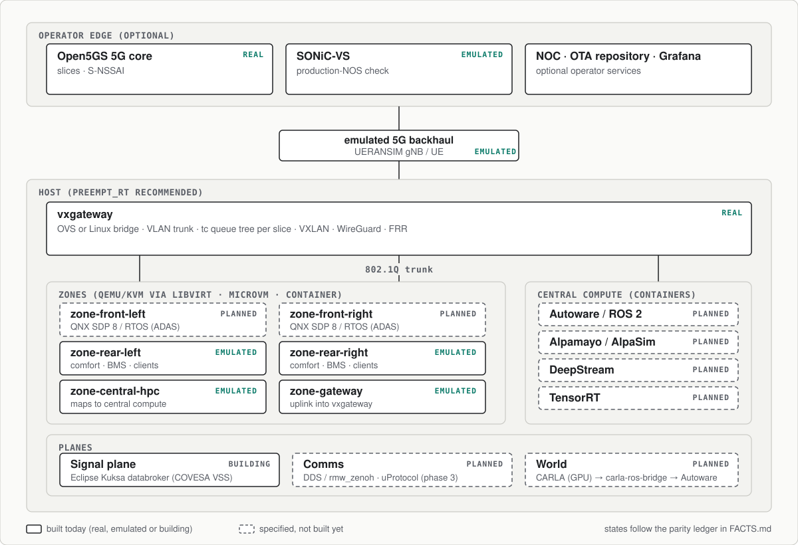
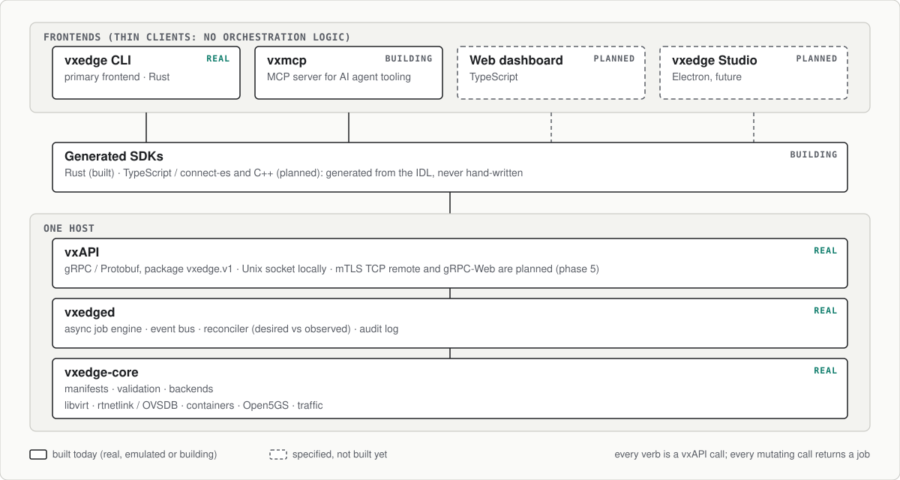

# Architecture

*The architecture specification for vxedge: research goals, topology, vxAPI, manifest schemas, the network, service and virtualization models, methodology, and the phased roadmap.*

vxedge is a research-grade orchestration and experiment platform that evaluates 5G network-slice mapping onto zonal and central software-defined-vehicle (SDV) E/E architectures, **entirely in software**. In short:

- **Gateway.** `vxgateway`, built on the Linux networking stack, replaces physical edge gear.
- **Zones.** KVM/QEMU VMs managed through libvirt provide zonal ECUs (QNX, Zephyr, FreeRTOS, Android Automotive).
- **Compute.** Containerized central compute runs Autoware/ROS 2 and NVIDIA AD workloads (Alpamayo, DeepStream, TensorRT).
- **Control plane.** A Rust daemon (`vxedged`) orchestrates manifest-driven vehicles, experiments, services and telemetry, and exposes a versioned gRPC/Protobuf API (**vxAPI**).
- **Frontends.** Thin clients of that API: the `vxedge` CLI today; web/TypeScript and Electron frontends next; and an MCP server (`vxmcp`) for AI agent tooling. Locally over a Unix socket, or cloud-hosted behind mTLS.

*Qt/QML is not an operator-dashboard frontend here; see §5.1 for its two real, unrelated roles: an in-vehicle embedded IVI loadable, and a future `vxmodels` graphical design tool.*

---

## Table of contents

1. Executive summary
2. Research goals & hypotheses
3. High-level architecture (topology & components)
4. Repositories & single-source rules
5. vxedge control plane & API (vxedged, vxAPI, frontends, CLI)
6. Manifests (experiment & vehicle schemas)
7. Network model — vxgateway (SDN slicing)
8. Service model (OTA, telemetry, extensibility)
9. Virtualization & zone provisioning (libvirt, QEMU/KVM, QNX, RTOS, containers)
10. Compute model (Autoware/ROS2, Alpamayo, inference, OTA hosting)
11. Edge agents & telemetry collection (vxagents / vxtelemetry)
12. Experiment methodology, metrics, and analysis plan
13. Reproducibility, CI/CD, artifact publication
14. Safety, security, licensing, and industrialization notes
15. Implementation policy & phased roadmap
16. Appendix: example manifests, gateway snippets, run sequence

---

## 1 — Executive summary

vxedge is a reproducible, modular framework to define and run SDV experiments that combine zone
virtual ECUs, central compute, a **software-defined virtual edge gateway** with 5G-style slicing,
and services (OTA, telemetry). Manifests declare the whole system — up to and including a complete
**software-bootstrapped vehicle** (`vxedge vehicle up`). The Rust CLI orchestrates the lifecycle
using a simple `up|down` model across all subsystems.

The platform is designed to:

- generate publishable results (latency/jitter percentiles, OTA reliability, isolation metrics);
- stay production-representative: the same middleware (Eclipse SDV: Kuksa/VSS, Zenoh, uProtocol),
  network stack (OVS/tc/FRR/WireGuard, SONiC as production NOS twin), and AD workloads
  (Autoware, NVIDIA Alpamayo) used or converged on by OEMs;
- run on a single NVIDIA GPU host (scaling to several), with an explicit later path onto NVIDIA
  hardware (Jetson AGX, DRIVE AGX / DRIVE OS, BlueField/DOCA offload);
- be **API-first**: all orchestration lives behind vxAPI (gRPC/Protobuf) served by the `vxedged`
  daemon. The CLI, GUIs (Electron), web dashboards, and the `vxmcp` MCP server are
  interchangeable thin clients — human-operated or agent-operated, same rule either way — and
  the same API hosts locally or in the cloud (controller mode federating multiple hosts).

No physical router is required: the edge-gateway role is fully absorbed by `vxgateway`.

---

## 2 — Research goals & hypotheses

**Primary goal:** Quantify whether a **software-defined virtual gateway** — built from the
production Linux SDN stack (OVS/Linux bridge, tc queue trees, VXLAN, WireGuard, FRR) and running
co-located with virtualized zonal ECUs and central compute — can provide slice isolation and
deterministic performance for SDV workloads mapped to logical 5G slices.

**Hypotheses to test:**

- **H1 (isolation):** Per-slice VLAN/VXLAN mapping with hierarchical tc queue-tree reservations in
  vxgateway can keep p95/p99 latency for ADAS (URLLC-like) traffic near baseline under heavy
  infotainment load.
- **H2 (real slicing vs. static mapping):** True 5G slicing (S-NSSAI PDU sessions via
  Open5GS + UERANSIM) provides measurably different — and under contention, stronger — isolation
  than static VLAN-to-slice mapping.
- **H3 (virtualization choice):** Virtual ECU packaging (full VM via libvirt vs. container vs.
  microVM via raw QEMU/QMP or cloud-hypervisor) measurably affects latency/jitter observable at
  zone-to-compute flows.
- **H4 (service co-location):** OTA service co-located in central compute (deployed on demand)
  does not compromise ADAS slice SLAs when slices and queue reservations are correctly configured.

**Deliverables:** Reproducible experiment artifacts, datasets, scripts, and publishable analysis —
plus a reference "vehicle-in-software" composition demonstrating the full stack end to end.

**Framing note:** unlike physical edge gear, the virtual gateway shares the host with the
workloads it isolates. Determinism controls (PREEMPT_RT kernel, `isolcpus`, CPU pinning,
hugepages) are part of the method, and their effect is itself reported.

---

## 3 — High-level architecture (topology & components)

[](diagrams/zonal-topology.svg)

*Figure 3.1: the topology (click for full size). Box states follow the parity ledger in [`FACTS.md`](FACTS.md): solid is built
today (real, emulated or building), dashed is specified and not built yet. Source:
[`diagrams/topology.py`](diagrams/topology.py).*

**Key components:**

- **vxedged (Rust)** — control-plane daemon: orchestration + provisioning core behind **vxAPI**
  (gRPC/Protobuf). See §5.
- **vxedge CLI (Rust)** — thin vxAPI client; the primary frontend.
- **vxgateway** — the software-defined edge gateway: Linux-native data plane (OVS or Linux
  bridge, tc, VXLAN, WireGuard, FRR), provisioned declaratively by the CLI. See §7.
- **vxzones** — authoritative zone manifests, VM images (QNX SDP 8, Zephyr, FreeRTOS, AAOS),
  RTOS builds.
- **vxcompute** — central compute manifests, Autoware/ROS2 images, Alpamayo/AlpaSim, inference.
- **vxota** — OTA server & signing tooling (artifact store).
- **vxagents** — performant Rust agents for measurements and metrics.
- **vxtelemetry** — telemetry ingestion & Prometheus export (VSS-aligned; see §11).
- **vxperiments** — manifest-driven experiments, vehicle manifests, and results.

---

## 4 — Repositories & single-source rules

Canonical repos (under vxedge org):

- `vxedge/vxedge` — Rust workspace: `vxedge-core` (domain lib), `vxedged` (daemon, vxAPI),
  `vxedge-cli` (thin client), `proto/` (vxAPI Protobuf IDL — the source for all generated SDKs:
  Rust/tonic, TypeScript/connect-es), plus **gateway provisioning templates**
  (netlink/OVS/nftables/tc, libvirt domain XML templates).
- `vxedge/vxparts` — the unified loadable registry: zone VM/kernel/RTOS bundles, central-compute
  container images, gateway/TCU images, agent binaries, and platform-service images — every
  loadable the platform boots, published to `ghcr.io/vxedge/parts/...` via OCI/ORAS, classified
  by `class`/`subtype`/`layer` (see §13's own artifact-publication rules). **Supersedes
  `vxzones` and `vxcompute`** (Track P, decided 2026-07-26): those two repos split loadables by
  deployment mechanism (VM vs. container) rather than by domain, which is exactly the kind of
  implementation detail this workspace's own single-source-of-truth discipline exists to keep
  out of repo topology. Both were **archived 2026-08-04** (GitHub archive, not deleted — their
  history stays reachable, read-only) once their content was confirmed fully present in
  `vxparts` — see `vxparts/TASKS.md` Track P for the migration account.
- `vxedge/vxota` — OTA server, signing, manifests.
- `vxedge/vxagents` — Rust agents, metrics exporters.
- `vxedge/vxtelemetry` — telemetry ingestion and exporters.
- `vxedge/vxperiments` — experiment manifests, **vehicle manifests**, notebooks, results.
- `vxedge/vxmodels` — *(track M)* SysML v2 system models:
  requirements/traceability (H1–H4 `verify`-linked to frozen result archives), vehicle
  structure models, the analysis-case/variant library, and the `vxmodel` renderer (Rust)
  that generates manifests from models. See §6.3 and §15 (track M).
- `vxedge/docs` — papers, slides, reproducibility guide.

**Single-source rules:**

- A zone/compute's manifest is authoritative for its images and node IDs.
- Services declared under `services` in an experiment manifest are the authoritative runtime
  descriptors for that experiment (image + config). The code lives in vxota or vxtelemetry as
  appropriate.
- A **vehicle manifest** is the authoritative composition of zones + compute + network + services
  for a software-bootstrapped vehicle; experiments reference a vehicle rather than restating it.
- CLI uses manifests as sole input; state stored in ephemeral runtime directories and vxedge logs.
- Exactly two cross-language interfaces exist: **manifests** (YAML content) and **vxAPI**
  (Protobuf IDL under `vxedge/vxedge/proto/`, authoritative; client SDKs are generated, never
  hand-written). No bespoke ad-hoc RPC.
- **Model governance (track M, when `vxmodels` lands):** the SysML v2 model is the *design
  authority* upstream of manifests; manifests remain the **sole execution contract** — the
  daemon/CLI never read models. A model-rendered manifest records the digest of the model
  version that produced it and must pass `vxedge manifest validate` like any hand-written
  manifest. The model never duplicates what zone/compute manifests are authoritative for
  (images, node IDs). See §6.3.

---

## 5 — vxedge control plane & API (vxedged, vxAPI, frontends, CLI)

**Principle (API-first):** the split every production SDV toolchain converges on — Tesla-style
fleet tooling, NVIDIA DriveWorks tools, AUTOSAR Adaptive development tooling — is a headless core
behind a strongly-typed IDL, with every UI a disposable thin client. vxedge adopts it outright:
**no orchestration logic lives in any frontend.**

### 5.1 Layers & frontends

[](diagrams/vxapi-layers.svg)

*Figure 5.1: layers and frontends (click for full size). Box states follow the parity ledger in [`FACTS.md`](FACTS.md).
Source: [`diagrams/layers.py`](diagrams/layers.py).*

- **vxedge-core** (Rust lib): pure domain logic; no user-facing I/O.
- **vxedged** (Rust daemon, tonic + tonic-web): hosts vxAPI. Every mutating verb is an **async
  job** with server-streamed progress; the reconciler compares desired (manifest) vs observed
  state — that is what makes `up|down` idempotent.
- **Frontends** (all thin clients of the same API): platform administration, live status
  monitoring, and experiment operation — for two kinds of operator: OEM engineers and SDV
  researchers directly, and (via `vxmcp`) AI agent tooling acting on their behalf. **None of
  these are the in-vehicle HMI** — that role belongs to **Android Automotive (AAOS)**, already
  the infotainment zone's guest OS, or an **embedded Qt/QML IVI loadable** (running under a
  QEMU ARM zone node or hosted atop QNX — the production pattern several OEMs actually run;
  both are real, alternate in-vehicle-HMI baselines, §9). Frontends here are external tooling
  that operates the testbed, not something running inside a simulated vehicle. **Correction
  (2026-08-06): there is no Qt/QML operator dashboard** — any platform monitoring dashboard is
  web-based (TS) or the CLI, never Qt. A separate, future, not-yet-built Qt/QML tool is planned
  for `vxmodels`' MBSE tooling (§6.3) — a graphical experiment designer, not an operator
  dashboard and not a vxAPI frontend the way the items below are.
  - **`vxedge` CLI** (Rust) — unchanged UX; local Unix socket by default, `--endpoint` for
    remote; auto-spawns an ephemeral local daemon for single-host lab use.
  - **Web dashboard / Electron** (TypeScript; connect-es-generated SDK over gRPC-Web) — cloud
    console first, "vxedge Studio" desktop app later.
  - **vxedge-tray** (Rust, StatusNotifierItem/SNI system tray) — at-a-glance gateway/experiment
    state + quick up/down from the desktop; pairs with a **systemd unit for vxedged**
    (socket-activated where possible). Same thin-client rule: 1:1 vxAPI calls, no logic.
  - **`vxmcp`** (Rust, `rmcp` — the official MCP Rust SDK) — an MCP server exposing vxAPI to AI
    agent tooling (any MCP client), for the same reason every frontend above exists: a
    thin, 1:1 client over the same RPCs, this time addressed by an LLM agent's tool-call surface
    instead of a terminal or a GUI. Every MCP tool is a direct wrapper over one vxAPI RPC
    (`GatewayService`/`ZoneService`/`ComputeService`/`ExperimentService`/`TrafficService`/
    `SvcService`/`JobService`/`EventService`) — never a multi-step workflow baked into the
    server, the hard rule stated explicitly for this frontend too. Sits directly on
    `vxedge-api`'s generated tonic bindings (a Rust-to-Rust dependency, not a second codegen
    pipeline the way the TS/C++ SDKs are). Targets **MCP spec 2026-07-28**: stateless
    request-response (no `initialize` handshake), with **Multi Round-Trip Requests**
    (`InputRequiredResult`/`InputRequest::Elicitation`) as the mechanism for the one thing a
    thin wrapper still needs — a mutating tool (`up`/`down`/`traffic up`) asking its caller to
    confirm before it runs, the same posture a human operator gets from the CLI's own explicit
    verbs, not something an LLM can chain unsupervised into a destructive sequence. Read tools
    (`status`/`list`/`events subscribe`/results-archive summaries) ship first, since they carry
    no such confirmation question and are useful standalone; mutating tools follow once the
    MRTR confirmation flow is built and reviewed. New repo, `vxedge/vxmcp`, phase 3
    (`docs/ROADMAP.md`) — frontend/tooling investment, not hardware-gated, so it doesn't wait on
    anything phase 3's GPU items do.

### 5.2 API surface (vxAPI, `proto/vxedge/v1/`)

| Service | RPCs (declarative, manifest-in) |
|---|---|
| `GatewayService` | `Apply`, `Up`, `Down`, `Status` |
| `ZoneService` / `ComputeService` | `Apply`, `Up`, `Down`, `List`, `Remove`, `PushImage` (client-streaming) |
| `SvcService` (ota, telemetry) | `Up`, `Down`, `Status` |
| `VehicleService` | `Up`, `Down`, `Status` |
| `ExperimentService` | `Up`, `Down`, `Status` |
| `TrafficService` | `Up`, `Down` |
| `JobService` | `Get`, `Watch` (server-streamed progress; every mutating RPC returns a `Job`) |
| `EventService` | `Subscribe` (state transitions, audit events) |
| `TelemetryService` | `StreamMetrics` (live), `Collect` (archive job) |

Rules: mutating RPCs carry manifest documents (or references to them) — the API introduces **no
second source of truth** beside manifests; daemon state stays in ephemeral runtime dirs + logs.
The proto package is versioned (`vxedge.v1`): additive changes stay in v1, breaking changes mean
`vxedge.v2`.

**Why gRPC/Protobuf** (not SOME/IP, not bare REST): SOME/IP–`ara::com` is the *in-vehicle service
plane* — the wrong tool for an orchestration/tooling plane; bare REST lacks first-class streaming
and codegen rigor. One Protobuf IDL generates every SDK, gRPC-Web covers browsers and Electron,
and Protobuf is what Eclipse uProtocol already speaks — schema reuse when the signal plane lands
in phase 3. An optional REST/OpenAPI façade can be added later by transcoding, without touching
the core.

### 5.3 Transport, security, deployment modes

- **Local (default, live today):** Unix domain socket only — `vxedged --listen` rejects any
  other scheme outright, and `vxedge --endpoint` rejects any non-`unix://` value the same way
  (found while scoping Phase 5, 2026-08-05: neither side has ever accepted anything else).
  The access boundary today is filesystem permissions on the socket path, not a per-call
  identity check — no `SO_PEERCRED`/`UCred` peer-credential extraction exists anywhere in the
  code yet. "Peer-credential auth" below is the target for this mode, not its current
  behavior; stated honestly here per this doc's own fidelity rule (§14 / `testbed-quality`)
  rather than implying it already gates local connections.
- **Remote (planned, Phase 5):** TCP + mTLS, OIDC bearer tokens; roles viewer/operator/admin;
  every mutating call audit-logged **with the calling actor's identity attached** — a second
  gap found during the same scoping pass: `Audit::record(rpc, detail)`
  (`vxedged/src/audit.rs`) has no actor field at all today, because there has only ever been
  one, local, unauthenticated caller. Remote access without that field would produce an audit
  log that says what happened but not who did it — not acceptable once "who" is a real
  question. Full scope: `docs/ROADMAP.md`'s Phase 5 section.
- **Cloud-hosted (planned, Phase 3):** `vxedged --controller` runs anywhere and federates one
  or more site daemons (one per GPU host, reached over WireGuard + mTLS) behind the **same
  vxAPI**. Frontends never know whether they talk to a single host or a fleet controller, and
  never touch hypervisors directly. A related but distinct concern from Remote access above:
  federation is site-daemon-to-controller plumbing, not the human/CLI-to-daemon auth path —
  see `docs/ROADMAP.md`'s Phase 5 section for why the two are scoped separately.

### 5.4 CLI — commands & semantics

**Location:** `vxedge/vxedge` (Rust workspace: `vxedge-core`, `vxedged`, `vxedge-cli`, `proto/`).
**Binaries:** `vxedge` (thin client), `vxedged` (daemon).
**Global behavior:** all lifecycle commands follow `up|down` semantics. Where staging is required,
`up` performs staging + start; `down` stops + cleanup. All operations are idempotent.

**Commands (canonical)**

```bash
# Daemon / control plane
vxedged serve [--listen unix:///run/vxedge.sock | https://0.0.0.0:8443] [--controller]

# Client endpoint (applies to every command below; defaults to the local Unix socket)
vxedge [--endpoint <url>] ...

# Gateway (vxgateway — virtual edge gateway)
vxedge up|down|status

# Zones
vxedge zone up --vxid <vxid>
vxedge zone down --vxid <vxid>
vxedge zone list
vxedge zone add --manifest vxzones/...yaml
vxedge zone rm --vxid <vxid>
vxedge zone image push --vxid <vxid> --from <path> --registry <url?>

# Compute
vxedge compute up --vxid <vxid>
vxedge compute down --vxid <vxid>
vxedge compute add --manifest vxcompute/...yaml
vxedge compute rm --vxid <vxid>
vxedge compute image push --vxid <vxid> --from <path> --registry <url?>

# Services (OTA, telemetry)
vxedge ota up [--experiment <path>]      # cwd-resolved by default, like `experiment up`;
vxedge ota down [--experiment <path>]    # --experiment overrides with an explicit workspace
vxedge telemetry up|down|collect         # not yet wired to the daemon (planned);
                                          # vxtelemetry runs standalone via its own binary today

# Vehicle (software-bootstrapped SDV: gateway + zones + compute + signal plane + services)
vxedge vehicle up --manifest vxperiments/vehicles/<vehicle>.yaml
vxedge vehicle down --manifest vxperiments/vehicles/<vehicle>.yaml
vxedge vehicle status --manifest vxperiments/vehicles/<vehicle>.yaml

# Experiments (manifest-driven; may reference a vehicle manifest)
vxedge experiment up --manifest vxperiments/exp-001.yaml
vxedge experiment down --manifest vxperiments/exp-001.yaml

# Traffic generation
vxedge traffic up --manifest ...
```

`vxedge vehicle up` is sugar for the ordered composition: gateway up → zones up → compute up →
signal plane up (Kuksa, phase 3) → services up. `vehicle down` tears down in reverse.

Every CLI verb is a 1:1 wrapper over a vxAPI RPC — anything the CLI can do, every other frontend
(web, Electron, scripts against the TS SDK) can do identically.

---

## 6 — Manifests — final schemas (YAML)

### 6.0 The workspace model (Track D)

An experiment is a **folder**. Every file declares its `kind` and `id`; the loader indexes on
that pair, and **every cross-reference is by id, never by path** — so files can be renamed or
reorganised without breaking anything.

```
h1-slice-isolation/
  h1-slice-isolation.vxp   # package descriptor: id, version, entry, requires
  main.yaml                # kind: experiment  — the test
  vehicle.yaml             # kind: vehicle     — the system under test
  road1.yaml               # kind: road        — the environment (omit if unused)
  parts.yaml               # kind: baseline    — which software
  scripts/run.sh           # the campaign: repetitions, warmup, measurement window
  parts/                   # this experiment's own loadables
  assets/                  # scenario files, traces, maps
  tools/                   # analysis specific to this experiment
  results/                 # archives, one per run
```

**A workspace is a sandbox.** It owns everything the experiment needs, so it can be zipped,
sent, unzipped and run — which is what makes an experiment shareable at all. A workspace whose
parts live three directories up is not something a recipient can unpack. Only the top-level
`*.yaml` are workspace *documents*; the subdirectories are content, and the loader ignores them
(a `part.yaml` inside `parts/` describes a loadable, not an experiment).

Kinds: `experiment` | `vehicle` | `road` | `baseline` | `component`. Loading is: read the
`.vxp`, glob `*.yaml` (non-recursive, so a `results/` archive is never absorbed), index by
`(kind, id)`, resolve references by id. No includes, no import boilerplate, no ordering rules.
Files exist only when the experiment needs them.

**A file may hold several documents**, `---`-separated, and a whole workspace may be one file.
That follows from every reference being by id: the file boundary carries no meaning, so it is
free to move. Separate files stay the scaffold default because they teach the model, but an
engineer who wants one file — or a caller with no directory to point at, such as an inline
manifest over vxAPI — has one.

**Structure and software are separate files.** One `vehicle.yaml` with many baselines is what
an OTA campaign is, what an RxSWIN identifies, and what makes an A/B arm two baselines rather
than two vehicle files that drift apart.

**The vehicle names a slice; the experiment defines it.** `links[].slice: adas` in the vehicle,
`network.slices[].mode: vlan|s-nssai` in the experiment. H2's comparison is therefore *one
block changed over a provably unchanged vehicle*, enforced by the schema rather than asserted
in a README. This is the only reference that crosses the structure/test boundary, and
`vxedge experiment validate` checks it.

`network:` (and everything under it — `slices`, `tunnels`, `data_plane`, `nos_check`) lives in
the experiment document only, never inside a vehicle document, for a second reason beyond H2:
there is exactly **one** vxgateway per experiment run (one bridge, one HTB tree — a deliberate
fidelity choice, one vehicle has one gateway ECU, not an oversight). When an experiment
references multiple vehicles (`vehicles: [car1, car2]`), they share that one gateway, so they
share one `network:` block too — a per-vehicle `network:` would imply each vehicle gets its own
separate gateway, which the system doesn't build. Vehicles that need distinct, isolated
segments still get them: the experiment declares every slice either vehicle needs
(`car1-adas`/`car2-adas` on separate VLANs, say), and each vehicle's own `links` references only
the slice IDs that belong to it — `car2.yaml` never has to mention `car1-adas` at all.

**Local-first.** Every ref has a local form (`./images/foo`) and a published form
(`ghcr.io/…` + digest), same key, resolved by shape. `digest` is optional for local refs
(content-hashed into the results archive) and **required** for published ones — a moving tag
is not reproducible for anyone else. So a run is always reproducible *for its author*, and
publishing is what makes it reproducible *for others*. `vxedge experiment up` must work
offline with zero published artifacts.

Tooling: `vxedge experiment new <id> [--template minimal|slicing]` scaffolds a workspace;
`vxedge experiment validate [path]` runs every cross-file check and reports all problems at
once.

#### 6.0.1 `kind: vehicle`

```yaml
kind: vehicle
id: car1
class: road                          # taxonomy spine: kind > class > subtype
subtype: car

zones:                               # REGIONS of the entity, not devices
  front-left: {}
  central: { name: central compute bay, reference: <external zoning std> }

devices:                             # units LOCATED IN zones
  zonefl: { role: zone-controller, zone: front-left, backend: container }
  hpc1:   { role: hpc, zone: central, backend: container, resources: { cpu: 4, memory: 8 } }
  gw1:    { role: gateway, backend: container }

functions:                           # units of BEHAVIOUR, deployed onto devices
  adas:    { deployed_on: zonefl, asil: B }
  percept: { deployed_on: hpc1 }

links:                               # transport: how bytes move (the harness)
  - { id: trunk-fl,  endpoints: [gw1:eth0, zonefl:eth0], slice: adas }
  - id: arm-cont                     # object form, when an attachment needs a fixed address
    endpoints: [{ node: zonefl, port: eth0, ip: 10.101.0.11/24 }]
    slice: adas
  - id: seg-t1                       # a slice-bound link may emulate its PHY
    endpoints: [node-sensor-01:eth0]
    slice: adas
    impairments: { rate_mbps: 100, delay_us: 250, jitter_us: 40, loss_pct: 0.01 }
    harness: { medium: 100BASE-T1, length_m: 2.4, weight_g: 85 }

channels:                            # interaction: what is exchanged, between FUNCTIONS
  - id: adas.object-list
    from: percept
    to:   [adas]
    protocol: dds | zenoh | someip | udp
    qos: { reliability: reliable, deadline_ms: 50 }
    carried_by: [trunk-hpc, trunk-fl]
```

**Zone, device, function are three different things.** A zone is a *place* — a named region
(front-left, cabin, nacelle-2, an ATA zone), not an enum, which is what lets a non-road entity
have zones at all. A device is a unit located in one. A function is behaviour deployed *onto* a
device: AUTOSAR calls it a software component, and separating it from the ECU it runs on is the
whole point of the Virtual Function Bus. `parts:` targets **functions**, and `channels` connect
functions — a topic flows between behaviours, and which devices they sit on is a deployment
decision a study should be able to vary without rewriting the interaction topology.

`role` is `zone-controller | hpc | gateway | ecu | sensor | actuator | switch`. `backend` is
`container | qemu-microvm | libvirt` and is **required for any device attached to a slice**:
the planner has to know whether to build a veth or a tap, and guessing produced a workspace
that validated and then could not boot.

Addressing is `<id>[:<port>]`. Ids are **flat and unique workspace-wide** (`zonefl`, not
`zones.front-left`): structural paths break when the model is restructured, and flat ids do
not. Uniqueness is an enforced check, and so is the zone/device collision it makes possible.

A link endpoint takes two forms. The **bare** `zonefl:eth0` is right whenever nothing has to be
reachable at a known address, which is most attachments. The **object** form
`{ node, port, ip }` pins a host address on that attachment, for the case with no other
expression: exp-002's three arms share one VLAN and are told apart *only* by address. An
address belongs to the attachment rather than the device — a device on two slices has two — and
it lives in the vehicle rather than the experiment because it states a structural fact ("this
ECU answers here"), which is what keeps one vehicle usable by many baselines.

`carried_by` binds a channel to the links carrying it, and validation requires the channel's
endpoints to be genuinely **reachable** over those links. This is what makes latency and loss
attributable **per topic per slice** rather than only per link — the measurement §12 exists to
produce. Without the reachability check, `carried_by` would be an unchecked assertion.

A slice-bound link may add `impairments` (tc netem: `rate_mbps`/`delay_us`/`jitter_us`/
`loss_pct`) to emulate the PHY it stands for — the mechanism behind §7's "Harness modeling."
Every value is per traversal, one direction: a round trip pays the declared delay twice. Exactly
one of the link's access ports renders it, in both directions (the reverse direction rides an
IFB, since a qdisc only shapes egress); which port is not observable in a measurement, only that
the segment's declared characteristics apply once per crossing. Any link, impaired or not, may
separately carry `harness` (`medium`, `length_m`, `weight_g`) — the declarative record a
zonal-versus-domain harness-reduction study reports on, distinct from `impairments`' emulated
half: nothing about a length in meters is a `tc` argument.

Behaviour splits in two: *interaction* (`channels`) belongs to the vehicle; *stimulus*
(`traffic_profiles`, scenario) belongs to the experiment and the road. The vehicle is the same
vehicle whether it is driven hard or gently.

#### 6.0.2 `kind: baseline`

```yaml
kind: baseline
id: bl-2026-07
rxswin: RX-VXE-0001-0003             # optional; UN R156, a property of the vehicle TYPE

parts:
  - ref: ghcr.io/vxedge/parts/zone/qnx/os/sdp8-base:1.0.0
    digest: sha256:…                 # required for published refs
    target_ids: [zonefl, zonefr]     # scalar or list — declared once, however many nodes
  - ref: ./images/my-autoware        # local; no digest required
    target_ids: hpc1
```

Each entry carries `ref`, `digest`, `target_ids`, and — only where the reference is silent
about it — `kind: container | bundle`. Class, subtype, layer, name and the VXPN part number are
all derivable from the ref path; restating them is the drift the computed-part-number design
exists to prevent.

`kind` exists because a part knows what it *is* and a device knows how it is *run*, and the two
have to agree: a container backend boots a container image, libvirt and qemu-microvm boot a
guest bundle. The `local/…` namespace is conclusive on its own (a host process, never a
bundle), and a published vxparts ref is deliberately **not** read for this — its class says
what kind of node the part loads onto, not how it is packaged, and a zone guest is legitimately
a container under the netns backend. Only a bare path is genuinely ambiguous, and there `kind`
is how the author says so. A stated kind is validated against the device's backend, so a
baseline pointing an H3 libvirt arm at a container image is rejected with both halves named
rather than silently accepted and failed at boot. `vxedge manifest bom` derives them for display,
SBOM export and the RxSWIN roll-up.

`target_ids` declared once for many components is deliberate: repeating a shared part
per-component is how fleet baselines silently drift when one copy is bumped and the others are
not.

#### 6.0.3 `kind: experiment` and the `.vxp` descriptor

`kind: experiment` carries `network` (slices, tunnels, nos_check), `traffic_profiles`,
`telemetry`, `services` and `results`, plus `vehicles: [<id>…]`, `baseline: <id>`, `world: <id>`,
and a `method` block (`duration_s`, `repetitions`, `warmup_s`). It carries no `zones`/`compute`
inline: structure is the vehicle's, and software is the baseline's.

Every one of those blocks is **typed and validated when the model is built** — a malformed
`services:` entry is one error against the file the author wrote, not a surprise at `svc up`.

`network.tunnels` (`docs/ROADMAP.md` #16) declares a point-to-point link the gateway itself
terminates, reaching a *remote* peer (another site's gateway) — distinct from `network.slices`,
which partitions the *local* bridge fabric zone nodes attach to. Two kinds today, each with only
the fields it needs:

```yaml
network:
  tunnels:
    - id: ota-uplink
      kind: wireguard                  # an encrypted, routed L3 endpoint
      listen_port: 51820
      address: 10.200.0.1/24           # this side's address on the tunnel's own overlay subnet
      peer:
        public_key: <base64>           # the peer's key, known out of band — never this side's own
        endpoint: 198.51.100.7:51820   # omit if this side only listens (WireGuard roaming)
        allowed_ips: [10.200.0.0/24]
    - id: site-b-adas
      kind: vxlan                      # extends a local slice's L2 domain across hosts
      vni: 100                         # 24-bit VXLAN network identifier
      remote: 198.51.100.7             # the remote gateway's reachable address (bare IP)
      dstport: 4789                    # optional; defaults to the IANA-assigned VXLAN port
      slices: [adas]                   # which of this experiment's own slices this link carries
```

`wireguard` carries no local key material, deliberately: a manifest is a versioned document, and
a private key does not belong in one. The gateway mints its own identity on first `up` — piped
straight from `wg genkey` into `wg set`'s stdin, never written to disk — and `vxedge status`
reports the resulting public key back, which is what an operator hands to the peer out of band.
Re-applying an already-existing tunnel reconfigures its peer/listen-port declaratively without
touching that identity, so a routine reconcile pass can never silently invalidate what the peer
already trusts.

`vxlan` has no key material at all — an unencrypted L2 extension, the same trust model as a
physical inter-switch link — and is structurally the opposite of `wireguard`: a WireGuard
interface is a routed L3 endpoint, never enslaved to the bridge/OVS switch, while a VXLAN
interface *joins* the bridge as a trunk-like port, so `slices` (not an `address`/`peer` block)
is what a `vxlan` tunnel actually needs — which local slice(s) it extends, validated against
`network.slices` the same way a `links[].slice` reference is. **Model and validation only**
(`docs/ROADMAP.md` #16, delivered 2026-08-04) — `GatewayPlan` refuses to plan a `kind: vxlan`
tunnel today (`PlanError::VxlanTunnelNotYetProvisionable`), loudly rather than silently
dropping it, since provisioning it is a separate, not-yet-built follow-on.

`network.nos_check` (`docs/ROADMAP.md` #16/#31, schema settled 2026-08-04) opts an experiment
into checking its `network.slices` VLAN intent against a real production network OS, alongside
— never instead of — the actual measured path (`network.data_plane`). Absent by default; most
experiments don't declare it:

```yaml
network:
  nos_check:
    kind: sonic-vs                     # the only kind today
    trunk_port: Ethernet0              # validated against the pinned image's actual port list
    # part_ref / digest: optional, default to the pinned build vxparts/parts/gw/nos/os/sonic-vs
```

Deliberately not named "twin": the whole testbed already is one (an executable virtual
prototype of a vehicle), so reusing that word for one internal field would describe nothing.
What this does is a **check** — boot a real instance of the named NOS, hand it the same VLAN
declaration `network.slices` already expresses, and confirm it accepts and reports back exactly
that. It never carries measured traffic (§7: SONiC-VS is functional but not
timing-representative), and it is not part of `experiment up`'s provisioning sequence — a
missing or misconfigured `nos_check` block never blocks or changes what an experiment actually
measures.

`kind` names which NOS is being checked against — `sonic-vs` today, the shape a second kind
would extend rather than a reason to design one now (`network.data_plane`'s own
`kernel-bridge | ovs` precedent). `trunk_port` is not a name vxedge invents: it is one of the
pinned image's own, fixed port names (SONiC-VS's default reference platform exposes exactly 32,
`Ethernet0`/`Ethernet4`/.../`Ethernet124` — confirmed by booting it, not assumed), validated at
`vxedge experiment validate` time against that concrete list rather than a free-form string or a
loose pattern.

The `.vxp` descriptor holds packaging rather than content, so a version bump never touches an
experiment file:

```yaml
id: h1-slice-isolation
version: 0.1.0
entry: main.yaml
requires: { gpu: none }              # surfaced at scaffold time, checked by validate
```

#### 6.0.4 Requirements vs. allocation

Two different things that both sound like "resources":

- **`requires`** on a *part* (`part.yaml` in `vxparts`) — what the software needs: `arch`,
  `libc`, `cpu`, `memory_gb`, `gpu.vram_gb`, `gpu.compute_capability`.
- **`resources`** on a *component* (in a vehicle) — what the node is allocated.

`vxedge manifest validate` checks part → component → host and fails early, so "this host
cannot run this workspace" is reported before build time is spent rather than after.
`depends_on` between parts is **metadata only**: validated for presence in the same baseline,
never version-solved — a resolver is a package manager, and that would be a separate,
deliberate decision.

#### 6.0.5 Interface naming

A device's host interfaces are derived from its **id**: `vz-<stem>` for the bridge access port
(the veth host side, or the tap itself) and `vzp-<stem>` for the veth peer. The stem is the
sanitised id, shortened to a readable head plus a hash of the whole id when it does not fit the
kernel's 15-byte `IFNAMSIZ` limit — `node-cont-01` becomes `vz-node-c-32cc`.

This is a contract, not an implementation detail: campaign scripts address these names directly
(`ip addr replace … dev vzp-node-a-c06a`, `qemu … ifname=vz-node-q-691e`). Names used to be
**positional** — `vz0`, `vz1`, … in traversal order — which made ordering load-bearing in the
worst way: adding a device renumbered the rest, and two views of the *same* topology could
number it differently. exp-002 declares its arms `cont, microvm, libvirt` and sorts to `cont,
libvirt, microvm`, so two H3 arms swapped interfaces between the two schema paths — the
campaign would have measured libvirt and reported microvm, passing every test on the way.

A name now depends on its own device and nothing else: not declaration order, not sorting, not
how many other devices exist. Two ids that shorten to one name are refused with both named.
`vxedge zone list` prints each device's `port=` and `peer=`, so the mapping is always
answerable without recomputing a hash.

#### 6.0.6 Migration status

§6.0 is **the only authored schema, and the only runnable one** (2026-07-31). Every planner
takes the domain model, which is built from a workspace; `vxedge up`, `vxedge experiment up`
and `vxtelemetry ingest|collect` all read a workspace directory. All five experiments —
exp-001, exp-002, exp-002b, exp-003, exp-010 — have workspaces, each verified to produce
plans identical to the frozen §6.1 manifest it replaced.

§6.1 and §6.2 are **deleted** — structs, adapter and lowering alike. `vxmodel render` (track M)
emits workspaces too, so `vxedge manifest validate` has one shape to check and CI asserts it.

The frozen `vxperiments/experiments/exp-*.yaml` files are kept as provenance for the results
already recorded against them, not as inputs. Pointing a tool at one now reports what the
document is and where to go instead.

### 6.1–6.2 Experiment and vehicle manifests — **retired 2026-07-31**

These two schemas are gone: the structs are deleted from `vxedge-core`, nothing parses them, and
no tool emits them. §6.0 is the only schema.

They are named here rather than silently dropped because results archives, `RESULTS.md` entries
and the frozen `vxperiments/experiments/exp-*.yaml` files all reference them. A §6.1 experiment
manifest was one document carrying `experiment`/`network`/`zones`/`compute`/`links`/
`traffic_profiles`/`telemetry`/`results`, with software attached to a node as a flat `image:`;
a §6.2 vehicle manifest carried the same composition blocks under a `vehicle:` header. §6.0
splits both across `kind: experiment` / `kind: vehicle` / `kind: baseline` documents and
separates zone (a place) from device (a unit) from function (behaviour) — the conflation that
made `channels` unexecutable and a slice's definition unlocatable.

The frozen manifests stay in `vxperiments/experiments/` as provenance for results recorded
against them. To read one against the schema it was written to, use the `v0.1.0` tag, which is
where phase-1 reproducibility is anchored.

### 6.3 Model governance — SysML v2 (track M, `vxmodels`)

Why SysML v2 here: unlike v1 it is textual (git-diffable), has a standardized REST/JSON API,
and composes typed elements — the first systems-modeling standard practical for GenAI
authoring. vxedge is unusually well-placed for it: the system is already fully declarative
(manifests) and fully executable (`up|down`), so a model layer is *live*, not documentation.

Construct mapping (authoritative for track M):

| SysML v2 construct | vxedge artifact |
|---|---|
| `requirement` def + `verify` | hypotheses (H1–H4, then per-experiment) → frozen result archives |
| `part` / `connection` / `interface` defs | vehicle manifest: zones/nodes, `links` harness, slices + QoS |
| `analysis case` + variant points | experiment manifest + its arms |
| `use case` / `occurrence` | traffic/transportation scenarios (CARLA; ASAM OpenSCENARIO alignment) |
| metadata annotations | fidelity ledger: per-part caveats → per-experiment validity envelope |

Pipeline: `.sysml` sources (authored in `vxmodels`) → `vxmodel render` (Rust) → YAML
manifest (+ recorded model digest) → `vxedge manifest validate --json` → the normal CLI
lifecycle. GenAI-authored experiments therefore clear **two typed gates** (model typing,
then manifest validation) before touching the testbed — the safety argument for generated
experiments is structural, not aspirational.

Out of model scope, by rule: Rust internals, the vxAPI IDL (Protobuf stays the contract,
SDKs stay generated), and anything zone/compute manifests are authoritative for.

**Future graphical frontend (not yet built, added 2026-08-06)**: a Qt/QML desktop tool —
analogous to the planned Electron "vxedge Studio," an MBSE/CAD-style variant of the same idea —
to help OEM engineers design experiments visually instead of hand-authoring `.sysml` text
directly. It would still read/write the same textual, git-diffable `.sysml` sources (the
construct-mapping table above stays the contract either way); a graphical editor is a view onto
that source, not a second model format. Explicitly deferred — no design work done here yet.

Terminology (matches `ROADMAP.md`): track M makes vxedge a **model-governed executable
virtual prototype**. "Digital twin" is an earned claim reserved for phase-4 hardware parity
— track M supplies the model half; phase 4 supplies the physical half.

---

## 7 — Network model — vxgateway (SDN slicing)

The edge gateway is a **virtual network function** built entirely from the production open-source
Linux SDN stack, provisioned declaratively by `vxedge` (Rust `rtnetlink`/OVSDB, no shell
templating):

- **Data plane:** Open vSwitch (or Linux bridge) carrying an 802.1q trunk; one VLAN per slice.
  Deployed either as a set of network namespaces on the host (default; lowest overhead, fully
  inspectable) or as a dedicated VM (stronger isolation of the gateway itself).
- **Queueing / slice QoS:** hierarchical tc (HTB) queue trees per slice with guaranteed min-rate
  for URLLC-like slices — the object of hypothesis H1.
- **Real 5G slicing (H2):** Open5GS core + UERANSIM gNB/UE terminate PDU sessions per S-NSSAI;
  slice definitions in the manifest (`mode: s-nssai`) provision both the 5G core and the gateway.
  Zone nodes may additionally carry a URSP-style `slice_policy` (per-traffic-class selection
  across concurrent PDU sessions), mirroring UE-side slicing as deployed on production
  automotive modems (Qualcomm Snapdragon Auto 5G; cf. the DT/BMW/Valeo/Ericsson/Qualcomm 5G SA
  slicing trial, which vxedge reproduces openly in software). Optional radio-channel realism
  via **NVIDIA Sionna** (6G Developer Program); full **Aerial CUDA-Accelerated RAN** is a
  stretch goal requiring specific NVIDIA platforms.
- **TSN variant (phase 3):** time-aware scheduling via `taprio`/`cbs` qdiscs + gPTP time sync
  (`linuxptp`, 802.1AS) as an alternative gateway shaping mode — enables HTB-vs-TSN isolation
  comparisons matching production automotive Ethernet backbones.
- **Legacy bus edges (`type: can`, phase 3):** SocketCAN/vcan buses per zone, exposed to guests
  via QEMU CAN controllers and tunneled across the backbone with cannelloni; CAN frames map to
  VSS signals via Kuksa feeders — the zonal-controller CAN-aggregation role that makes the
  prototype vehicle-shaped rather than datacenter-shaped.
- **Harness modeling:** the manifest `links` section *is* the wiring harness. Per-link
  `impairments` (tc netem: rate cap, latency/jitter, loss) emulate PHY characteristics such as
  100/1000BASE-T1 — **delivered**: rendered onto the elected access port's egress qdisc and,
  for the reverse direction, an IFB the port's ingress traffic is redirected onto (a qdisc only
  shapes egress, so the return direction needs a device of its own to shape). `harness`
  (`medium`/`length_m`/`weight_g`) carries the same segment's physical properties declaratively,
  for a harness-reduction report, independent of whether it is impaired. CAN/LIN drops ride
  `type: can` links (LIN modeled as a constrained bus, phase 3).
  Because harness topology is manifest data, it becomes an experimental variable — star vs
  daisy-chained zones, sensor-to-ECU path placement — iterable in minutes, which no physical
  testbed offers. Power distribution is modeled only as VSS signals (vxplant power tree,
  optional); electrical/thermal fidelity is explicitly out of scope. gPTP/TSN (above) is the
  harness's timing layer.
- **Tunnels:** VXLAN for inter-host communication; WireGuard (in-kernel) for secure telemetry and
  OTA transport — `network.tunnels` (§6.0.3), one gateway-terminated point-to-point link per
  entry. **WireGuard delivered** (`docs/ROADMAP.md` #16): backend-independent (a WireGuard
  interface is a routed L3 endpoint, never enslaved to the bridge/OVS switch — the same
  mechanism regardless of `network.data_plane`). No local key material in the manifest; the
  gateway mints its own identity on first `up` and reports the public key back via `status`.
  Kernel-level correctness (a real handshake between two simulated hosts, not just interface
  presence) verified by `gateway_netns.rs`'s
  `tunnel_completes_a_real_handshake_between_two_simulated_hosts`. **VXLAN: model and validation
  delivered 2026-08-04** (`docs/ROADMAP.md` #16) — `kind: vxlan` (§6.0.3), structurally the
  opposite of WireGuard: it joins the bridge as a trunk-like port, extending one or more local
  slices' L2 domain across hosts. `GatewayPlan` provisioning is a separate, not-yet-built
  follow-on; declaring one today is refused loudly at plan time, not silently dropped.
- **Routing:** static for lab experiments; FRR provides BGP for cloud interconnect.
- **Firewalling:** nftables per VLAN/slice.
- **Production NOS twin:** the same slice/VLAN/VXLAN/BGP intent is also rendered onto a
  **SONiC-VS** virtual switch (community qcow2). SONiC is the production open-source NOS
  (Linux Foundation; NVIDIA ships production SONiC on Spectrum), which demonstrates that vxedge
  slice configs express identically on a production NOS. The SONiC-VS data plane is functional
  but **not timing-representative**, so all latency/jitter measurements run against the
  Linux-native vxgateway path. (NVIDIA Cumulus VX is deprecated as a standalone image and is not
  used; NVIDIA Air remains only an optional cloud sandbox.) Manifest field: `network.nos_check`
  (§6.0.3).
- **Determinism controls:** gateway forwarding cores pinned and isolated (`isolcpus`), PREEMPT_RT
  host kernel, hugepages. An optional **FD.io VPP (DPDK)** data-plane variant exists for
  URLLC-focused runs needing minimal per-packet latency variance.
- **Hardware offload path (phase 4):** the same OVS/tc intent offloads onto NVIDIA
  **BlueField DPU / ConnectX** via DOCA — the production exit ramp from the virtual gateway.
- **Monitoring:** gateway counters, tc/OVS statistics, and syslog exported to the central
  Prometheus node.

---

## 8 — Service model (OTA, telemetry, extensibility)

- All services defined under top-level `services` in the manifest.
- `ota` and `telemetry` are the core supported types.
- Services can be referenced in `zones` or `compute` nodes.
- CLI deploys services via `vxedge ota up|down [--experiment <path>]` (cwd-resolved by
  default), or as part of `experiment up --stage services` — the path an actual campaign
  takes, since it sequences services after the gateway/zones they depend on.
- Extensible: future `vxsvc-*` repos can be added and referenced in manifests. The phase-3
  **Kuksa databroker** (vehicle signal plane, COVESA VSS) is deployed via the vehicle manifest's
  `signal_plane` block rather than as an experiment service.
- Each service definition includes `id`, `type`, `image`, `config`.

**OTA design (H4, `vxota`):** the service exists to be a *realistic, measurable* OTA
workload for H4, not a fleet-management platform — two industry concerns are kept
deliberately separate:

- **Trust model (adopted as design vocabulary, not as a dependency):** artifact metadata
  follows the shape of **Uptane** (the automotive-specific, TUF-derived OTA security
  framework — the closest thing to an ISO/SAE 21434 / UNECE R156-aligned standard) —
  signed root/targets-style manifests, image-repo vs. director-repo separation. The
  reference implementation **aktualizr** (C++) is *not* adopted as a dependency: it would
  contradict the Rust-first service policy (§15) for no benefit vxota needs today.
- **Delivery/orchestration (out of scope for vxota v1):** production fleet tools —
  **Eclipse hawkBit** (Java rollout server + DDI API) and **Mender** (Go, server+client)
  — are named here only as the production analogs an OEM engineer would recognize
  (mapped in `docs/USER-GUIDE.md` §6); neither is wired in, since vxota's zones/compute
  nodes are ephemeral per-experiment instances, not persistent fleet devices needing
  campaign/rollout management.
- **Slot/image-swap updates (phase 3, optional):** if a later experiment wants a *real*
  atomic image swap on a running zone (vs. vxota v1's signed-blob delivery), the
  candidate is **Rugix Ctrl** (Rust, memory-safe, secure-by-default signature
  verification, native content-defined-chunking delta updates — chosen over the more
  established **RAUC** specifically for the Rust-policy fit; RAUC remains the fallback
  if Rugix's narrower deployment history or its gaps — no NAND/UBI, no encrypted
  updates, both irrelevant to our QEMU/libvirt block-storage bundles — become a
  blocker). Maps naturally onto vxzones guest bundles, which are already
  kernel+initramfs "slots" in Rugix/RAUC's sense.
- **v1 service backend (fidelity caveat, stated honestly):** `SvcService.Up` (§5) spawns
  the service binary (`vxota serve`) as a host-local child process co-located with
  `vxedged`, tracked by a pidfile the same way the microVM zone backend tracks QEMU — not
  yet scheduled onto a `vxcompute` node, since that backend doesn't exist. `config.listen`
  (new manifest field, alongside `config.artifacts`) is the address the process binds; today
  that is still the gateway's own bridge address on the slice under test, an address zone
  nodes can already reach without a tunnel. `network.tunnels` (§7) now exists as a mechanism
  — a manifest can declare a WireGuard link the gateway terminates — but `vxota` is not yet
  wired to bind `config.listen` onto one; that integration, and scheduling onto a real
  `vxcompute` node, remain open (`vxedge/TASKS.md` §4).

---

## 9 — Virtualization & zone provisioning (libvirt, QEMU/KVM, QNX, RTOS, containers)

**Stack, bottom to top:** host Linux (PREEMPT_RT, isolcpus, hugepages) → KVM → QEMU — managed by
**libvirt**, driven by `vxedge` through the Rust `virt` crate.

- **libvirt is the default zone backend** for `kind: vm | rtimage`. The CLI compiles zone
  manifests into libvirt domain XML: lifecycle (`define/start/destroy/undefine`) gives idempotent
  `up|down` and queryable `status`; vNICs attach to the vxgateway OVS/bridge trunk with per-vNIC
  VLAN tags; `<cputune>` (vcpupin/emulatorpin), hugepages, and virtio multiqueue express the
  manifest's `realtime:` block; storage pools hold the SHA256-digest-tagged images.
- **microVM escape hatch:** `backend: qemu-microvm` drives raw QEMU (QMP, `microvm` machine type)
  — or cloud-hypervisor/Firecracker — bypassing libvirt's device model for the minimal-latency
  arm of hypothesis H3. Both backends hide behind the same `vxedge zone up` interface.
- **Guest palette:**
  - **QNX SDP 8** (free non-commercial license) — QEMU x86-64/ARM guest; the
    production-representative ADAS/safety guest for `front-left`/`front-right` zones. QNX is what
    production ADAS and cockpit controllers run, which anchors OEM relevance.
  - **Zephyr / FreeRTOS** — microVM images for sensor/ECU nodes.
  - **Android Automotive (AAOS)** — infotainment zone; QEMU with virtio-gpu or GPU passthrough.
  - **Embedded Qt/QML IVI/cluster loadable** — an alternate infotainment/cluster baseline to
    AAOS, not desktop tooling (**correction, 2026-08-06**: earlier drafts of this document
    wrongly scoped Qt/QML as an operator dashboard only — it has no such role, see §5.1). Runs
    either as an app/middleware layer atop the QNX guest above (the production QNX+Qt
    cluster/IVI pattern several OEMs actually ship) or under a bare QEMU ARM zone node —
    exercises the same "one vehicle, many baselines" mechanism (`ARCHITECTURE.md` §6.0) that
    lets an experiment swap AAOS for Qt/QML (or vice versa) on the same infotainment zone
    without touching the vehicle's structural definition.
  - **Containers** — for nodes where packaging as a container is the experimental variable.
- **Fidelity caveat (stated honestly in publications):** production zonal controllers invert this
  stacking — silicon runs a Type-1 hypervisor (QNX Hypervisor and peers) hosting guests, whereas
  here KVM plays the hypervisor and QNX is a guest. Functionally equivalent for slice-isolation
  research; the gap closes via the **hypervisor fidelity ladder** below and, ultimately, DRIVE OS
  on DRIVE AGX hardware (phase 4).
- **Hypervisor fidelity ladder** (production-grade rungs only — no research-toy hypervisors):
  - *Rung 0 (software-only, phase 1–3):* KVM with strict static partitioning — isolcpus/cpuset
    pinned cells, hugepages — the Linux approximation of partitioning and the baseline arm of
    the freedom-from-interference experiment (exp-004).
  - *Rung 1 (phase 4):* **Xen dom0less** as a dedicated boot-entry host profile — production
    open-source with an active functional-safety track (Xen 4.21 dom0less refactoring; AMD/Honda
    automotive demos, Xen Summit 2025); Zephyr domUs boot sub-second.
  - *Rung 2 (phase 4):* **QNX Hypervisor** — the production zonal-controller stack itself
    (license permitting; pairs with DRIVE OS QNX).
  Each rung converts part of the stated caveat into a measured claim (exp-004 reruns per rung).
- CLI stages images, creates instances, and configures network interfaces; persistent storage
  optional per zone; logs and telemetry collected centrally.

### Sensor, actuator & I/O virtualization (four layers)

1. **Perception sensors** (camera, lidar, radar, GNSS/IMU) — synthesized by the world
   simulator (CARLA; AlpaSim / Sensor RTX as the higher-fidelity path). In a real vehicle
   these ride GMSL/FPD-Link serdes into the ADAS ECU; here the transport **is** slice traffic
   through vxgateway (`traffic_profiles.source: carla`) — sensor streams are the measured
   ADAS load, not synthetic filler.
2. **Body sensors/actuators** (doors, HVAC, wipers, BMS…) — **restbus simulation**: simulated
   nodes emit/consume CAN frames per DBC definitions (`sensors:`/`actuators:` in the node
   schema); Kuksa's CAN provider maps DBC signals ↔ VSS. Closed-loop behavior comes from the
   **vxplant agent** (in `vxagents`): subscribes to actuator commands, integrates a plant
   model (first-order default; FMI/FMU import in phase 4 so OEMs can drop in Simulink-exported
   models), publishes sensor feedback.
3. **Register-level I/O** (GPIO/ADC/PWM/I2C/SPI) — application-class ECUs (QNX, AAOS) use QEMU
   device models (`io.devices`); MCU-class ECUs needing register fidelity use **Renode**
   (`backend: renode`): full peripheral models running unmodified Zephyr/FreeRTOS firmware.
4. **Actuation loop closure** — control commands (steering/throttle/brake) return to CARLA via
   carla-ros-bridge vehicle control, closing the loop world → sensors → slices → AD stack →
   actuation → world. End-to-end **control-loop latency under slice contention** is a
   first-class metric (§12).

**Boundary standards (phase 4):** ASAM **OSI** at the simulator↔stack boundary, **FMI/FMU**
for plant models, **XIL**-style semantics for the bench API — so the virtual testbed and
OEM HIL rigs speak the same protocols (the SIL→HIL migration story).

---

## 10 — Compute model (vxcompute — Autoware/ROS2, Alpamayo, inference, OTA hosting)

- Compute nodes run containerized workloads. Two AD stacks are supported as ADAS-slice workloads,
  which usefully stress the network differently:
  - **Autoware / ROS2** (Apache-2.0) — classical modular AV stack; consumes CARLA sensor streams
    via carla-ros-bridge.
  - **NVIDIA Alpamayo / AlpaSim** (open-sourced at CES 2026) — reasoning-VLA driving model and
    open simulation framework; runs on the host GPU without DRIVE hardware. Fine-tuning and
    DRIVE Hyperion integration are out of scope (phase 4).
- Perception/inference workloads use **DeepStream / TensorRT**; container definitions are
  optimized for GPU pass-through and TensorRT runtime (see `resources.gpu` in the schema).
- OTA server may be deployed in a compute node if referenced in the experiment manifest.
- Resources declared in manifest (`cpu`, `memory`, `gpu`); services deployed dynamically per
  manifest references.
- Optional in-vehicle-style workload orchestration via **Eclipse Ankaios/BlueChi** (phase 3) to
  mirror production SDV runtimes.

---

## 11 — Edge agents & telemetry collection (vxagents / vxtelemetry)

- Rust agents deployed per experiment to collect metrics, latency, and traffic.
- Prometheus exporters for centralized metric collection; **GPU metrics tracked alongside**
  (DCGM/NVML: utilization, VRAM boundaries, thermal/power throttling) since AD workloads share
  the host with the gateway.
- **VSS alignment:** vehicle-signal telemetry follows the COVESA VSS catalog via the Kuksa
  databroker (phase 3). The open-source C++ **AWS IoT FleetWise edge agent** serves as a design
  reference for signal collection/campaign semantics — as a reference only: the AWS-hosted
  FleetWise service closes to new customers in April 2026 and is not a dependency.
- Optional PCAP capture for detailed traffic analysis.
- Agents and telemetry services configured via manifest and CLI commands.
- Designed to be lightweight to avoid perturbing experiment results.

---

## 12 — Experiment methodology, metrics, and analysis plan

**Methodology:**

1. **Preparation:**
   - Validate manifest syntax and semantics (experiment + referenced vehicle manifest).
   - Stage images on host(s) using CLI (libvirt storage pools / container registry).
   - `vxedge up` provisions vxgateway slices (VLANs, tc queue trees; S-NSSAI slices in the
     5G core for `mode: s-nssai`).

2. **Execution:**
   - `vxedge vehicle up` (or `vxedge experiment up` referencing a vehicle) to provision gateway,
     zones, compute, signal plane, and services.
   - Generate traffic per `traffic_profiles` — synthetic (pps/bandwidth) and/or real perception
     traffic (`source: carla`).
   - Collect telemetry (Prometheus + GPU metrics + PCAP) and service logs.

3. **Postprocessing:**
   - Extract metrics from Prometheus exporters.
   - Parse PCAPs for latency, jitter, packet loss.
   - Aggregate results per slice and per node.

**Metrics:**

- **Network:** p50/p95/p99 latency, jitter, packet loss per slice.
- **Closed loop (phase 2+):** end-to-end control-loop latency — world → sensors → slices →
  AD stack → actuation → world — under slice contention.
- **Compute:** CPU/memory/GPU utilization, service response times.
- **OTA:** deployment success rate, artifact delivery latency.
- **Telemetry agents:** data ingestion rates, metric completeness.

**Analysis plan:**

- Compare latency/jitter under different virtualization choices (H3: libvirt VM vs container vs
  microVM).
- Evaluate slice isolation under heavy multi-zone traffic (H1), and static VLAN mapping vs real
  S-NSSAI slicing (H2).
- Quantify OTA and telemetry impact on URLLC slices (H4).
- Quantify the effect of determinism controls (pinning, PREEMPT_RT, VPP data plane) on tail
  latency.
- Generate reproducible tables, charts, and CSV datasets for publication.

---

## 13 — Reproducibility, CI/CD, artifact publication (registries)

- **Workspace identity — one rule.** A run's provenance is a SHA-256 over **every file the
  experiment is made of**: the relative path, a NUL, the bytes, a NUL, in sorted path order,
  recursing into subdirectories and **excluding `results/`**.

  Each part of that is load-bearing. The path is hashed with the bytes, so renaming a file is a
  change. Order is sorted rather than as-read, so the answer does not depend on the filesystem.
  `results/` is excluded because outputs are not inputs — including them would change a run's
  identity the moment it produced one. The recursion is what distinguishes the identity from
  the *document* set: a sandbox's `parts/`, `assets/`, `scripts/` and `tools/` are what ran
  even though they are not workspace documents, and a local part that changes is a different
  experiment.

  It answers one question — *did every repetition of this campaign run from the same input?* —
  and it is one rule because it is recorded in two places that must agree: the daemon's audit
  records and the results archive's `workspace_sha256`. `vxedge-core` and `vxtelemetry`
  implement it independently (the latter deliberately does not depend on the former) and pin
  the **same test vector** over the same fixture. Two implementations of one rule stay honest
  by agreeing on an answer, not by sharing code; if the rule is revised, both move together.

- **Reproducibility:**
  - All manifests under `vxperiments` are versioned and authoritative.
  - Images and RTOS builds tagged with SHA256 digest.
  - CLI ensures idempotent `up|down` operations (libvirt domain lifecycle; declarative gateway
    provisioning).
  - Because the gateway is software, its full provisioning is unit/integration-testable in CI
    against network namespaces — no physical router in the loop.

- **CI/CD:**
  - GitHub Actions pipelines for building images, testing CLI, and publishing manifests.
  - Artifacts automatically uploaded to private registry or S3 bucket.
  - Experimental runs can be triggered and reproduced on demand.

- **Artifact publication:**
  - Results archived per `results_prefix` in experiment manifest.
  - Metadata includes experiment ID, workspace identity (above), `.vxp` id/version, CLI
    version, and — when the campaign opts in — the content-addressed digests of the container
    images it ran against. The archive bundles the workspace itself under `workspace/`, so a
    result is re-runnable from what is inside it rather than merely described by it.
  - Registry uploads optional; ensures compliance with reproducible research principles.

---

## 14 — Safety, security, licensing, and industrialization notes

- **Safety:**
  - Non-safety-critical lab environment; no real vehicle control signals.
  - Experiments simulate zonal ECU traffic in virtual/isolated networks.
  - The platform is production-*representative*, not safety-certified; the QNX-as-guest
    inversion (§9) and shared-host gateway are documented fidelity caveats.

- **Security:**
  - WireGuard for encrypted telemetry and OTA transport.
  - Images validated with SHA256 digests.
  - No root exposure in containerized services.
  - nftables firewall per VLAN/slice on vxgateway.

- **Licensing:**
  - Open-source Rust CLI and agents (MIT/Apache-2.0).
  - QNX SDP 8 under QNX free non-commercial license (research use); Zephyr/FreeRTOS under their
    respective licenses.
  - Autoware/ROS2 under Apache-2.0; Alpamayo models/AlpaSim under NVIDIA's open-model licenses;
    SONiC, OVS, FRR, Open5GS, UERANSIM, Eclipse SDV components under their upstream OSS licenses.

- **Industrialization notes:**
  - Middleware and patterns match the production SDV convergence: Eclipse SDV (Kuksa/VSS, Zenoh,
    uProtocol, Ankaios), SOAFEE-style cloud/vehicle virtual-ECU parity, NVIDIA DRIVE-adjacent
    compute, and UE-side slicing semantics matching production automotive modems (Qualcomm
    Snapdragon Auto, URSP). This makes results directly legible to NVIDIA-DRIVE-partner OEMs
    (JLR-class zonal E/E programs) and Qualcomm-Digital-Chassis programs alike.
  - ARM64 zone/compute variants (phase 3) target NVIDIA Jetson and the cloud virtual-ECU
    parity paths both silicon vendors ship: Snapdragon vSoC / Virtual Platforms on Graviton
    and Google Cloud.
  - All manifests modular, reusable across multiple experiments.
  - Gateway patterns have an explicit hardware exit ramp: SONiC on Spectrum, or OVS/DOCA offload
    on BlueField/ConnectX.
  - CI/CD pipelines support automated image and manifest validation.
  - Publishable results designed to integrate into research papers or internal dashboards.

---

## 15 — Implementation policy & phased roadmap

### Languages

- **Rust** — `vxedge-core`, `vxedged` daemon (vxAPI/tonic), `vxedge` CLI, `vxagents`, gateway
  provisioning (rtnetlink/OVSDB, `virt` crate for libvirt).
- **C++** — everything touching ROS 2/DDS/Autoware, DeepStream/TensorRT plugins, QNX-side
  components (automotive-native, AUTOSAR-adjacent), and the embedded Qt/QML IVI/cluster
  loadable (an in-vehicle-HMI baseline alongside AAOS — see §5.1, §9).
- **Python** — Sionna, notebooks, analysis pipelines.
- **TypeScript** — web dashboard, Electron "vxedge Studio", generated vxAPI SDK (connect-es).
- **Qt/QML** (future, not yet built) — a graphical `vxmodels` MBSE frontend for designing
  experiments visually (see §5.1, §6.3); an Electron-style desktop variant, not an operator
  dashboard.
- **Shell** — glue only.
- **SysML v2** (track M) — authoring-time system models in `vxmodels`, rendered to YAML
  manifests by `vxmodel`. Deliberately *not* a third runtime interface.
- Manifests (YAML) and the generated vxAPI (Protobuf) are the only cross-language interfaces.

### Containerization policy (hybrid, Podman — decided 2026-07-14)

The **measured path stays on the host**: kernel data plane (bridge/VLAN/tc/netem/
WireGuard/vcan), KVM/libvirt zone execution, `vxedged`, and measurement agents. Containers
share the kernel, so containerizing these would put container networking *inside* the
measurement and break comparability with frozen campaigns. Everything else runs
containerized under **Podman** (daemonless/rootless; OCI images stay Docker-compatible;
matches the automotive ecosystem — Ankaios, AGL, RH In-Vehicle): the 5G stack (Open5GS
NFs + UERANSIM + MongoDB as one pod sharing a network namespace, so `FiveGPlan`'s loopback
addressing is unchanged in or out of the pod — `vxedge/containers/fiveg/`), service images
(vxota/vxtelemetry), the build/dev toolchain, and phase-2 workloads (CARLA/Autoware/
DeepStream, already container-first per §10). Image digests are version pins recorded into
results metadata (§13). Host keeps only: distro-standard kernel tooling, QEMU/libvirt, and
one `modprobe sctp` for UERANSIM's NGAP (SCTP is not namespaced). This mirrors the
SOAFEE/EWAOL production pattern (containerized workloads over a thin KVM host) and is the
portability story for non-Linux dev machines (build/analysis anywhere; measurement always
on a Linux kernel).

### Phases

1. **Phase 1 — slicing core, API-first from day one:** `vxedge-core` + `vxedged` + vxAPI v1
   (Gateway/Zone/Compute/Job/Event services) with the CLI as thin client; vxgateway
   (OVS/tc/FRR/WireGuard) + synthetic traffic + vxagents/vxtelemetry → the H1/H3/H4 isolation
   numbers. This alone is the paper.
2. **Phase 2 — real slices & workloads:** Open5GS/UERANSIM S-NSSAI slicing (H2) incl.
   URSP-style `slice_policy` (UE-side selection over concurrent PDU sessions);
   CARLA → ROS2 → Autoware as real ADAS traffic, **closed-loop** (actuation back into CARLA;
   control-loop latency metric); per-link harness `impairments` (netem, BASE-T1 emulation);
   QNX SDP 8 and AAOS zones; SONiC-VS production-NOS twin; TypeScript vxAPI SDK + minimal web
   dashboard (live slice metrics over gRPC-Web).
3. **Phase 3 — production SDV alignment:** vehicle manifest end-to-end (`vxedge vehicle up`);
   Kuksa/VSS signal plane; rmw_zenoh/uProtocol comms; Ankaios workload orchestration; Sionna
   channel realism (NVIDIA 6G Developer Program); Alpamayo/AlpaSim workload; optional
   Rugix-Ctrl-based atomic slot updates on vxzones guest bundles (§8 OTA design); embedded
   Qt/QML IVI/cluster loadable (an alternate in-vehicle-HMI baseline to AAOS, §9); cloud-hosted
   `vxedged --controller` federating multiple GPU hosts;
   Electron
   "vxedge Studio" groundwork; vxedge-tray (Rust SNI tray, thin vxAPI client) + vxedged
   systemd unit; ARM64 zone/compute/agent variants (Jetson + Snapdragon
   vSoC / Graviton parity); CAN/LIN edge modeling (`type: can`, SocketCAN/vcan + Kuksa CAN
   feeders); TSN gateway variant (taprio/cbs + gPTP); UDS/DoIP diagnostic probe for OTA runs;
   V2X groundwork — multi-vehicle composition (second vehicle-manifest instance, V2V) + `rsu`
   nodes (V2I); sensor/actuator virtualization — restbus simulation (DBC + Kuksa CAN
   provider), **vxplant** plant-model agent, QEMU `io.devices`, **Renode backend** for
   MCU-class virtual ECUs.
4. **Phase 4 — hardware (optional):** Jetson AGX in the loop (affordable DRIVE-lineage stand-in);
   DRIVE AGX + DRIVE OS (Linux/QNX); BlueField/DOCA gateway offload; Aerial CUDA-Accelerated RAN;
   V2X radio realism — C-V2X PC5 sidelink (Sionna channel models; PAWR/AERPAW outdoor
   validation); ASAM boundary standards — OSI (simulator↔stack), FMI/FMU plant-model import,
   XIL-style bench semantics; optional VSS power-tree modeling; hypervisor fidelity ladder
   rungs 1–2 — Xen dom0less host profile and QNX Hypervisor (freedom-from-interference
   measured per rung via exp-004).
5. **Phase 5 — remote/multi-user/cloud deployment (backlog, no gate yet):** mTLS + OIDC auth
   path for vxAPI's TCP transport, with viewer/operator/admin roles (§5.3's own target design —
   today only the local Unix-socket transport is live, and even that lacks the peer-credential
   check §5.3 names as its own target, see that section's 2026-08-05 correction). Deliberately
   not scheduled into an earlier phase: it secures *remote* access, and every frontend that
   would use it remotely (web dashboard, Electron, `vxmcp`) is itself deferred
   to phase 3/4 (`docs/ROADMAP.md`'s 2026-08-01 re-scope — "the CLI is the only frontend any experiment
   uses," and the CLI only ever talks over the local socket). Building the auth layer before a
   real remote consumer exists would be infrastructure with nothing to test it against; revisit
   once a phase-3/4 frontend actually needs it. **Scoped 2026-08-05** (full account,
   `docs/ROADMAP.md` Phase 5 section) into six concrete sub-items — TCP listener support in
   `vxedged`/`vxedge-cli` (neither accepts anything but `unix://` today), mTLS (cert
   provisioning is an open design question, not just a library choice), OIDC bearer-token
   validation, a per-RPC role/authorization model, actor-aware audit logging (a real, present
   gap — `Audit::record` carries no identity field today), and the concurrent-multi-experiment
   question this makes sharper (`EdgeState.active` is a single slot, not a collection, already
   flagged under "Beyond phase 4"). **FRR (BGP for cloud interconnect)** joins it for the
   same reason, moved here 2026-08-04: unlike VXLAN (which extends an already-documented
   `network.tunnels` schema hook), FRR has no manifest schema field anywhere in this document —
   it would need one designed from scratch — and its only stated purpose, cloud interconnect,
   has no current or near-term consumer; every experiment today uses static routing, which §7
   already states is sufficient for lab experiments. Revisit alongside mTLS+OIDC once a real
   multi-host/cloud deployment scenario exists to design and test the schema against.
   **Deliberately excluded from this scope**: `vxedged --controller` federation (still Phase 3
   — a site-daemon-to-controller plumbing concern, not the human/CLI-to-daemon auth path this
   item covers) and the cloud-hosted persistence/multi-tenant-session/event-streaming question
   (`docs/ROADMAP.md`'s "Beyond phase 4" — explicitly speculative, no phase assigned, its own
   separate sign-off needed before scoping).

### Cross-cutting track M — SysML v2 model governance (twin-readiness)

Not phase-gated; runs alongside phases 2–3 and gates nothing in phases 1–4. All public
claims keep the *executable virtual prototype* vocabulary until phase-4 hardware parity
earns the term "digital twin" (`ROADMAP.md` terminology rule); track M builds the
model half of that claim. Details in §6.3; work items on the program board
(`docs/ROADMAP.md`) and, once created, `vxmodels/TASKS.md`.

- **M0 — governance & home:** this section + §4/§6.3 scoping; `vxedge/vxmodels` created
  and seeded (AGENTS.md/TASKS.md/quality guides) — all done 2026-07-13.
- **M1 — retroactive traceability:** H1–H4 as `requirement` definitions with `verify`
  links to the frozen exp-001/exp-002b/exp-003 archives (manifest digests). Zero new
  experiments; demonstrates the requirement → analysis-case → manifest → archive chain on
  already-published-quality data.
- **M2 — structure model + renderer:** vx-vehicle-01 E/E architecture as
  `part`/`connection`/`interface` definitions; `vxmodel render` (Rust) emits the vehicle
  manifest, gated by `vxedge manifest validate --json`; model digest recorded in the
  generated manifest (§4 single-source rule).
- **M3 — analysis cases + variants (the GenAI generation target):** experiments as
  `analysis case`s; arms (packaging choice, vlan vs s-nssai) as variant points enumerated
  mechanically; a `sysml-authoring` skill so LLM tooling composes typed model elements —
  generated experiments pass the §6.3 double gate before touching the testbed. Aligns
  with phase 2 (the S-NSSAI driver gives variants something real to enumerate).
- **M4 — scenarios + fidelity ledger:** traffic/transportation scenarios as
  `use case`/`occurrence` structures mapped toward ASAM OpenSCENARIO (extending the
  phase-4 OSI commitment); fidelity caveats as first-class model annotations so every
  generated experiment carries its validity envelope; environmental KPIs (energy per
  slice/workload via the DCGM/NVML hooks) as verified requirements; V2X multi-vehicle
  scenario families in phase 3.

Paper #3 (`ROADMAP.md`) draws on M1–M4; the twin claim attaches only if phase 4 lands.

---

## 16 — Appendix: example manifests, gateway snippets, run sequence

### Example experiment manifest snippet

```yaml
experiment:
  id: exp-001
  name: ADAS slice isolation test
  duration_s: 1800
  results_prefix: results/exp-001
  vehicle: vxperiments/vehicles/vx-vehicle-01.yaml

network:
  slices:
    - id: adas
      mode: vlan
      vlan: 101
      qos: { min_rate_mbps: 100, max_rate_mbps: 200, priority: 1 }
    - id: infotainment
      mode: vlan
      vlan: 103
      qos: { min_rate_mbps: 0, max_rate_mbps: 500, priority: 5 }

services:
  ota:
    id: ota-01
    type: ota
    image:
      url: registry/vxota:latest
      kind: container
    config:
      artifacts: /opt/ota/artifacts
      listen: 10.101.0.1:9900   # reachable from zone nodes on the same slice
  telemetry:
    id: telemetry-01
    type: telemetry
    image:
      url: registry/vxtelemetry:latest
      kind: container
    config:
      scrape_interval_s: 5
```

### vxgateway provisioning (rendered by the CLI; shown as equivalent shell for illustration)

```bash
# OVS trunk + per-slice VLANs (one access port per zone vNIC, tagged)
ovs-vsctl add-br vxbr0
ovs-vsctl add-port vxbr0 vz-front-left  tag=101   # adas slice
ovs-vsctl add-port vxbr0 vz-front-right tag=102
ovs-vsctl add-port vxbr0 vz-rear-left   tag=103   # infotainment slice
ovs-vsctl add-port vxbr0 vz-central-hpc tag=105

# Per-slice queue tree (HTB): guaranteed min-rate for ADAS, capped infotainment
tc qdisc add dev vxup0 root handle 1: htb default 50
tc class add dev vxup0 parent 1:  classid 1:1  htb rate 1gbit
tc class add dev vxup0 parent 1:1 classid 1:10 htb rate 100mbit ceil 200mbit prio 1  # adas
tc class add dev vxup0 parent 1:1 classid 1:50 htb rate 1mbit   ceil 500mbit prio 5  # infotain
```

### Run sequence (CLI)

0. `vxedged serve`                                        # or let the CLI auto-spawn a local daemon
1. `vxedge up`                                            # vxgateway: bridges, VLANs, queue trees
2. `vxedge zone up --vxid vxzone-front-left`
3. `vxedge zone up --vxid vxzone-front-right`
4. `vxedge compute up --vxid vxcompute-central`
5. `vxedge ota up --experiment vxperiments/exp-001.yaml`
6. `vxedge telemetry up --experiment vxperiments/exp-001.yaml` (not yet wired to the daemon)
7. `vxedge experiment up --manifest vxperiments/exp-001.yaml`
8. Collect results: `vxedge telemetry collect --manifest vxperiments/exp-001.yaml --out results/exp-001.zip`
9. Tear down: `vxedge experiment down --manifest vxperiments/exp-001.yaml` then services, compute, zones, gateway

Or, end to end with a vehicle manifest:
`vxedge vehicle up --manifest vxperiments/vehicles/vx-vehicle-01.yaml` →
`vxedge experiment up --manifest vxperiments/exp-001.yaml` → collect → `experiment down` →
`vehicle down`.

---
